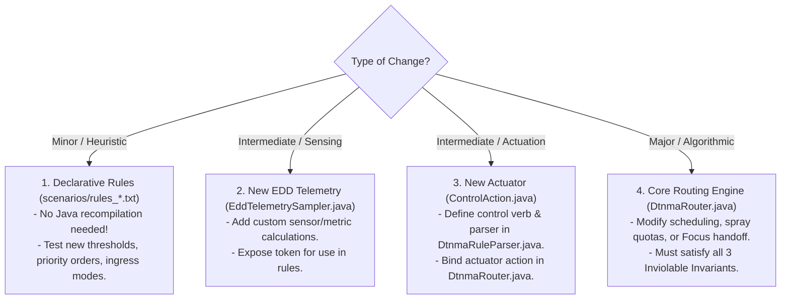

# Team Collaboration & Development Guide: ADTNM

Welcome to the **Autonomic Delay-Tolerant Network Management (ADTNM)** research team! This document outlines our collaborative development workflows, architectural extensibility patterns, and safety invariants to ensure that rapid iterations (both major and minor) remain smooth, conflict-free, and mathematically sound.

---

## 1. Collaborative Architecture & Repository Separation

The core design principle of ADTNM is **decoupling the autonomic framework from the simulator engine**:
- **`ADTNM/` (This Repository):** Contains the official research framework source code, declarative rules, tools, publications, and tests. This is tracked in Git.
- **`the-one/` (Simulator Workspace):** A fresh local clone of The ONE Simulator where simulation runs occur, and reports/plots are generated. This is untracked by ADTNM.

Because developers test algorithms inside the simulator but commit them to `ADTNM`, we provide automated synchronization tools.

---

## 2. Recommended Development Workflows

Choose the workflow that best fits your development style:

### Workflow A: Live-Link Mode (Recommended for IDE Users)
If you develop in IntelliJ IDEA, Eclipse, or VS Code:
```bash
python install.py --mode link --one-dir ../the-one
```
- **How it works:** Hard-links the source files directly between `ADTNM` and `the-one`.
- **Benefit:** Any edit you make in either directory is **instantly reflected in both**. You can run simulations immediately, and `git status` in `ADTNM` will automatically see your changes without needing to copy anything!

### Workflow B: Sync-Back Mode (Recommended for Quick Experimenters)
If you prefer hacking directly inside `the-one/src/...` to test hypotheses:
1. Make your changes and run your test in `the-one`.
2. Check what differs:
   ```bash
   python install.py --status --one-dir ../the-one
   ```
3. Pull your modifications back into the git repository:
   ```bash
   python install.py --sync-back --one-dir ../the-one
   ```
4. Commit and push:
   ```bash
   git add .
   git commit -m "feat(routing): add dynamic queue drift damping"
   git push origin <your-branch>
   ```

### Workflow C: Team Update Mode (When Teammates Push Changes)
When another collaborator pushes changes to GitHub:
```bash
cd ADTNM
git pull origin main
install.bat ..\the-one          # Windows (or ./install.sh ../the-one on Linux)
```
The installer redeploys the updated files and automatically recompiles The ONE in 2 seconds.

---

## 3. How to Make Major vs. Minor Changes

The codebase is modularized so that different kinds of research contributions can be made with minimal blast radius:



### Level 1: Declarative Policy Rule Changes (Minor)
- **Files:** `scenarios/rules_ntn.txt`, `rules_vdtn.txt`, `rules_uav.txt`
- **Recompilation needed?** **No.** Rules are parsed dynamically at runtime.
- **Example:** Testing a more aggressive emergency shedding threshold:
  ```text
  RULE: ARI://DTNMA/SRL/NTN_AGGRESSIVE_FAILSAFE | PRIORITY: 100 | DESC: High-orbit congestion
  IF: (EDD_QUEUE_RATIO >= 0.88) || (EDD_QUEUE_DRIFT > 0.05)
  THEN: CTRL_SET_SPRAY_QUOTA(1); CTRL_SET_INGRESS_MODE(2); CTRL_SET_BACKPRESSURE(true)
  ```

### Level 2: Adding New EDD Telemetry Metrics (Intermediate)
- **Files:** `src/routing/EddTelemetrySampler.java`
- **Recompilation needed?** Yes (`compile.bat` or `install.py`).
- **Steps:**
  1. Add a new `public static final String EDD_MY_METRIC = "EDD_MY_METRIC";`
  2. Implement sampling logic inside `sampleTelemetry(DTNHost host, MessageRouter router)`.
  3. Store in the telemetry cache map.
  4. Your metric is now instantly accessible in any rule file via `(EDD_MY_METRIC >= threshold)`.

### Level 3: Adding New Control Actions (Intermediate)
- **Files:** `src/routing/ControlAction.java` and `src/routing/DtnmaRuleParser.java`
- **Recompilation needed?** Yes.
- **Steps:**
  1. Add action enum/constants in `ControlAction.java`.
  2. Add regex or parser dispatch in `DtnmaRuleParser.java`.
  3. Implement the actuator response inside `DtnmaRouter.java`.

### Level 4: Core Routing & Queuing Logic (Major)
- **Files:** `src/routing/DtnmaRouter.java`
- **Recompilation needed?** Yes.
- The router is partitioned into isolated stages:
  - `update()`: Periodic MAPE-K loop evaluation.
  - `tryPolicyGovernedForwarding()`: Contact iteration, HoL priority preemption, and spray/focus handoff.
  - `checkReceiving()`: Ingress admission control.
  - `getNextMessageToRemove()`: Eviction selection.
  - `transferDone()` / `messageTransferred()`: Replica accounting.

---

## 4. Non-Negotiable Safety Invariants

Before submitting any code changes, verify that your changes uphold the three core mathematical theorems of the thesis:

1. **Inviolable Zero-Drop Invariant:** Critical fault telemetry must **never** be dropped from buffer due to congestion.
   ```java
   // In getNextMessageToRemove(boolean excludeMsgBeingSent):
   if (isCriticalMessage(m)) {
       continue; // INVIOLABLE: Critical telemetry cannot be evicted
   }
   ```
2. **Strict Binary Token Conservation:** During spraying ($C > 1$), total network copies must remain invariant:
   $$\sum_{i} C_i(t) = C_{\text{initial}}$$
   The sender must retain $\lceil C / 2 \rceil$ and the receiver must receive $\lfloor C / 2 \rfloor$.
3. **Single-Copy Focus Handoff Conservation:** When a single-copy bundle ($C = 1$) is handed off via PRoPHET focus, the sender **must delete its copy** upon successful transfer confirmation. Total network copies must remain exactly 1.

---

## 5. Pre-Commit Verification & CI Check

Before opening a Pull Request:
```bash
# 1. Run the benchmark simulation
cd the-one
./one.bat -b 1 scenarios/scenario_dtnma.txt     # (or ./one.sh on Linux)

# 2. Run automated regression verification with zero-drop assertion
python verify_and_plot.py --assert-zero-drops
```
If `verify_and_plot.py` exits with 0 and prints `[VERIFICATION PASSED]`, your code is clean and safe to submit!

---

## 6. Git Branching & Issue Tracking

1. **User Stories:** Before starting a major feature, create a GitHub Issue using our `.github/ISSUE_TEMPLATE/user-story.md` template.
2. **Branch Naming:**
   - Features: `feature/<story-number>-<short-description>` (e.g., `feature/12-adaptive-drift-filter`)
   - Fixes: `fix/<issue-number>-<short-description>` (e.g., `fix/15-prophet-aging-sync`)
3. **Automated CI:** GitHub Actions runs a full build, simulation, and zero-drop assertion on every pull request. PRs can only be merged when CI is green.
