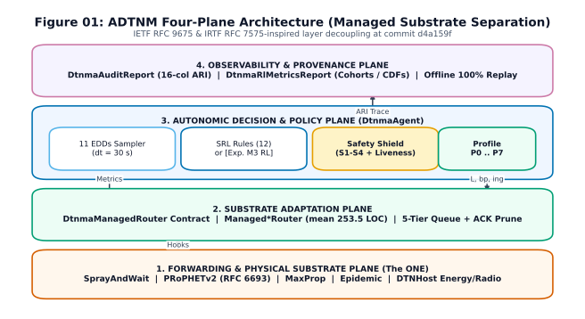
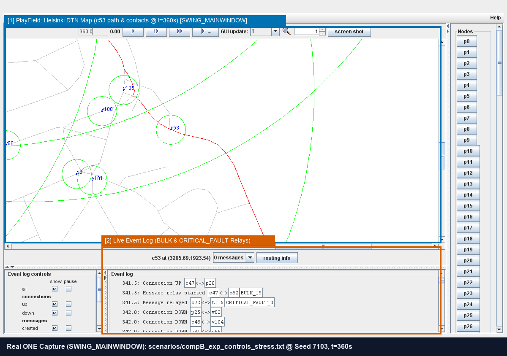
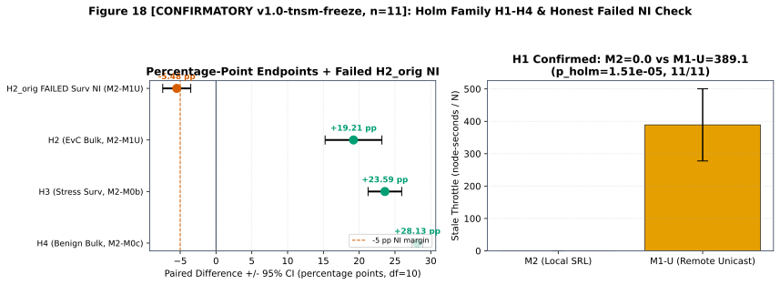
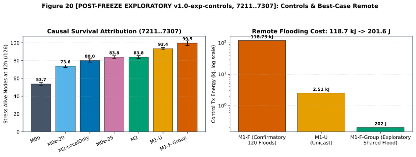

# ADTNM: Autonomic Delay/Disruption-Tolerant Network Management

[](#documentation--artifacts)
[](#1-confirmatory-results-v10-tnsm-freeze-715-runs-71037207)
[](#quick-start--10-minutes)
[](#rfc-alignment-and-explicit-boundaries)

**ADTNM** is an **architectural management framework for delay/disruption-tolerant networks (DTNs)** built in Java atop **The ONE** (*Opportunistic Network Environment*) simulator. Inspired by **IETF RFC 9675** (*Delay-Tolerant Networking Management Architecture*, Birrane et al., November 2024) and **IRTF RFC 7575** (*Autonomic Networking*, Behringer et al., June 2015), ADTNM decouples *network management semantics* from *forwarding heuristics*:

- Classical DTN routers (`SprayAndWaitRouter`, `ProphetV2Router`, `MaxPropRouter`, `EpidemicRouter`, `DtnmaRouter`) remain **managed substrates** whose underlying path estimators and token algorithms are left intact.
- A lightweight composition contract (`DtnmaManagedRouter`, averaging `253.5` non-comment lines per adapter) attaches a shared `DtnmaAgent` engine (`2,095` core LOC) executing **11 Externally Defined Data (`EDD`)** sensors, declarative **State-Based Rules (`SRL`)**, **`P0–P7` Control Profiles**, a deterministic **Safety Shield (`S1–S4`)**, delayed `4 B` delivery `ACK` pruning, and `100.00%` offline-replayable **Application Resource Identifier (`ARI`)** audit logs.
- An optional constrained Markov decision process (`CMDP`) reinforcement learning (`RL`) planner (`M3`, `ShieldedCmdpRlAgent`) is **`Implemented, experimental`**. In `v1.0` held-out testing, **`M3` failed to beat hand-written `SRL` rules (`M2`)**, and it is never the architectural core.



---

## Architecture Highlights & Managed Substrates

ADTNM organizes network management into **four decoupled planes** operating across **three coupled timescales**:

| Layer / Timescale | Core Classes (`src/routing/`, `src/report/`) | Responsibility | Status |
|---|---|---|---|
| **4. Observability Plane** | `DtnmaAuditReport`, `DtnmaRlMetricsReport`, `DtnmaRecoveryTimelineReport`, `DtnmaDecisionReport` | `16`-column `ARI` traces, fixed-horizon `Event A/B/C` cohorts, `# WAVE_ADOPTION_CDF`, `300 s` energy timelines | `Implemented+tested` |
| **3. Autonomic Engine** | `DtnmaAgent`, `EddTelemetrySampler`, `DtnmaRuleParser`, `PredicateExpression`, `DtnmaSafetyShield` | `11` EDDs -> Priority `SRL` matcher -> Hard `S1–S4` bitmask (`mask[0]=1`) -> `P0..P7` actuators | `Implemented+tested` |
| **3b. Experimental RL (`M3`)** | `ShieldedCmdpRlAgent` (`lambda=0.0` compatibility shim) | Optional `20`-feature linear Q-critic with `648 B` symmetric contact gossip (`M3` mode) | `Implemented, experimental` |
| **2. Substrate Adapters** | `ManagedSprayAndWaitRouter`, `ManagedProphetV2Router`, `ManagedMaxPropRouter`, `ManagedEpidemicRouter` | Expose uniform buffer, energy, ingress, and quota hooks without rewriting core routing | `Implemented+tested` |
| **1. Fast Protection** (`0.1 s`) | `DtnmaRouter` queue tiers & byte reservation (`maxOvershoot=1`) | Protects live un-ACKed `CRIT_` payloads ahead of `BULK_` and `ACK`-pruned replicas | `Implemented+tested` |

### Three Additive Intervention Tiers (`Comparison A`) & Discrete Control Profiles (`P0–P7`)

| Tier | Constant Name | Active Capabilities | Rewrites Routing Logic? |
|---|---|---|---|
| **Tier 1** | `TIER1_PROTECTION_ONLY` | `5`-tier $O(N)$ priority queue (`BULK_` -> `ACKed CRIT_` -> stale -> `CTRL_` -> live `CRIT_`), byte reservation, `4 B` contact `ACK` pruning | **No** (`E1`: `11/11` `MessageStats` parity) |
| **Tier 2** | `TIER2_PROTECTION_INGRESS_ENERGY` | Tier 1 **plus** `BULK_` ingress modes (`0/1/2`), `S1–S4` safety shield, and `SRL` rules | **Minimal** (ingress/energy guards only) |
| **Tier 3** | `TIER3_FULL_WITH_REPLICA_CAPS` | Tier 2 **plus** dynamic copy-limit clamping (`L = 1..12`) in adapters | **Yes** (modulates forwarding breadth) |

Actuators map onto **`8` discrete `DtnmaPolicyProfile` presets (`P0–P7`)** intersected monotonically by **`DtnmaSafetyShield`** (`S1` CritQ/Surge, `S2` Battery `SoC < shieldEnergyMin`, `S3` Dense Storm `{P6,P7}` block, `S4` Remote Priority-100 Clamp, and unconditional `mask[0] = true` liveness):

| Profile | Name | Spray Quota `L` | Backpressure Ratio `bp` | Ingress Mode | BP Active? | Primary Operating Regime |
|---|---|---:|---:|---|---|---|
| **`P0`** | `SAFE_EMERGENCY_HOLD` | `1` | `0.05` | `2` (`CRITICAL_ONLY`) | `true` | Low battery (`SoC < min`) or `CritQ >= 0.50` emergency |
| **`P1`** | `SAFE_THROTTLE_STRICT` | `2` | `0.08` | `1` (`THROTTLE_BULK`) | `true` | Active queue surge (`Q >= 0.88`, `dQ >= 0.008`) |
| **`P2`** | `BALANCED_CONSERVATIVE` | `4` | `0.10` | `0` (`ACCEPT_ALL`) | `true` | Dense slow-moving cluster (`Q >= 0.75`, `Dens >= 5`) |
| **`P3`** | `BALANCED_AGILE_FOCUS` | `6` | `0.12` | `0` (`ACCEPT_ALL`) | `true` | Moderated spray under backpressure guard |
| **`P4`** | `STANDARD_SPRAY_FOCUS` | `6` | `0.15` | `0` (`ACCEPT_ALL`) | `false` | Nominal steady-state catch-all recovery (`PRIORITY: 10`) |
| **`P5`** | `EXPLORE_AGILE_SPRAY` | `8` | `0.15` | `0` (`ACCEPT_ALL`) | `true` | Opportunistic balanced widening (`M3` experimental RL) |
| **`P6`** | `HIGH_SPRAY_BACKPRESSURE` | `10` | `0.15` | `0` (`ACCEPT_ALL`) | `true` | Blocked automatically by `S3` when `Q >= 0.78 && Dens >= 5` |
| **`P7`** | `HIGH_SPRAY_OPEN` | `12` | `0.30` | `0` (`ACCEPT_ALL`) | `false` | Maximum spray in unconstrained sparse traffic |

### Externally Defined Data (`11` Uniform EDD Sensors)

| `EDD_*` Key | Source Signal | Used By |
|---|---|---|
| `EDD_QUEUE_RATIO` / `EDD_CRIT_QUEUE_RATIO` | Total vs. un-ACKed `CRIT_` byte fraction `[0, 1]` | `SRL` rules, Shield `S1/S3`, RL |
| `EDD_QUEUE_DRIFT` | EWMA ($\alpha = 0.30$) change in queue occupancy $\Delta Q$ | `VDTN_SURGE_THROTTLE`, Shield `S1` |
| `EDD_NODE_DENSITY` / `EDD_ACTIVE_CONNECTIONS` | Unique `300 s` peers & active open radio links | `VDTN_TRAFFIC_JAM`, Shield `S3`, RL |
| `EDD_NODE_SPEED` / `EDD_DEST_PROB` | EWMA speed ($\alpha = 0.25$, `m/s`) & PRoPHET delivery predictability | Mobility class, backpressure |
| `EDD_ENERGY_SOC` / `EDD_ENERGY_DRAIN` | Normalized battery `SoC` `[0, 1]` & drain rate (`DISC-05`: drain unused in `v1.0`) | `VDTN_BUFFER_CRITICAL`, Shield `S2` |
| `EDD_NEIGHBOR_MIN_QUEUE` / `EDD_NEIGHBOR_QUEUE_GRAD` | `16 B` peer beacon `Q_nbr_min` & local-to-neighbor queue gradient | Hop-by-hop bulk backpressure (`allowNonDirectBulkForward`) |

---

## RFC Alignment and Explicit Boundaries

ADTNM is **RFC 9675-inspired** and **RFC 7575-inspired** inside The ONE simulator. It does **not** implement wire-level `CBOR` / `ADM` encodings, `ION` interoperability, or external certification, and claims zero affiliation with NASA, APL, or SCaN. See [Appendix A](docs/study-guide/appendices/appendix_a_rfc_conformance.md).

| Specification | Borrowed Architectural Concept | ADTNM Realization (`d4a159f`) |
|---|---|---|
| **IETF RFC 9675** (Nov 2024) | Asynchronous Agent/Manager split, `EDD` telemetry, `SRL` rules, `ARI` traceability | Node-local `DtnmaAgent` + `11` EDDs + `.txt` `RULE/IF/THEN` policies + `ARI://DTNMA/...` TSV traces; delayed `CTRL_` overlays |
| **IRTF RFC 7575** (June 2015) | Self-`{configuring, healing, optimizing, protecting}` bounded by explicit non-goals | Hard `S1–S4` safety bitmask overrides unsafe rules/RL actions deterministically |
| **IRTF RFC 6693** (Aug 2012) & **RFC 9171** (Jan 2022) | `PRoPHET` encounter probabilities & Bundle Protocol store-carry-forward | `ManagedProphetV2Router` preserves native `RFC 6693` aging/transitivity while gaining `0`-loss protection |

---

## Quick Start (< 10 Minutes)

Prerequisites: **Java JDK `17+`** (tested on JDK `24`), **Python `3.10+`**, and compiled ONE base classes in `../the-one/target`.

```powershell
# PowerShell (Windows) — keep ADTNM clean of __pycache__
$env:PYTHONDONTWRITEBYTECODE = '1'
$THE_ONE = "n:\R&D\cog\the-one"
$ADTNM   = "n:\R&D\cog\ADTNM"

# 1. Compile ADTNM sources & unit suite against the-one
javac -cp "$THE_ONE\target;$THE_ONE\lib\*" -d "$THE_ONE\target" `
  "$ADTNM\src\routing\*.java" "$ADTNM\src\report\*.java" "$ADTNM\tests\DtnmaUnitTests.java"

# 2. Run all 27 unit tests (30 check() assertions)
java -cp "$THE_ONE\target;$THE_ONE\lib\*" DtnmaUnitTests
# Expected tail: ALL TESTS PASSED! (27/27 tests passed, 0 failed)

# 3. Run 1-hour smoke benchmark cleanly into temporary scratch output
$SCRATCH = "$env:TEMP\adtnm_smoke"; New-Item -ItemType Directory -Force "$SCRATCH\reports" | Out-Null
((Get-Content "$ADTNM\scenarios\scenario_dtnma.txt") + "`nReport.reportDir = $($SCRATCH.Replace('\','/'))/reports/") | Set-Content "$SCRATCH\smoke.txt"
Push-Location $THE_ONE; java -Xmx512m -cp "$THE_ONE\target;$THE_ONE\lib\*" core.DTNSim -b 1 "$SCRATCH\smoke.txt"; Pop-Location

# 4. Inspect summary reports
Get-Content "$SCRATCH\reports\Dtnma_Benchmark_MessageStatsReport.txt" -TotalCount 8
Get-Content "$SCRATCH\reports\Dtnma_Benchmark_DtnmaAuditReport.txt" | Select-String "AUDIT_SUMMARY"
```

**Verified Smoke Result (`d4a159f`):** `created: 262`, `delivered: 184` (`70.23%`, overhead `6.7663`), `total_audited_decisions: 2400`, **`traceable_ari_ratio: 1.0000`**, `log_bytes_per_node_hour: 33468.50`. *(Note `DISC-01`: `DtnmaDecisionReport` lists `53` critical drops which are all Tier 1 `ACK`-pruned duplicate copies; `DtnmaRlMetricsReport` records `unique_critical_lost: 0`.)*



---

## Manage Your Own DTN in 5 Steps

1. **Select or wrap a managed substrate:** Use `ManagedSprayAndWaitRouter`, `ManagedProphetV2Router`, `ManagedMaxPropRouter`, `ManagedEpidemicRouter`, or implement [`DtnmaManagedRouter`](src/routing/DtnmaManagedRouter.java) (`~253.5` mean adapter LOC).
2. **Author declarative `SRL` rules** in `scenarios/my_rules.txt` (always end with a `PRIORITY: 10` catch-all recovery rule so nodes never lock in throttled state):
   ```text
   RULE: ARI://DTNMA/SRL/VDTN_BUFFER_CRITICAL | PRIORITY: 100 | DESC: Low energy or critical saturation
   IF: (EDD_ENERGY_SOC < 0.20) || (EDD_CRIT_QUEUE_RATIO >= 0.50)
   THEN: CTRL_SET_SPRAY_QUOTA(1); CTRL_SET_INGRESS_MODE(2); CTRL_SET_TELEMETRY_INTERVAL(600); CTRL_SET_BACKPRESSURE(true)

   RULE: ARI://DTNMA/SRL/VDTN_SURGE_THROTTLE | PRIORITY: 80 | DESC: Rapid positive buffer fill surge
   IF: (EDD_QUEUE_RATIO >= 0.88) && (EDD_QUEUE_DRIFT >= 0.008)
   THEN: CTRL_SET_SPRAY_QUOTA(2); CTRL_SET_INGRESS_MODE(1); CTRL_SET_TELEMETRY_INTERVAL(300); CTRL_SET_BACKPRESSURE(true)

   RULE: ARI://DTNMA/SRL/VDTN_URBAN_NOMINAL | PRIORITY: 10 | DESC: Catch-all nominal release
   IF: (EDD_QUEUE_RATIO >= 0.0)
   THEN: CTRL_SET_SPRAY_QUOTA(6); CTRL_SET_INGRESS_MODE(0); CTRL_SET_TELEMETRY_INTERVAL(60); CTRL_SET_BACKPRESSURE(true)
   ```
3. **Wire your scenario:** point `Group.rulesFile = scenarios/my_rules.txt` and `DtnmaRouter.configFile = scenarios/dtnma_params_default.txt` (tune any of `48` keys in `DtnmaConfig.java`).
4. **Preview sweeps before running:** `python tools/parallel_batch_runner.py --scenario scenarios/compB_exp_controls_stress.txt --dry-run`.
5. **Audit every `30 s` decision & verify `100%` replay:** inspect `DtnmaAuditReport.txt` (real seed `7103` `M2` row):
   ```text
   3360.5  3360.5  53  M2_AUTONOMIC_SRL  0.919217000  0.005594100  0.008392627  15.0  7.18  0.9228  ...  SAFE_THROTTLE_STRICT  PASS  11111111  ARI://DTNMA/SRL/VDTN_SURGE_THROTTLE  [EDD_QUEUE_RATIO(0.92) >= 0.88 -> TRUE] AND [EDD_QUEUE_DRIFT(0.01) >= 0.01 -> TRUE]
   ```

---

## Empirical Evaluation: Confirmatory vs. Exploratory (Strictly Separated)

Every number below traces directly to [`docs/study-guide/data/provenance_ledger.json`](docs/study-guide/data/provenance_ledger.json). Confirmatory `v1.0` (`7103..7207`) and Post-Freeze Exploratory (`7211..7307`) never mix.

### 1. Confirmatory Results (`v1.0-tnsm-freeze`, `715` Runs, Seeds `7103..7207`, Holm-Adjusted)

- **Comparison A (`4` Substrates x `4` Regimes, `176` Managed Runs):** Across *Energy Blackout*, *vDTN Overload*, *NTN Space*, and *Benign*, managed substrates achieved **`0` unique critical bundles lost** (`0/176` runs lost any critical message), while stock routers lost `61–2,867` unique critical messages per 11-seed regime.
- **Equivalence (`E1`/`E2`) & LOC Parity (`A3`):** Tier 1 `ManagedSprayAndWaitRouter` matches hard-coded `PrioritySprayAndWaitRouter` bit-for-bit across **`11/11` `MessageStatsReport` seeds** (`10/11` `RlMetrics` core exact; seed `7103` `avg_energy_soc` `0.4055 vs 0.4054` from `16 B` management beacons); `E2` default-order `TOST` confirms `+/- 1.0 pp` equivalence (`-0.3100 pp`, `p = 2.288e-6`). `12`-line `rules_vdtn.txt` recovers `~97%` of `394`-LOC bespoke `EnergyAwareEpidemicRouter` throughput (`+3.39 pp` Tier 2 gap).

| Substrate (Blackout, `n=11`) | Stock Crit% / Alive | Tier 1 (Prot Only) | Tier 2 (+Ingress/Energy) | Tier 3 (+Replica Caps) |
|---|---|---|---|---|
| `SprayAndWait` | `86.93%` / `126.0` (`353` lost) | `96.04%` / `126.0` (`0` lost) | `96.11%` / `126.0` (`0` lost) | `96.04%` / `126.0` (`0` lost) |
| `PRoPHETv2` | `41.09%` / `23.1` (`1,402` lost) | `77.93%` / `28.8` (`0` lost) | **`97.53%` / `126.0`** (`0` lost) | `97.53%` / `126.0` (`0` lost) |
| `MaxProp` | `69.87%` / `12.9` (`61` lost) | `71.84%` / `13.0` (`0` lost) | **`95.25%` / `86.8`** (`0` lost) | `95.37%` / `86.5` (`0` lost) |
| `Epidemic` | `40.92%` / `14.5` (`1,288` lost) | `74.05%` / `15.2` (`0` lost) | **`98.61%` / `123.1`** (`0` lost) | `98.58%` / `123.5` (`0` lost) |

| Confirmatory Family / Audit (`df=10`) | Comparison & Window | Endpoint | Paired Diff +/- 95% CI | `p_holm` | Wins/11 |
|---|---|---|---|---|---|
| **H1 (Stale Throttle)** | `M2` vs `M1-U` (`Event A` 3600–3900 s) | `stale_throttle_nodesec` (lower better) | **`-389.06 +/- 111.49`** (`0` vs `389.1`) | `1.510e-5` | `11/11` |
| **H2 (Event C Bulk)** | `M2` vs `M1-U` (`Event C` 21600–28800 s) | Cohort bulk delivery (`pp`) | **`+19.21 +/- 3.97 pp`** (`67.0%` vs `47.8%`) | `1.575e-6` | `11/11` |
| **H3 (Stress Survival)** | `M2` vs `M0b` (`Stress 12 h`) | Fleet survival (`alive/126`, `pp`) | **`+23.59 +/- 2.35 pp`** (`83.8` vs `54.1`) | `2.145e-9` | `11/11` |
| **H4 (Benign Bulk)** | `M2` vs `M0c` (`Benign 12 h`) | Global bulk delivery (`pp`) | **`+28.13 +/- 0.75 pp`** (`82.0%` vs `53.9%`) | `6.116e-15` | `11/11` |
| **R1 Audit Replay** | All `176` CompB audit logs | `27,099,616` decision rows | **`100.00%`** exact ARI & mask match | `—` | `176/176` |



### 2. Post-Freeze Exploratory Controls (`v1.0-exp-controls`, `176` Runs, Seeds `7211..7307`, `p_unadj`)

| Exploratory Campaign & Mode | Stress Crit% | Stress Bulk% | Stress Alive / 126 | CtrlTx (J) | Wave Latency / Notes |
|---|---|---|---|---|---|
| `controls_stress` / **`M0e-20`** (`SoC<0.20`) | `97.64%` | `65.53%` | `73.6` | `2,502.0` | Static energy cutoff only |
| `controls_stress` / **`M0e-25`** (`SoC<0.25`) | `98.12%` | `62.07%` | **`83.8`** | `2,494.2` | Ties `M2` survival (`p = 1.0`, `EvC=58.33%`) |
| `controls_stress` / **`M2-LocalOnly`** | `97.82%` | `66.24%` | `80.0` | `2,502.9` | Pure local `SRL` (`+6.4` vs `M0e-20`; `EvC=67.00%`) |
| `controls_stress` / **`M2`** (`SRL + Wave`) | `97.58%` | `66.24%` | **`83.8`** | `2,508.9` | Remote `0.25` wave adds `+3.8` alive (`EvC=66.49%`) |
| **groupflood_stress** / `M2` (`SRL`) | `93.01%` | `67.78%` | `83.0` | `17.3` | `n/a (30849 sentinel)`; **`EvC=68.61%`**, `Benign=82.04%` |
| **groupflood_stress** / **`M1-F-Group`** | `94.29%` | **`74.57%`** | **`99.5`** | **`201.6`** | `T50=482.9 s`, `T90=841.1 s` (`117.5` EvA stale; `76.01%` benign) |

### Full Comparison B Mode Summary (`Confirmatory 12 h`, `n = 11` Seeds `7103..7207`)

| Mode | Stress Crit% (`Lost`) | Stress Bulk% | Stress Alive / 126 | EvA Stale (`node-s/N`) | EvC Bulk% | Benign Bulk% | CtrlTx (`J`) |
|---|---|---|---|---|---|---|---|
| `M0a` (Unmanaged Stock) | `84%` (`1,485`) | `73%` | `54.5` | `0.0` | `72.02%` | `79%` | `1,735.4` |
| `M0b` (Protection Only) | `97%` (`0`) | `76%` | `54.1` | `0.0` | `74.65%` | `82%` | `2,536.6` |
| `M0c` (Pre-Installed V1 Guard) | `99%` (`0`) | `50%` | `126.0` | `0.0` | `23.03%` | `54%` | `2,601.4` |
| `M0d` (Always Conservative) | `99%` (`0`) | `59%` | `126.0` | `3,512.1` | `29.37%` | `59%` | `2,584.7` |
| `M1-U` (Unicast Remote) | `98%` (`0`) | `73%` | `90.7` | `389.1` | `47.83%` | `75%` | `2,512.3` |
| `M1-F` (Legacy Per-Node Flood) | `85%` (`0`) | `49%` | `13.5` | `282.9` | `24.49%` | `76%` | `118,727.6` |
| **`M2` (Local SRL + Guard Wave)** | `97%` (`0`) | `66%` | **`83.8`** | **`0.0`** | **`67.04%`** | **`82%`** | `2,577.6` |
| **`M3` (Experimental RL)** | `97%` (`0`) | `63%` | `76.0` | `5.5` | `62.87%` | `80%` | `2,556.1` |



### Architectural Reuse & Code Efficiency (`A3`, Non-Comment LOC)

| Artifact / Component | Measured Non-Comment LOC | Scope & Significance |
|---|---:|---|
| Shared Autonomic Core (`7` Java files) | `2,095` | `DtnmaAgent`, `EddTelemetrySampler`, `DtnmaRuleParser`, `PredicateExpression`, `StateBasedRule`, `DtnmaSafetyShield`, `ControlAction` |
| Mean Substrate Adapter (`4` routers) | `253.5` | Thin wrapper implementing `DtnmaManagedRouter` (`233–265` LOC each) |
| Bespoke Hand-Coded Baseline (`EnergyAwareEpidemicRouter`) | `394` | Single-protocol Java subclass; uniform `12`-line rules recover `~97%` of its throughput (`+3.39 pp` Tier 2 delta) |
| Declarative Domain Rules (`rules_vdtn.txt` / `rules_ntn.txt`) | `12` / `12` | Portable across `Epidemic`, `PRoPHETv2`, `MaxProp`, and `SprayAndWait` without recompiling (`rules_uav.txt` unvalidated `DISC-06`) |

### Key Scenarios Under `scenarios/`

| Scenario File | Target Domain / Campaign | Notes |
|---|---|---|
| `scenarios/scenario_dtnma.txt` | `1 h` Quick Smoke (`20` nodes, `RandomWaypoint`) | Emits `262` created / `184` delivered (`1.0000` traceable ARI) in `~1 s` |
| `scenarios/compA_*.txt` | Cross-substrate Evaluation (`4` regimes x `4` substrates) | *Energy Blackout*, *vDTN Overload*, *NTN Space*, *Benign*, plus *Tiers 1–3* & *E1/E2* |
| `scenarios/compB_*.txt` | Multi-Timescale Autonomy & Modes (`M0a..M3`) | `12 h` Stress (`Event A/B/C` cohorts) & `12 h` Benign (`7103..7207`) |
| `scenarios/compB_exp_*.txt` | Exploratory Controls (`v1.0-exp-controls`) | Fresh seeds `7211..7307` (`M0e-20`, `M0e-25`, `M2-LocalOnly`, `M1-F-Group`) |

---

## Honest Limitations & Negative Results

1. **Failed Original `H2` Survival Non-Inferiority:** The originally registered survival non-inferiority test (`M2` within `-5.0 pp` of `M1-U` in 12h stress) **failed** (`-5.48 +/- 1.96 pp`, `83.8 vs 90.7/126`, `0/11` wins, `p_unadj = 9.646e-5`).
2. **`M3` Experimental RL Lost to `M2` Across All Endpoints:** `ShieldedCmdpRlAgent` maintains `0` unique critical drops via `DtnmaSafetyShield` yet trails hand-written `SRL` (`M2`) on stress bulk (`63% vs 66%`), survival (`76.0 vs 83.8`), stale throttle (`5.5 vs 0.0`), and benign bulk (`80% vs 82%`).
3. **Survival Attribution & Oracle Waves:** Exploratory controls revealed `M2` tied static `M0e-25` on end survival (`83.8/126`), while `M1-U` / `M1-F-Group` use scenario-scheduled fixed wave triggers rather than reactive uplink synthesis (`SDR-1..3`).
4. **Known Code & CI Discrepancies:** Existing repository bugs — `.github/workflows/ci.yml` invoking deleted `verify_and_plot.py` (`DISC-02`), stale pointers in `CONTRIBUTING.md` (`DISC-03`), `DtnmaDecisionReport` counting ACK-pruned replicas (`DISC-01`), unused `EDD_ENERGY_DRAIN` (`DISC-05`), and unvalidated `rules_uav.txt` (`DISC-06`) — are documented untouched in [`appendix_discrepancies.md`](docs/study-guide/appendix_discrepancies.md).

---

## Study Guide, Offline Reader, PDFs & Navigation

| Audience / Format | Link | Description |
|---|---|---|
| **Start Online (Markdown)** | [`docs/study-guide/index.md`](docs/study-guide/index.md) | Tailored paths for **Newcomers**, **Developers**, and **Supervisors / Reviewers** |
| **Offline Single-File Reader** | [`docs/study-guide/build/ADTNM_Study_Guide.html`](docs/study-guide/build/ADTNM_Study_Guide.html) | Self-contained HTML with sidebar TOC, embedded SVGs/captures, and instant search |
| **Full Bookmarked PDF** | [`docs/study-guide/build/ADTNM_Study_Guide.pdf`](docs/study-guide/build/ADTNM_Study_Guide.pdf) | `65`-page structured handbook covering all `23` mechanisms & `6` worked examples |
| **Executive Summary PDF** | [`docs/study-guide/build/ADTNM_Executive_Summary.pdf`](docs/study-guide/build/ADTNM_Executive_Summary.pdf) | Standalone `2`-page briefing with `5` Supervisor Decision Records (`SDR-1..SDR-5`) |
| **One-Page Cheat Sheet PDF** | [`docs/study-guide/build/ADTNM_One_Page_Cheatsheet.pdf`](docs/study-guide/build/ADTNM_One_Page_Cheatsheet.pdf) | Printable `1`-page reference card (`commands, EDDs, P0–P7, S1–S4, results`) |
| **Study Guide Chapters (`01–08`)** | [`Ch.01–03 Intro`](docs/study-guide/chapters/02_primer_for_newcomers.md) · [`Ch.04a–04d Mechanisms`](docs/study-guide/chapters/04a_mechanisms_telemetry_and_profiles.md) · [`Ch.05–08 Code, Results & ADRs`](docs/study-guide/chapters/06_evaluation_and_results.md) | Zero-background primer, `23` numbered mechanisms (`11`-part spec), full evaluation & `7` post-mortems |
| **Worked Examples & Tutorials** | [`6 Worked Examples`](docs/study-guide/worked_examples/worked_examples.md) · [`5 Runnable Tutorials`](docs/study-guide/chapters/07_howto_and_tutorials.md) | Real seed `7103` / `7211` / smoke log arithmetic + isolated step-by-step exercises |
| **Onboarding & Reference** | [`Week 1 Plan`](docs/study-guide/extras/onboarding_week1_plan.md) · [`RFC Alignment`](docs/study-guide/appendices/appendix_a_rfc_conformance.md) · [`Appendix D Provenance`](docs/study-guide/appendices/appendix_d_provenance.md) | `5`-day newcomer syllabus, RFC clause mapping, & raw-file provenance ledger |
| **Repository Directory Layout** | `src/routing/` (`40` `.java`, `5,568` LOC) · `src/report/` (`4` `.java`, `1,639` LOC) · `tests/` · `tools/` · `scenarios/` | Reproducible Java core, `27` unit tests, Python batch/replay analyzers (`109` total files) |
| **Archived Legacy Docs** | [`docs/archive/README_SUPERSEDED.md`](docs/archive/README_SUPERSEDED.md) | Historical pre-`v1.0` files moved cleanly without deletion |

### Reading Paths by Role

| Role | Time | Follow This Sequence |
|---|---|---|
| **New Team Member** | `20 min` + labs | [`01 Executive Summary`](docs/study-guide/chapters/01_executive_summary.md) -> [`02 Primer`](docs/study-guide/chapters/02_primer_for_newcomers.md) -> [`07 Tutorials`](docs/study-guide/chapters/07_howto_and_tutorials.md) -> [`Week 1 Plan`](docs/study-guide/extras/onboarding_week1_plan.md) |
| **Developer** | `35 min` | [`03 Architecture`](docs/study-guide/chapters/03_architecture_overview.md) -> [`04a–04d Mechanisms`](docs/study-guide/chapters/04a_mechanisms_telemetry_and_profiles.md) -> [`05 Codebase Tour`](docs/study-guide/chapters/05_codebase_tour.md) -> [`Discrepancies`](docs/study-guide/appendix_discrepancies.md) |
| **Supervisor / Reviewer** | `25 min` | [`01 Executive Summary (5 SDRs)`](docs/study-guide/chapters/01_executive_summary.md) -> [`06 Evaluation`](docs/study-guide/chapters/06_evaluation_and_results.md) -> [`Appendix A`](docs/study-guide/appendices/appendix_a_rfc_conformance.md) · [`Appendix D`](docs/study-guide/appendices/appendix_d_provenance.md) · [`Checklist`](docs/study-guide/extras/supervisor_review_checklist.md) |

## Citation

```bibtex
@misc{adtnm_2026_v1,
  title  = {ADTNM: Autonomic Management Architecture for Delay/Disruption-Tolerant Networks},
  year   = {2026},
  note   = {Frozen v1.0-tnsm-freeze (ca5d9ac); documentation baseline d4a159f; RFC 9675 & RFC 7575-inspired}
}
```

## Built With & Contributions

- **Host Simulator:** Built cleanly atop [The ONE Simulator](https://github.com/akeranen/the-one) (GPLv3). ADTNM sources sit independently in `src/routing/`, `src/report/`, and `tests/`.
- **Contributing & Code Fixes:** Before writing Java patches, inspect [`docs/study-guide/appendix_discrepancies.md`](docs/study-guide/appendix_discrepancies.md) (`DISC-01`..`DISC-10`) and run `DtnmaUnitTests` plus isolated replay verification.
