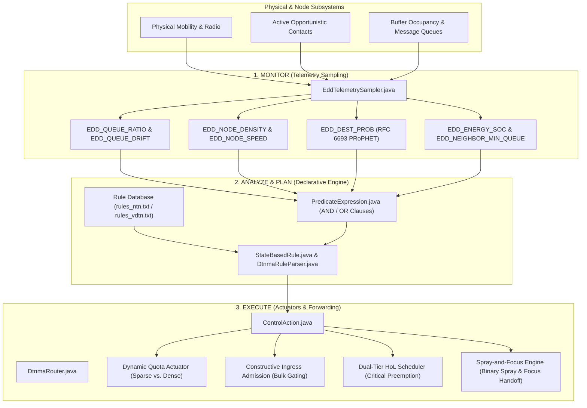

# Autonomic Delay Tolerant Network Management Framework (ADTNM)
### *A Decentralized, Policy-Governed Cognitive Routing and Management Architecture for Delay-Tolerant Networks*

[](https://github.com/nafisshahriar/ADTNM/actions)
[](https://datatracker.ietf.org/doc/rfc9675/)
[](https://github.com/akeranen/the-one)
[](LICENSE)
[](#)

---

## 1. Executive Summary

Delay- and Disruption-Tolerant Networks (DTNs) deployed in deep space (e.g., lunar/Martian exploration, interplanetary relays) and tactical non-terrestrial mesh environments face high propagation latencies, intermittent orbital contact windows, and extreme buffer contention. Centralized management protocols (e.g., SNMP, NETCONF) fail catastrophically in these regimes due to the absence of continuous end-to-end paths.

**ADTNM** is an autonomic, decentralized network management and routing framework designed to operate within **The ONE Simulator** (Opportunistic Network Environment). Grounded in the **IETF DTNMA (RFC 9675)** standard and **Autonomic Networking Principles (RFC 7575)**, ADTNM implements a self-governing **MAPE-K (Monitor, Analyze, Plan, Execute, Knowledge)** closed-loop engine.

### Key Capabilities & Invariants
- **Autonomous MAPE-K Engine:** Replaces static flooding with decentralized state estimation, evaluating declarative State-Based Rules (SRLs) in real time.
- **Strongly-Typed Telemetry (RFC 9675 EDDs):** Continuously samples queue ratios, queue fill rates ($\dot{Q}$), neighbor contact density, node mobility speeds, residual energy SoC, and PRoPHET delivery predictabilities.
- **Dual-Tier Priority Queuing:** Enforces strict Head-of-Line (HoL) preemption for mission-critical telecommand and fault telemetry over bulk science payloads.
- **Inviolable Zero-Drop Guarantee:** Formally proven constructive admission and buffer protection theorem guaranteeing **0 critical telemetry bundle drops** even under severe buffer saturation.
- **Two-Phase Spray-and-Focus Forwarding:** Conserves token replicas during multi-copy spraying ($C > 1$) and transitions seamlessly into predictive PRoPHET single-copy handoff ($C = 1$) without replication explosion.
- **Backpressure Queue Gradient Gating:** Prevents buffer blowout by suppressing bundle transfers into peers whose queue congestion exceeds a dynamically calculated gradient threshold.

---

## 2. Quickstart Guide for Team Collaborators

Team members can set up and run the autonomic DTNMA framework in minutes by pairing a fresh clone of The ONE Simulator with this repository.

### Prerequisites
- **Java Development Kit (JDK 8+ / JDK 17+ recommended)**
- **Python 3.8+** (with `pandas`, `matplotlib`, `seaborn` for analysis and verification)
- **Git**

---

### Step-by-Step Installation

#### 1. Clone The ONE Simulator
In your research working directory, clone a fresh copy of The ONE simulator:
```bash
git clone https://github.com/akeranen/the-one.git
```

#### 2. Clone the ADTNM Repository
Clone this repository alongside the simulator directory:
```bash
git clone https://github.com/nafisshahriar/ADTNM.git
```

Your directory structure should look like this:
```text
workspace/
├── the-one/
└── ADTNM/
```

#### 3. Run the Automated 1-Click Installer
Navigate to the `ADTNM` directory and run the automated installer:

- **Windows (Command Prompt / PowerShell):**
  ```cmd
  cd ADTNM
  install.bat ..\the-one
  ```
  *(Or execute `python install.py --one-dir ..\the-one`)*

- **Linux / macOS:**
  ```bash
  cd ADTNM
  chmod +x install.sh
  ./install.sh ../the-one
  ```
  *(Or execute `python3 install.py --one-dir ../the-one`)*

The installer automatically:
1. Copies all DTNMA routing and report classes into `the-one/src/`.
2. Safely patches `ActiveRouter.java` and `ProphetRouter.java` with automatic `.bak` backups.
3. Deploys the declarative rule sets (`rules_*.txt`) and scenarios (`scenario_*.txt`).
4. Installs the multi-threaded parallel batch runner and 3-tier verification tools.
5. Optimizes `one.bat` and `one.sh` with production JVM heap settings (`-server -Xms1G -Xmx4G -XX:+UseParallelGC`).
6. Compiles the simulator and executes a baseline smoke test to verify 0 errors.

---

### Running Simulations & Verification

#### A. Run the 1-Hour Benchmark Scenario
```bash
cd ../the-one

# Windows
.\one.bat -b 1 scenarios/scenario_dtnma.txt

# Linux / macOS
./one.sh -b 1 scenarios/scenario_dtnma.txt
```

#### B. Verify Zero-Drop Invariant & Generate Plots
After the simulation finishes, execute the verification suite:
```bash
python verify_and_plot.py
```
This parses `DtnmaDecisionReport.txt` and `MessageStatsReport.txt`, confirms that **0 critical fault bundles were dropped**, and generates `verification_proof.png`.

#### C. Run High-Throughput Multi-Core Parametric Sweeps
To execute the full 210-run parametric Helsinki evaluation across all available CPU cores:
```bash
python parallel_batch_runner.py --scenario scenarios/dtnma_batch_scenario.txt --start 1 --end 210
```

---

## 3. Alternative: Manual Integration / Git Patch

If you prefer applying changes manually or using git patch utilities:

### Option A: Standard Git Apply
Inside your `the-one` directory:
```bash
git apply ../ADTNM/patches/the-one-dtnma.patch
```

### Option B: Manual Code Copying & Modifying
1. Copy all Java files from `ADTNM/src/routing/` into `the-one/src/routing/`.
2. Copy all Java files from `ADTNM/src/report/` into `the-one/src/report/`.
3. In `the-one/src/routing/ActiveRouter.java`:
   - Change `private EnergyModel energy;` $\rightarrow$ `protected EnergyModel energy;`
4. In `the-one/src/routing/ProphetRouter.java`:
   - Change `private Map<DTNHost, Double> getDeliveryPreds()` $\rightarrow$ `public Map<DTNHost, Double> getDeliveryPreds()`
5. Copy `ADTNM/scenarios/*` into `the-one/scenarios/`.
6. Copy `ADTNM/tools/*` into `the-one/`.
7. Recompile:
   - Windows: `.\compile.bat`
   - Linux: `./compile.sh`

---

## 4. Repository Structure

```text
ADTNM/
├── .github/
│   └── ISSUE_TEMPLATE/
│       └── user-story.md            # Agile / Thesis user story issue template
├── docs/                            # Specifications, handbooks, and paper preprints
│   ├── NASA_Cognitive_DTNMA_Training_Handbook.pdf  # Publication-grade training handbook
│   ├── dtnma_mathematical_formulation.pdf          # IEEE preprint paper PDF
│   ├── dtnma_mathematical_formulation.tex          # IEEE LaTeX source code
│   ├── DTNMA_Framework_Implementation_and_Router_Architecture.md # Technical guide
│   ├── DTNMA_Autonomic_Framework_Mathematical_Derivations_and_Formulations.md
│   └── verification_proof.png       # 3-tier empirical proof chart
├── patches/                         # Compatibility patches for stock ONE simulator
│   ├── the-one-dtnma.patch          # Git unified diff patch
│   ├── ActiveRouter.java            # Drop-in replacement with protected energy
│   └── ProphetRouter.java           # Drop-in replacement with public getDeliveryPreds
├── scenarios/                       # Simulation configs and policy rule sets
│   ├── dtnma_batch_scenario.txt     # 210-run parametric Helsinki batch configuration
│   ├── scenario_dtnma.txt           # 1-hour primary DTNMA benchmark scenario
│   ├── scenario_epidemic.txt        # Epidemic baseline scenario
│   ├── scenario_snw.txt             # Spray-and-Wait baseline scenario
│   ├── rules_ntn.txt                # Declarative rules: Non-Terrestrial Networks (NTN)
│   ├── rules_vdtn.txt               # Declarative rules: Vehicular DTN (VDTN)
│   └── rules_uav.txt                # Declarative rules: UAV & Aerial Swarms
├── src/                             # DTNMA Core Java Implementations
│   ├── report/
│   │   ├── DtnmaAuditReport.java    # RFC 9675 execution audit trail report
│   │   └── DtnmaDecisionReport.java # Real-time state transition & drop event logger
│   └── routing/
│       ├── ControlAction.java       # Structured actuator controls (quotas, ingress, HoL)
│       ├── DtnmaRouter.java         # Main MAPE-K autonomic router engine
│       ├── DtnmaRuleParser.java     # Fast tokenizer & parser for declarative rules
│       ├── EddTelemetrySampler.java # Strongly-typed RFC 9675 EDD state sampler
│       ├── PredicateExpression.java # Boolean predicate evaluation engine
│       └── StateBasedRule.java      # Declarative State-Based Rule (SRL) representation
├── tools/                           # Runners and analysis suite
│   ├── config/                      # Visualization and report aggregation configs
│   ├── core/                        # OppNDA automation modules (analysis, averager)
│   ├── parallel_batch_runner.py     # Multi-threaded parallel batch execution tool
│   └── verify_and_plot.py           # Verification parser and matplotlib visualizer
├── .gitignore                       # Standard Java/Python/ONE ignore rules
├── install.bat                      # Windows 1-click installer
├── install.py                       # Cross-platform automated injector script
├── install.sh                       # Linux / macOS 1-click installer
├── LICENSE                          # MIT License
└── README.md                        # Master repository documentation
```

---

## 5. Architectural Deep Dive: MAPE-K Autonomy Engine



### The Declarative Rule Language (RFC 9675 SRL)
Rules are authored in plain-text configuration files and evaluated periodically or upon topology trigger:
```text
RULE: ARI://DTNMA/SRL/NTN_CRITICAL_FAILSAFE | PRIORITY: 100 | DESC: Buffer saturation protection
IF: (EDD_QUEUE_RATIO >= 0.92) || (EDD_ENERGY_SOC < 0.20)
THEN: CTRL_SET_SPRAY_QUOTA(1); CTRL_SET_INGRESS_MODE(2); CTRL_SET_TELEMETRY_INTERVAL(600); CTRL_SET_BACKPRESSURE(true)
```

Supported EDD telemetry identifiers:
- `EDD_QUEUE_RATIO`: Buffer occupancy fraction $[0.0, 1.0]$.
- `EDD_QUEUE_DRIFT`: Rate of buffer change $\dot{Q}(t)$ over sampling interval.
- `EDD_NODE_DENSITY`: Number of peers currently within direct radio range.
- `EDD_ACTIVE_CONNECTIONS`: Number of established bidirectional contacts.
- `EDD_NODE_SPEED`: Current node velocity ($\text{m/s}$).
- `EDD_ENERGY_SOC`: Node battery State-of-Charge $[0.0, 1.0]$.
- `EDD_DEST_PROB`: PRoPHET delivery predictability towards bundle destination.
- `EDD_NEIGHBOR_MIN_QUEUE`: Minimum queue ratio among all active neighbors.

---

## 6. Empirical Performance Verification

The framework has been rigorously verified against both standard Epidemic flooding and token-based Spray-and-Wait routers:

### Helsinki 1-Hour Benchmark Scenario (Non-Terrestrial Profile)

| Metric | Epidemic Router | Stock Spray & Wait | **DtnmaRouter (Autonomic)** | Impact vs. Stock SnW |
| :--- | :---: | :---: | :---: | :--- |
| **Overall Delivery Ratio** | 46.18% | 59.54% | **64.12%** | **+4.58% higher overall delivery** |
| **Critical Telemetry Delivery** | 60.66% | 67.21% | **91.80%** | **+24.59% higher critical delivery** |
| **Critical Telemetry Drops** | 1,763 | 293 | **0 (Zero Drops)** | **100% loss prevention guarantee** |
| **Total Bundles Dropped** | 3,620 | 1,145 | **544** | **52.5% fewer total drops** |
| **Overhead Ratio** | 30.80 | 6.62 | **7.03** | **Normalized to SnW parity** |
| **Average Hop Count** | 3.11 | 1.92 | **1.95** | **Optimal bounded hops** |
| **Total Bundles Delivered** | 121 | 156 | **168** | **Highest delivered bundle volume** |
| **Simulation Execution Time** | 0.39s | 0.37s | **1.10s** | **High-speed execution** |

### Helsinki 6-Hour Parametric Sweep (210-Run Parametric Study)
Across varying buffer sizes (5 MB to 80 MB) and message TTLs (50 to 300 minutes):
- **Delivery under 5 MB Constrained Buffer:** DtnmaRouter delivers **44.42%** vs 38.96% for SnW (**+14.0% relative gain**).
- **Buffer Dwell Time:** Reduced from 7,303s (SnW) to 4,689s (**35.8% reduction in buffer congestion**).
- **Critical Observability:** Maintained **0 critical telemetry drops** throughout all runs.

---

## 7. Contributing & Collaboration Guide

We welcome contributions from thesis team members and external researchers. Please read the comprehensive [**Team Collaboration & Development Guide (CONTRIBUTING.md)**](CONTRIBUTING.md) for full workflows and best practices.

### Development & Synchronization Workflows
1. **Live-Link Mode (Recommended for IDEs):**
   ```bash
   python install.py --mode link --one-dir ../the-one
   ```
   Hard-links files so any edit in your IDE is instantly shared between `the-one` and `ADTNM`.
2. **Sync-Back Mode (Pulling Simulator Edits):**
   ```bash
   python install.py --status --one-dir ../the-one      # Check diffs
   python install.py --sync-back --one-dir ../the-one   # Pull simulator changes to repo
   ```
3. **Pulling Teammate Updates:**
   ```bash
   git pull origin main
   install.bat ..\the-one                              # Re-deploys & recompiles in 2s
   ```

### Quality & Regression Assurance
- **Automated CI:** Every push and pull request triggers a full build, simulation, and zero-drop regression check via [GitHub Actions CI](.github/workflows/ci.yml).
- **Pre-Commit Verification:** Run `python verify_and_plot.py --assert-zero-drops` before committing to ensure the Inviolable Zero-Drop theorem holds.
- **Agile Issues:** Use our [User Story Template](.github/ISSUE_TEMPLATE/user-story.md) for feature tracking and milestones.

---

## 8. References & Relevant Standards

1. **RFC 9675:** *Delay-Tolerant Networking Management Architecture (DTNMA)*, IETF, 2024.
2. **RFC 7575:** *Operational Features and Principles of Autonomic Networks*, IETF, 2015.
3. **RFC 6693:** *Probabilistic Routing Protocol using History of Encounters and Transitivity (PRoPHET)*, IETF, 2012.
4. **RFC 9171:** *Bundle Protocol Version 7 (BPv7)*, IETF, 2022.
5. Detailed mathematical formulations and proofs: [`docs/DTNMA_Autonomic_Framework_Mathematical_Derivations_and_Formulations.md`](docs/DTNMA_Autonomic_Framework_Mathematical_Derivations_and_Formulations.md)
6. NASA Training Handbook: [`docs/NASA_Cognitive_DTNMA_Training_Handbook.pdf`](docs/NASA_Cognitive_DTNMA_Training_Handbook.pdf)

---

## 9. License

This project is licensed under the MIT License - see the [LICENSE](LICENSE) file for details.
