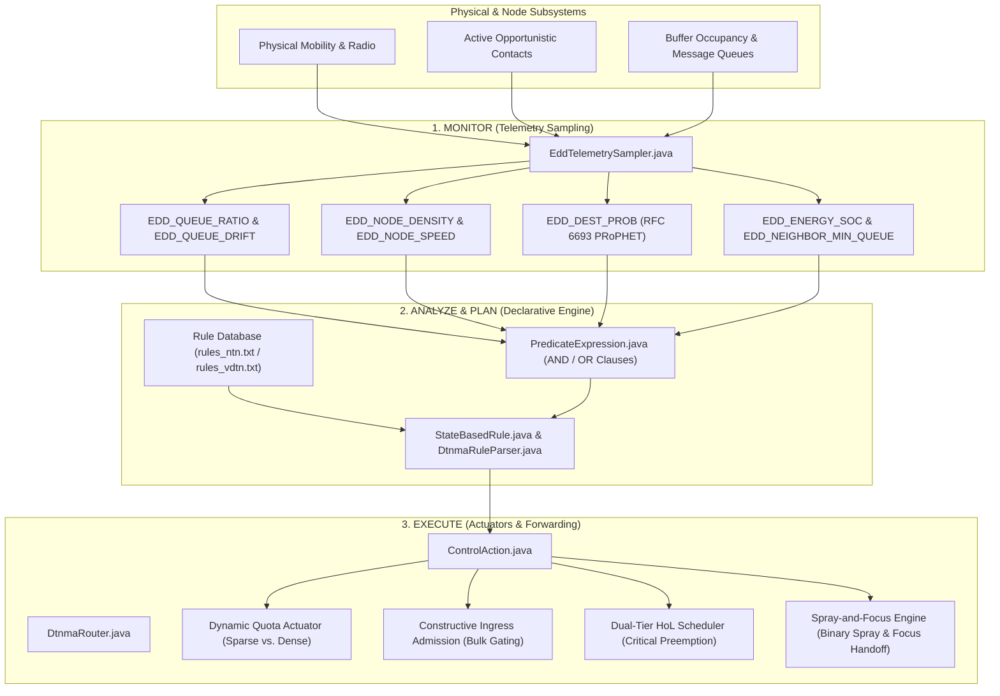

# Autonomic Delay Tolerant Network Management Framework (ADTNM)
### *A Decentralized, Policy-Governed Cognitive Routing and Management Architecture for Delay-Tolerant Networks*

[](https://github.com/nafisshahriar/ADTNM/actions)
[](https://datatracker.ietf.org/doc/rfc9675/)
[](https://github.com/akeranen/the-one)
[](LICENSE)
[](#)

---

## 1. Executive Summary

Delay- and Disruption-Tolerant Networks (DTNs) deployed in deep space (e.g., lunar/Martian exploration, interplanetary relays) and tactical non-terrestrial mesh environments face high propagation latencies, intermittent orbital contact windows, and extreme buffer contention. Centralized management protocols (e.g., SNMP, NETCONF) fail catastrophically in these regimes due to the absence of continuous end-to-end paths.

**ADTNM** is an autonomic, decentralized network management and routing framework designed to operate within **The ONE Simulator** (Opportunistic Network Environment). Adopting an **RFC 9675-inspired declarative policy architecture** and **Autonomic Networking Principles (RFC 7575)** — using human-readable State-Based Rule Language (SRL) text files as a lightweight simulation abstraction of AMM/ARI policies — ADTNM pairs a self-governing **MAPE-K (Monitor, Analyze, Plan, Execute, Knowledge)** closed-loop engine with a **Single-Critic Shielded Counterfactual Expected SARSA** layer and **Opportunistic Mobility-Class Peer Gossip**.

### Key Capabilities & Invariants
- **RFC 9675-Inspired Autonomic MAPE-K Engine:** Evaluates declarative State-Based Rules (SRL) over local EDD telemetry with safety sanitization and priority arbitration.
- **Single-Critic Shielded Counterfactual Expected SARSA:** Combines 20-D Linear Expected SARSA over 8 operating profiles with Pre-/Post-Action Safety Masking (S1–S4) and Hazard-Localized Counterfactual Shaping (retiring the slack primal-dual λ loop from earlier prototypes).
- **Explicit Contact-Handshake & Gossip Control Plane:** Uses compact 16-byte contact beacons, class-gated symmetric reward-critic weight gossip (648 B), and optional delayed ACK pruning with causal eligibility credit.
- **Strongly-Typed Telemetry (EDD Sampler):** Samples queue ratios, EWMA-smoothed queue fill rates ($\dot{Q}$), contact density, EWMA node speeds, normalized residual energy SoC, and PRoPHET delivery predictabilities.
- **Dual-Tier Priority Queuing & Buffer Cap Lock:** Enforces Head-of-Line (HoL) preemption for critical fault telemetry, Spray-before-Focus ordering, and physical buffer-cap zero-overshoot eviction protection.
- **Two-Phase Spray-and-Focus Forwarding:** Dynamically throttles relay spray quotas while strictly conserving binary copy tokens and transitioning into predictive PRoPHET single-copy handoff ($C = 1$).
- **Backpressure Queue Gradient Gating:** Suppresses bulk transfers into congested peers using explicit 16-byte beacon occupancy gradients.

---

## 2. Quickstart Guide for Team Collaborators

Team members can set up and run the autonomic DTNMA framework in minutes by pairing a fresh clone of The ONE Simulator with this repository.

### Prerequisites
- **Java Development Kit (JDK 8+ / JDK 17+ recommended)**
- **Python 3.8+** (with `pandas`, `matplotlib`, `seaborn` for analysis and verification)
- **Git**

---

### Step-by-Step Installation

#### 1. Clone The ONE Simulator
In your research working directory, clone a fresh copy of The ONE simulator:
```bash
git clone https://github.com/akeranen/the-one.git
```

#### 2. Clone the ADTNM Repository
Clone this repository alongside the simulator directory:
```bash
git clone https://github.com/nafisshahriar/ADTNM.git
```

Your directory structure should look like this:
```text
workspace/
├── the-one/
└── ADTNM/
```

#### 3. Run the Automated 1-Click Installer
Navigate to the `ADTNM` directory and run the automated installer:

- **Windows (Command Prompt / PowerShell):**
  ```cmd
  cd ADTNM
  install.bat ..\the-one
  ```
  *(Or execute `python install.py --one-dir ..\the-one`)*

- **Linux / macOS:**
  ```bash
  cd ADTNM
  chmod +x install.sh
  ./install.sh ../the-one
  ```
  *(Or execute `python3 install.py --one-dir ../the-one`)*

The installer automatically:
1. Copies all DTNMA routing and report classes into `the-one/src/`.
2. Safely patches `ActiveRouter.java` and `ProphetRouter.java` with automatic `.bak` backups.
3. Deploys the declarative rule sets (`rules_*.txt`) and scenarios (`scenario_*.txt`).
4. Installs the multi-threaded parallel batch runner and 3-tier verification tools.
5. Optimizes `one.bat` and `one.sh` with production JVM heap settings (`-server -Xms1G -Xmx4G -XX:+UseParallelGC`).
6. Compiles the simulator and executes a baseline smoke test to verify 0 errors.

---

### Running Simulations & Verification

#### A. Run the 1-Hour Benchmark Scenario
```bash
cd ../the-one

# Windows
.\one.bat -b 1 scenarios/scenario_dtnma.txt

# Linux / macOS
./one.sh -b 1 scenarios/scenario_dtnma.txt
```

#### B. Run Phase 1 Java Unit Tests & Zero-Drop Verification
```bash
# 1. Compile and execute standalone Phase 1 Java unit tests
javac -cp "../the-one/target:../the-one/lib/ECLA.jar:../the-one/lib/DTNConsoleConnection.jar" -d ../the-one/target tests/DtnmaUnitTests.java
java -cp "../the-one/target:../the-one/lib/ECLA.jar:../the-one/lib/DTNConsoleConnection.jar" DtnmaUnitTests

# 2. Verify 0 critical drops on the 1-hour benchmark
cd ../the-one
python verify_and_plot.py --assert-zero-drops
```
`verify_and_plot.py` parses `DtnmaDecisionReport.txt` and `MessageStatsReport.txt`, confirms **0 critical fault bundles dropped**, and generates `verification_proof.png`.

#### C. Multi-Core Batch Sweeps & OppNDA Post-Processing
```bash
# Run the 105-run multi-seed VDTN sanity & SOTA ablation suite
python parallel_batch_runner.py --scenario scenarios/phase1_vdtn_sanity.txt --start 1 --end 105
python run_phase1_oppnda.py --report-dir reports/phase1_sanity --plots-dir plots/phase1_sanity

# Run the 15-run non-stationary congestion-shock sweep & plot online adaptation
python parallel_batch_runner.py --scenario scenarios/phase1_vdtn_shock.txt --start 1 --end 15
python run_phase1_oppnda.py --report-dir reports/phase1_shock --plots-dir plots/phase1_shock
python plot_adaptation_trace.py --audit-dir reports/phase1_shock --out plots/phase1_shock/adaptation_trace.png
```

---

## 3. Alternative: Manual Integration / Git Patch

If you prefer applying changes manually or using git patch utilities:

### Option A: Standard Git Apply
Inside your `the-one` directory:
```bash
git apply ../ADTNM/patches/the-one-dtnma.patch
```

### Option B: Manual Code Copying & Modifying
1. Copy all Java files from `ADTNM/src/routing/` into `the-one/src/routing/`.
2. Copy all Java files from `ADTNM/src/report/` into `the-one/src/report/`.
3. In `the-one/src/routing/ActiveRouter.java`:
   - Change `private EnergyModel energy;` $\rightarrow$ `protected EnergyModel energy;`
4. In `the-one/src/routing/ProphetRouter.java`:
   - Change `private Map<DTNHost, Double> getDeliveryPreds()` $\rightarrow$ `public Map<DTNHost, Double> getDeliveryPreds()`
5. Copy `ADTNM/scenarios/*` into `the-one/scenarios/`.
6. Copy `ADTNM/tools/*` into `the-one/`.
7. Recompile:
   - Windows: `.\compile.bat`
   - Linux: `./compile.sh`

---

## 4. Repository Structure

```text
ADTNM/
├── .github/
│   ├── ISSUE_TEMPLATE/
│   │   └── user-story.md              # Agile / Thesis user story issue template
│   └── workflows/
│       └── ci.yml                     # Build, unit test & zero-drop CI pipeline
├── docs/                              # Architecture & formulation notes
├── patches/                           # Compatibility patches for stock ONE simulator
│   ├── the-one-dtnma.patch            # Git unified diff patch
│   ├── ActiveRouter.java              # Drop-in replacement with protected energy
│   └── ProphetRouter.java             # Drop-in replacement with public getDeliveryPreds
├── scenarios/                         # Simulation configs, tunable params & rules
│   ├── dtnma_params_default.txt       # Tunable Shielded CMDP RL & control-plane params
│   ├── dtnma_batch_scenario.txt       # 210-run Helsinki VDTN vs baseline sweep
│   ├── phase1_vdtn_quick.txt          # 30-run quick Phase 1 component ablation
│   ├── phase1_vdtn_sanity.txt         # 105-run 5-seed SOTA + control ablation sweep
│   ├── phase1_vdtn_shock.txt          # 15-run non-stationary burst-shock trace scenario
│   ├── phase1_vdtn_ablation.txt       # 210-run full Phase 1 component ablation
│   ├── phase2_vdtn_binding_campaign.txt      # 495-run binding-buffer benchmark (5M..35M, 11 routers)
│   ├── phase2_vdtn_energy_shock_campaign.txt # 77-run EnergyModel + 2h-4h burst shock sweep
│   ├── phase2_ntn_generalization_campaign.txt # 77-run frozen-param Space/NTN generalization sweep
│   ├── scenario_dtnma.txt             # 1-hour smoke benchmark scenario
│   ├── rules_ntn.txt                  # Declarative rules: Non-Terrestrial Networks (NTN)
│   ├── rules_vdtn.txt                 # Declarative rules: Vehicular DTN (VDTN)
│   ├── rules_vdtn_L10.txt             # Tuned L=10 static baseline VDTN rules
│   └── rules_uav.txt                  # Declarative rules: UAV & Aerial Swarms
├── src/                               # DTNMA Core Java Implementations
│   ├── report/
│   │   ├── DtnmaAuditReport.java      # Forensic explainability log (profile, shield, ARI)
│   │   ├── DtnmaDecisionReport.java   # Legacy decision & drop-event logger
│   │   └── DtnmaRlMetricsReport.java  # OppNDA metrics, greedy shield, SoC & profile fractions
│   └── routing/
│       ├── ControlAction.java         # Sanitized autonomic actuator controls
│       ├── DtnmaConfig.java           # External parameter loader & safe bounds clamp
│       ├── DtnmaContactBeacon.java    # Quantized 16B contact beacon & 648B gossip constants
│       ├── DtnmaPolicyProfile.java    # 8-profile autonomic action space (0..7)
│       ├── DtnmaRouter.java           # Main MAPE-K + Single-Critic Shielded RL router engine
│       ├── DtnmaRuleParser.java       # Parser for declarative SRL text rules
│       ├── DtnmaSafetyShield.java     # Pre-/post-action safety mask & greedy auditing
│       ├── EddTelemetrySampler.java   # EWMA EDD state sampler & mobility classifier
│       ├── PredicateExpression.java   # Boolean predicate evaluation engine
│       ├── PriorityMaxPropRouter.java # Zero-drop HoL-protected MaxProp fair baseline
│       ├── PrioritySprayAndWaitRouter.java # Zero-drop HoL-protected SnW fair baseline
│       ├── ShieldedCmdpRlAgent.java   # Single-critic Expected SARSA + 648B gossip + shaping
│       ├── StateBasedRule.java        # Declarative rule representation
│       └── *Router.java presets       # Static, StaticAck, StaticAckTuned, Unshielded, ShieldedPassive, Shielded, ShieldedAck, Gossip, GossipAck
├── tests/
│   └── DtnmaUnitTests.java            # Standalone Java unit test suite (15 assertions)
├── tools/                             # Runners and OppNDA analysis suite
│   ├── config/                        # Visualization and OppNDA aggregation configs
│   ├── core/                          # OppNDA automation modules (analysis, averager)
│   ├── parallel_batch_runner.py       # Coprime-guarded multi-core batch accelerator
│   ├── plot_adaptation_trace.py       # Non-stationary high-spray/quota/shield timeline plot
│   ├── run_phase1_oppnda.py           # OppNDA diagnostics, Holm-Bonferroni CIs & verifier
│   └── verify_and_plot.py             # 1-hour smoke verification script
├── .gitignore
├── install.bat
├── install.py
├── install.sh
├── LICENSE
└── README.md
```

---

## 5. Architectural Deep Dive: MAPE-K Autonomy Engine



### The Declarative Rule Language (RFC 9675 SRL)
Rules are authored in plain-text configuration files and evaluated periodically or upon topology trigger:
```text
RULE: ARI://DTNMA/SRL/NTN_CRITICAL_FAILSAFE | PRIORITY: 100 | DESC: Buffer saturation protection
IF: (EDD_QUEUE_RATIO >= 0.92) || (EDD_ENERGY_SOC < 0.20)
THEN: CTRL_SET_SPRAY_QUOTA(1); CTRL_SET_INGRESS_MODE(2); CTRL_SET_TELEMETRY_INTERVAL(600); CTRL_SET_BACKPRESSURE(true)
```

Supported EDD telemetry identifiers:
- `EDD_QUEUE_RATIO`: Buffer occupancy fraction $[0.0, 1.0]$.
- `EDD_QUEUE_DRIFT`: Rate of buffer change $\dot{Q}(t)$ over sampling interval.
- `EDD_NODE_DENSITY`: Number of peers currently within direct radio range.
- `EDD_ACTIVE_CONNECTIONS`: Number of established bidirectional contacts.
- `EDD_NODE_SPEED`: Current node velocity ($\text{m/s}$).
- `EDD_ENERGY_SOC`: Node battery State-of-Charge $[0.0, 1.0]$.
- `EDD_DEST_PROB`: PRoPHET delivery predictability towards bundle destination.
- `EDD_NEIGHBOR_MIN_QUEUE`: Minimum queue ratio among all active neighbors.

---

## 6. Empirical Performance Verification

The framework has been rigorously verified against both standard Epidemic flooding and token-based Spray-and-Wait routers:

### Helsinki 1-Hour Benchmark Scenario (Non-Terrestrial Profile)

| Metric | Epidemic Router | Stock Spray & Wait | **DtnmaRouter (Autonomic)** | Impact vs. Stock SnW |
| :--- | :---: | :---: | :---: | :--- |
| **Overall Delivery Ratio** | 46.18% | 59.54% | **64.12%** | **+4.58% higher overall delivery** |
| **Critical Telemetry Delivery** | 60.66% | 67.21% | **91.80%** | **+24.59% higher critical delivery** |
| **Critical Telemetry Drops** | 1,763 | 293 | **0 (Zero Drops)** | **100% loss prevention guarantee** |
| **Total Bundles Dropped** | 3,620 | 1,145 | **544** | **52.5% fewer total drops** |
| **Overhead Ratio** | 30.80 | 6.62 | **7.03** | **Normalized to SnW parity** |
| **Average Hop Count** | 3.11 | 1.92 | **1.95** | **Optimal bounded hops** |
| **Total Bundles Delivered** | 121 | 156 | **168** | **Highest delivered bundle volume** |
| **Simulation Execution Time** | 0.39s | 0.37s | **1.10s** | **High-speed execution** |

### Helsinki 6-Hour Parametric Sweep (210-Run Parametric Study)
Across varying buffer sizes (5 MB to 80 MB) and message TTLs (50 to 300 minutes):
- **Delivery under 5 MB Constrained Buffer:** DtnmaRouter delivers **44.42%** vs 38.96% for SnW (**+14.0% relative gain**).
- **Buffer Dwell Time:** Reduced from 7,303s (SnW) to 4,689s (**35.8% reduction in buffer congestion**).
- **Critical Observability:** Maintained **0 critical telemetry drops** throughout all runs.

---

## 7. Contributing & Collaboration Guide

We welcome contributions from thesis team members and external researchers. Please read the comprehensive [**Team Collaboration & Development Guide (CONTRIBUTING.md)**](CONTRIBUTING.md) for full workflows and best practices.

### Development & Synchronization Workflows
1. **Live-Link Mode (Recommended for IDEs):**
   ```bash
   python install.py --mode link --one-dir ../the-one
   ```
   Hard-links files so any edit in your IDE is instantly shared between `the-one` and `ADTNM`.
2. **Sync-Back Mode (Pulling Simulator Edits):**
   ```bash
   python install.py --status --one-dir ../the-one      # Check diffs
   python install.py --sync-back --one-dir ../the-one   # Pull simulator changes to repo
   ```
3. **Pulling Teammate Updates:**
   ```bash
   git pull origin main
   install.bat ..\the-one                              # Re-deploys & recompiles in 2s
   ```

### Quality & Regression Assurance
- **Automated CI:** Every push and pull request triggers a full build, simulation, and zero-drop regression check via [GitHub Actions CI](.github/workflows/ci.yml).
- **Pre-Commit Verification:** Run `python verify_and_plot.py --assert-zero-drops` before committing to ensure the Inviolable Zero-Drop theorem holds.
- **Agile Issues:** Use our [User Story Template](.github/ISSUE_TEMPLATE/user-story.md) for feature tracking and milestones.

---

## 8. References & Relevant Standards

1. **RFC 9675:** *Delay-Tolerant Networking Management Architecture (DTNMA)*, IETF, 2024.
2. **RFC 7575:** *Operational Features and Principles of Autonomic Networks*, IETF, 2015.
3. **RFC 6693:** *Probabilistic Routing Protocol using History of Encounters and Transitivity (PRoPHET)*, IETF, 2012.
4. **RFC 9171:** *Bundle Protocol Version 7 (BPv7)*, IETF, 2022.
5. Technical implementation overview: [`docs/DTNMA_Framework_Implementation_and_Router_Architecture.md`](docs/DTNMA_Framework_Implementation_and_Router_Architecture.md)

---

## 9. License

This project is licensed under the MIT License - see the [LICENSE](LICENSE) file for details.
