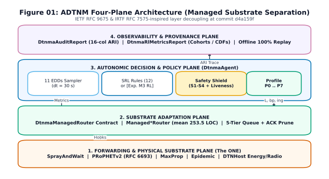

# Chapter 1: Executive Summary

> **Documented Commit:** `d4a159f` | **Frozen Evaluation Tag:** `v1.0-tnsm-freeze` (`c820752c` -> `ca5d9ac`) |
> **Exploratory Tag/Campaign:** `v1.0-exp-controls` (`7211..7307`) | **Target Size:** Standalone `<= 2` PDF pages

---

## 1. What ADTNM Is — And What It Is Not

**ADTNM** (*Autonomic Delay-Tolerant Network Management*) is an **architectural management framework** for challenged wireless and space networks implemented in Java inside **The ONE** (*Opportunistic Network Environment*) simulator. Inspired by **IETF RFC 9675** (*Delay-Tolerant Networking Management Architecture*, Nov 2024) and **IRTF RFC 7575** (*Autonomic Networking*, June 2015), ADTNM decouples **management semantics** from **bundle routing**:

- `EpidemicRouter`, `ProphetV2Router`, `MaxPropRouter`, `SprayAndWaitRouter`, and `DtnmaRouter` remain **managed substrates** whose forwarding heuristics stay intact.
- A uniform `DtnmaAgent` engine wraps any substrate via a thin adapter (`Managed*Router`, averaging `253.5` non-comment lines of Java) to execute **11 Externally Defined Data (`EDD`)** telemetry metrics, deterministic **State-Based Rules (`SRL`)**, discrete **`P0–P7` Control Profiles**, a hard **Safety Shield (`S1–S4`)**, and atomic **Application Resource Identifier (`ARI`)** audit logging (`100.00%` replayable).
- An optional constrained Markov decision process (`CMDP`) reinforcement learning (`RL`) planner (`M3`, `ShieldedCmdpRlAgent`) is `Implemented, experimental`. It is explicitly **not** the architecture's foundation — in held-out testing it failed to outperform hand-written `SRL` rules (`M2`).

```
[Manager Overlay] --- (Delayed Uplink/Downlink Bundles: seconds to hours) ---> [Node Agent: DtnmaAgent]
                                                                                     |
   11 EDDs (30s) -> SRL Rule Matcher (P0..P7) -> [Opt. M3 RL] -> Shield S1..S4 -> Thin Adapter -> Substrate Router
```



---

## 2. Headline Empirical Evidence (Confirmatory vs. Exploratory Separated)

All numbers trace verbatim to [provenance_ledger.json](../data/provenance_ledger.json). Confirmatory `v1.0` (`715` runs, paired primes `7103..7207`) and post-freeze Exploratory (`176` runs, `7211..7307`) never share statistical pools.

### A. Frozen Confirmatory `v1.0-tnsm-freeze` Results (`715` Runs, `n = 11` Seeds, Holm-Adjusted)

| Finding / Hypothesis | Endpoint & Comparison | Measured Result (`95%` CI, Wins) | Meaning |
|---|---|---|---|
| **Router-Agnostic Safety** | Critical lost across all `176` managed runs (`4` routers x `4` regimes) | **`0`** unique critical bundles lost (stock loses up to `100%` critical in blackouts) | Protection + ACK pruning generalizes without modifying core routing algorithms |
| **Tier Decomposition** (`Epidemic`, Blackout) | Tier 1 (protection) vs Tier 2 (+ ingress/energy) vs Tier 3 (+ quota caps) | Alive nodes: **`14.5`** (Tier 1) -> **`125.9`** (Tier 2) -> **`125.9/126`** (Tier 3) | Survival gains come from ingress/energy policies (`Tier 2`), leaving routing logic (`Tier 3`) untouched |
| **E1 & E2 Equivalence** (`SprayAndWait`) | `ManagedSprayAndWait` (Tier 1) vs hard-coded `PrioritySprayAndWait` | **E1:** `11/11` exact `MessageStats` (`0.00 pp`); **E2 TOST (`+/- 1 pp`):** `-0.31 pp`, `p = 2.29e-6` | Abstraction introduces zero unintended forwarding penalty |
| **A3 Architecture vs. Custom** (`Epidemic`, Blackout) | Hand-coded `EnergyAwareEpidemic` (`394` LOC) vs uniform rules (`12` LOC) | Bulk diff **`+3.39 pp`** vs Tier 2 / **`+3.14 pp`** vs Tier 3; `0` critical lost both | Matches `~97%` of bespoke Java at `3%` rule-file LOC across `4` substrates |
| **H1 (Autonomy Stale Throttle)** | `M2` (Local SRL) vs `M1-U` (Unicast Remote), Stress Event A (`3600–3900 s`) | **`-389.06 +/- 111.49` node-s/N** (`0` vs `389.1`), `p_holm = 1.51e-5` (`11/11`) | Remote commands arrive late (`T90 = 3336 s`) and keep throttling long after surge ends |
| **H2 (Event C Cohort Bulk)** | `M2` vs `M1-U`, Stress Event C (`21600–28800 s`, 1h horizon) | **`+19.21 +/- 3.97 pp`** bulk delivery, `p_holm = 1.58e-6` (`11/11`) | Local rules avoid late persistent remote hold during the longest outage |
| **H3 (Autonomous Survival)** | `M2` vs `M0b` (static protection, no energy guard), Stress `12 h` | **`+23.59 +/- 2.35 pp`** survival (`83.8` vs `54.1/126`), `p_holm = 2.15e-9` (`11/11`) | Energy-aware local rules prevent battery collapse vs. protection-only baseline |
| **H4 (Benign Throughput)** | `M2` vs `M0c` (pre-installed static `0.25` energy guard), Benign `12 h` | **`+28.13 +/- 0.75 pp`** bulk (`82.0%` vs `53.9%`), `p_holm = 6.12e-15` (`11/11`) | Conditional local autonomy avoids permanent static throttling when idle |
| **R1 Deterministic Replay** | `DtnmaAuditReport` offline verification across `176` CompB runs | **`100.00%`** (`27,099,616` rows verified exact ARI & shield mask) | Every local decision is deterministically auditable post-hoc |

### B. Honest Negatives & Post-Freeze Exploratory `v1.0-exp-controls` (`176` Runs, `n = 11`, Unadjusted `p_unadj`)

> [!WARNING] Key Caveats & Limitations Reviewers Must See
> 1. **Failed Original Survival Non-Inferiority (`H2_orig`):** Pre-registered survival non-inferiority (`M2` vs `M1-U` in stress, `-5 pp` margin) **failed**: `M2` trailed `M1-U` by **`-5.48 +/- 1.96 pp`** (`83.8` vs `90.7/126` alive, `0/11` wins, `p_unadj = 9.65e-5`).
> 2. **`M3` Experimental RL Planner Loses to `M2`:** Across CompB Stress (`bulk 63.0% vs 66.0%`, `alive 76.0 vs 83.8`) and Benign (`bulk 79.8% vs 82.0%`), the linear Q-learning planner underperforms hand-written `SRL` (`Status: Implemented, experimental`).
> 3. **Exploratory Control Decomposition (`v1.0-exp-controls`):**
>    - **Survival attribution:** In stress, **`M0e-25`** (static `SoC >= 0.25` guard, no local adaptation) tied **`M2`** on survival (**`83.8` vs `83.8/126`**, `p = 1.0`) while **`M2-LocalOnly`** dropped to **`80.0/126`** — isolating how much of `M2`'s survival edge came from its `0.25` remote wave guard (`+10.0` nodes over `M0e-20`).
>    - **Group-addressed flooding (`M1-F-Group`):** Replacing legacy per-node unicast (`M1-F`: `118.7 kJ`, `13.6` alive) with single-copy group dissemination drops control energy to **`201.6 J`** (`T90 = 841 s`, `99.5` alive), winning whole-mission survival over `M2` (`83.8`), though median adoption (`483 s`) still misses the `300 s` Event A surge window and trails `M2` in Benign bulk (`76.0%` vs `82.0%`).
>    - **Smoke / CI caveats:** `DtnmaDecisionReport` counts ACK-pruned redundant critical evictions inside `Critical Fault Messages Dropped` (`53` in 1h smoke while `unique_critical_lost = 0`), and `.github/workflows/ci.yml` references a removed plotting script ([Discrepancies Log](../appendix_discrepancies.md)).

---

## 3. Five Supervisor Decision Records for `v1.1`

1. **SDR-1 — Tightening Local Energy Hysteresis vs. Benign Throughput:** `M2`'s survival advantage depended substantially on receiving `0.25` remote guard updates (`M0e-25 = 83.8`, `M2-LocalOnly = 80.0`). *Decision needed:* Tune `rules_vdtn.txt` around `EDD_ENERGY_DRAIN` (`DISC-05`) rather than tightening static `SoC`, preserving `82%` benign bulk while targeting `>= 90` stress survivors?
2. **SDR-2 — Scope of `M3` RL Module:** `M3` failed to beat `M2` on any metric in `v1.0`. *Decision needed:* Keep `M3` strictly as a negative empirical control in the thesis/paper, or invest `v1.1` in a compact feature-reduced policy / contextual bandit?
3. **SDR-3 — Remote Manager Feedback Loop:** Current remote modes (`M1-U`, `M1-F-Group`) use scenario-scheduled fixed-time updates rather than synthesizing rules dynamically from delayed Manager uplinks. *Decision needed:* Implement uplink-driven adaptive Manager scheduling for `v1.1`?
4. **SDR-4 — Resolving `DISC-01` & `DISC-02` on `main`:** Align `DtnmaDecisionReport` with `DtnmaRlMetricsReport` (`un-ACKed` vs `ACK-pruned` drops) and repair `.github/workflows/ci.yml` in a dedicated code PR post-docs.
5. **SDR-5 — `rules_uav.txt` Validation & Config Cleanup:** Either validate/add catch-all rules to `scenarios/rules_uav.txt` and retire unused `lambda` shims (`DISC-08`), or archive them cleanly before `v1.1`.
