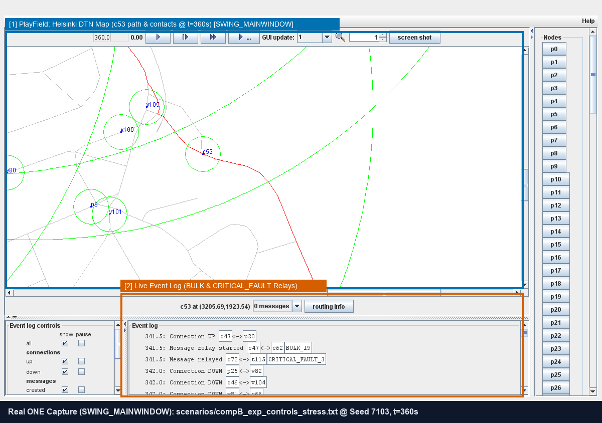

# Chapter 2: Zero-Background Primer for Newcomers

> **Target Audience:** New team members and reviewers with zero prior DTN, IETF RFC, or simulator background.  
> **Prerequisites:** None. **Acronyms expanded in full on first appearance.**

---

## 1. What Makes a DTN Different from the Internet?

On the everyday Internet (`TCP/IP`), you assume two things are true almost all the time:
1. An **end-to-end path** exists between your phone and a server right now.
2. **Round-trip delays** are tens of milliseconds, so asking *"Did you get that packet?"* happens nearly instantaneously.

In a **Delay/Disruption-Tolerant Network (DTN)** — disaster-response vehicular fleets, unmanned aerial relays, or deep-space satellites (`vDTN`, `UAV`, `NTN`) — both assumptions break:
- Nodes move, go behind buildings or planets, run on batteries, or lose radios for **minutes to hours**.
- There may *never* be a simultaneous path from sender `A` to receiver `D`: `A` hands data to `B` at `t = 5 min`, `B` drives across town, meets `C` at `t = 22 min`, and `C` delivers to `D` at `t = 40 min`.

Because packets cannot simply wait on a wire, DTNs use **Store-Carry-Forward** (**RFC 9171**, *Bundle Protocol Version 7*, Burleigh et al., Jan 2022). Data units called **bundles** sit inside node flash/RAM buffers while carriers physically move through space.

> [!TIP] INTUITION
> Think of DTN bundles like **relay baton messages carried by couriers**. If a courier runs out of backpack space (`buffer overflow`), critical triage dispatches (`CRIT_`) risk being thrown in the ditch to make room for low-priority telemetry logs (`BULK_`), OR a courier sprints back and forth handing copies to everyone until their battery dies (`energy blackout`).

---

## 2. Four Classical Routing Strategies — And Why Routing Alone Isn't Management

Before ADTNM, researchers invented different forwarding algorithms deciding **who gets a copy of a bundle** during brief wireless encounters (*contacts*):

| Router Class | Forwarding Idea | Strength | Failure Mode Under Stress |
|---|---|---|---|
| **Epidemic** (`EpidemicRouter`) | Flood every missing bundle to every neighbor met | Minimal latency when buffers & batteries are infinite | Rapidly exhausts buffers and batteries (`14–16/126` survivors in energy blackouts) |
| **PRoPHETv2** (`ProphetV2Router`, **RFC 6693**) | Track encounter probabilities $P(a, b)$; forward only to higher-probability carriers | Avoids blind flooding in structured mobility | Drops low-utility critical packets when congestion hits, still drains batteries |
| **MaxProp** (`MaxPropRouter`) | Estimate path delivery likelihood via Dijkstra over encounter rates + ACK deletion | High throughput under moderate load | Drops bundles by internal hop/cost order rather than operational criticality |
| **Spray-and-Wait** (`SprayAndWaitRouter`) | Binary mode: hand half of $L$ remaining copy tokens (`L_init = 6`) per contact until $L = 1$ (direct delivery only) | Bounded replication overhead (`<= L` copies) | Rigid static $L$ under surges unless dynamically throttled or prioritized |

Notice the key distinction: **routing algorithms answer *"who should carry this next?"* — management answers *"given scarce battery, surging traffic, and critical-safety goals right now, how much bulk replication, ingress admission, and buffer space should the node permit?"***

---

## 3. Why Centralized Management Fails in DTNs (RFC 9675 & RFC 7575)

In an ordinary cloud cluster (`SNMP` / `RESTCONF`), a central **Manager** continuously polls switches every few seconds and pushes fixes immediately. In a DTN, trying to manage nodes solely from a central ground station hits a physics wall:

1. **Timescale Mismatch (Stale Control Loops):** When a remote Manager sits behind opportunistic relays, its control bundle takes **hundreds to thousands of seconds** to reach agents (e.g., `T50 = 483 s` even with group-flooded dissemination in exploratory controls, or `T90 = 3336 s` with unicast in confirmatory stress). By the time a *"slow down!"* command arrives for a `300 s` traffic surge (`Event A`), the surge is over — causing **stale throttling** during calm traffic.
2. **Control Storm Overhead:** Flooding individual unicast control updates across a dense wireless DTN consumes massive radio energy (`118.7 kJ` in `M1-F` vs `2.58 kJ` in `M2`), killing nodes via management traffic itself.

Two IETF/IRTF specifications define the conceptual solution ADTNM adapts:
- **IETF RFC 9675 (*Delay-Tolerant Networking Management Architecture*, Birrane et al., Nov 2024):** Replaces synchronous polling with asynchronous **Agents** executing local **State-Based Rules (SRL)** parameterized by locally observable **Externally Defined Data (EDD)**, emitting compact **Application Resource Identifier (ARI)** audit records and executing **Controls** autonomously when disconnected from a **Manager**.
- **IRTF RFC 7575 (*Autonomic Networking*, Behringer et al., June 2015):** Defines **autonomic self-management** (`self-configuring`, `self-healing`, `self-optimizing`, `self-protecting`) alongside **explicit safety/human constraints** — autonomy operates strictly inside hard guardrails rather than unrestrained black-box optimization.

> [!NOTE] SUPERVISOR NOTE
> ADTNM is **RFC 9675-inspired** and **RFC 7575-inspired**. It borrows their architectural separation of roles, data models, and closed-loop constraints inside Java objects; it does **not** claim byte-level CBOR wire compatibility with IETF DTNMA drafts or ION. See [`Appendix A`](../appendices/appendix_a_rfc_conformance.md).

---

## 4. How The ONE Simulator Runs a Scenario

**The ONE** (*Opportunistic Network Environment*, `n:\R&D\cog\the-one\`) advances simulated wall time in discrete **`0.1 s`** steps (**tick interval**, `MovementModel.worldSize` & `Scenario.updateInterval = 0.1`):

1. **Scenario Parsing:** `.txt` config files (`scenarios/scenario_dtnma.txt` layered atop `dtnma_params_default.txt`) instantiate groups of `DTNHost` nodes, movement models (e.g., Helsinki `MapBasedMovement`), radio interfaces, `EnergyModel` batteries, traffic generators (`CRIT_` and `BULK_` prefixes), and one `MessageRouter` prototype per group.
2. **Every `0.1 s` Simulation Tick:**
   - Nodes advance along roads/trajectories; radios discover neighbors within range and open/close `Connection` objects.
   - Active transfers advance byte-by-byte at `transmitSpeed`; completed transfers fire `MessageListener` hooks and energy consumption debits (`scanEnergy`, `transmitEnergy`, `receiveEnergy`).
   - Each node's router executes `update()` (`DtnmaRouter.update()` delegates to `DtnmaAgent.update(...)`), which runs fast per-tick protection + `30 s`-interval autonomic decision epochs.
3. **End-of-Simulation Reporting:** Registered `Report` classes flush raw `.txt` files into the scenario's `reports/` folder (`MessageStatsReport`, `DtnmaRlMetricsReport`, `DtnmaAuditReport`, `DtnmaRecoveryTimelineReport`).

---

## 5. Five Real Failure Modes That Motivated ADTNM

Every mechanism in Chapters `04a`–`04d` traces directly to five failure behaviors observed directly in simulator experiments:

1. **Silent Critical Drop Under Congestion:** Without explicit priority classification and reserve enforcement, critical `CRIT_` fault alerts are dropped FIFO/cost-wise alongside bulk traffic (`Epidemic` loses `100%` of unique critical messages in `vDTN Overload`).
2. **Stale Redundant Replicas Starving Live Traffic:** Once a critical bundle reaches its destination, redundant copies still in relay buffers keep displacing fresh un-ACKed payloads until explicit delivery acknowledgments (`ACKs`) prune them.
3. **Battery Blackout Collapse:** Aggressive routers (`Epidemic`, `MaxProp`) transmit bulk relays until `SoC -> 0`, knocking out `87%–89%` of the fleet (`14–16/126` survivors) and severing connectivity for future critical dispatches.
4. **Delayed Remote Stale-Throttling:** Unicast/flooded Manager rules (`M1-U`, `M1-F`) suffer delayed delivery, throttling nodes after short surges recover and crippling benign/post-event throughput (`389.1` stale throttle node-s/N in Event A).
5. **Unsafe Exploration & Voluntary Hold Bugs:** Early unshielded RL policies (`M3` predecessors) explored aggressive `HIGH_SPRAY_OPEN` during dense storms (`41%` critical occupancy buildup) or stalled on `P0` when mis-rewarded — fixed via hard shield `S1–S4` and reward recalibration (`M3` still remains optional and secondary to `M2`).

