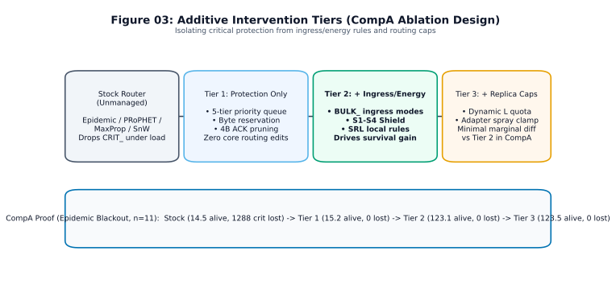

# Chapter 3: Architecture Overview

> **Scope:** Active Research Framework (`M2_MOBILITY_AWARE`) | **Core Principle:** Routers are **managed substrates** governed by an RFC 9675/7575-inspired autonomic management layer.

---

## 1. Layered Management–Substrate Architecture

ADTNM decomposes DTN operations into **decoupled management and forwarding layers** inside `src/routing/` and `src/report/`:

```
+-----------------------------------------------------------------------------+
| 4. OBSERVABILITY & AUDIT REPORTING                                          |
|    DtnmaAuditReport (21-col ARI trace) · DtnmaMetricsReport (Cohorts/CDF)   |
|    DtnmaDecisionReport · DtnmaRecoveryTimelineReport                        |
+-----------------------------------------------------------------------------+
                                      ^  Records every EDD, rule, shield, ARI
+-----------------------------------------------------------------------------+
| 3. LOCAL AUTONOMIC COORDINATOR (DtnmaAgent)                                 |
|    M2_MOBILITY_AWARE Closed-Form Coordinator · SRL Rule Parser              |
|    DtnmaSafetyShield (S1..S4 + Liveness) -> Active Control Profile (P0..P7) |
|    Remote Overlay Slot (upserts Manager DOWNLINK rule, priority 110)        |
+-----------------------------------------------------------------------------+
        ^  15 EDDs (dt = 1.0 s)                       v  Actuates L, bp, ing
+-----------------------------------------------------------------------------+
| 2. SUBSTRATE ADAPTER LAYER (DtnmaManagedRouter + Managed*Router)            |
|    Thin adapters for SnW, PRoPHETv2, MaxProp, Epidemic;                     |
|    Priority Reserve + ACK-first eviction + ByteBudget Guard                 |
+-----------------------------------------------------------------------------+
                                      ^  Native routing heuristics
+-----------------------------------------------------------------------------+
| 1. FORWARDING & PHYSICAL SUBSTRATE (The ONE Engine + Routers)               |
|    DTNHost · EnergyModel · MovementModel · ActiveRouter · SprayAndWait,     |
|    ProphetV2, MaxProp, Epidemic, DtnmaRouter                                |
+-----------------------------------------------------------------------------+
```

### Why This Layering Matters
- **Strict Separation of Concerns:** Changing a mobility model (`Layer 1`) or swapping `SprayAndWait` for `MaxProp` (`Layer 2`) does not alter `DtnmaAgent` rules (`Layer 3`) or audit logs (`Layer 4`).
- **Router-Agnostic Portability:** A single declarative rule file (`scenarios/rules_vdtn.txt`, `12` lines) governs four mathematically distinct forwarding algorithms without rewriting per-router Java scheduling logic.

---

## 2. Three Coupled Timescales of Control

ADTNM operates simultaneously across three distinct temporal scales (`implemented+tested`):

| Timescale | Cadence | Trigger / Actors | Responsibilities |
|---|---|---|---|
| **Fast Reactive Protection** | Per tick & per packet | `evaluateCheckReceiving`, `tryAllMessages`, `DtnmaRouter` queue/eviction | Reject un-ACKed `BULK_` when byte reservation full; evict ACKed criticals/bulk first, never live `CRIT_`; respect active `ingressMode` (`0/1/2`) and hard energy floors; prune delivered copies via peer contact `ACK` IDs (`4 B/ID`) |
| **Local Autonomic Control** | Every `dt = 1.0 s` | `EddTelemetrySampler` -> `DtnmaAgent` -> `M2-Mob` / `SRL` -> `DtnmaSafetyShield` | Compute `15` local + neighbor EDDs from `16 B` contact beacons; evaluate `M2_MOBILITY_AWARE` control law or priority-latched `SRL` rules; filter `P0..P7` through hard constraints `S1–S4`; emit atomic snapshot + `ARI://...` audit row |
| **Remote Manager Overlay** | Minutes to hours (`DTN` propagation) | Ground/Manager host -> Uplink telemetry & Downlink `CTRL_UPDATE_*` bundles (`M1-Remote`, `M2`) | Inject or refresh time-bounded remote overlay rules via `applyDownlinkControlBundle()` (e.g., pre-configuring `shieldEnergyMin = 0.25`); logs adoption CDFs (`T10..T95`) and Age of Information (`AoI`) |

> [!IMPORTANT] FORMAL / CODE
> Because DTN propagation delays exceed transient surge durations, the **Local Autonomic** loop responds within `1.0 s`, while the **Remote Overlay** provides slower strategic configuration updates (`M1-Remote` / `M2`). See [`DtnmaAgent.java`](../../../src/routing/DtnmaAgent.java).

---

## 3. Three Intervention Tiers (Architecture Decomposition)

| **Intervention Tier (1 / 2 / 3)** | `DtnmaConfig.interventionTier` | **Status:** `Implemented+tested` |

| Tier | Constant Name | Active Capabilities | Touches Core Routing? |
|---|---|---|---|
| **Tier 1** | `TIER1_PROTECTION_ONLY` | Priority queue reserve + byte reservation (`CRIT_`/`CTRL_` protected over `BULK_`) + critical ACK exchange & pruning | **No** |
| **Tier 2** | `TIER2_PROTECTION_INGRESS_ENERGY` | Tier 1 **plus** `BULK_` ingress admission throttling (`ing = 0/1/2`), `S1–S4` Shield, and local autonomy | **Minimal** (admits/rejects `BULK_` at ingress & hold; keeps forwarding heuristics unchanged) |
| **Tier 3** | `TIER3_FULL_WITH_REPLICA_CAPS` | Tier 2 **plus** dynamic replica copy-limit `L` (`1..12`) / backpressure forwarding caps applied in adapters | **Yes** (modulates substrate forwarding breadth) |

---

## 4. Active Management Modes & Presets

| **Mode / Class** | Router Class (`src/routing/`) | Local Autonomy? | Remote Control? | Role in Mobility Campaign | Status |
|---|---|---|---|---|---|
| **`M0a` / Baselines** | `SprayAndWaitRouter`, `CongestionAwareSnWRouter` | None | None | Unmanaged / encounter-utility stock baselines | `Implemented+tested` |
| **`M0b`** | `DtnmaM0bStaticRouter` | None | None | Static `P4`, **Protection Only** (no energy/congestion shield) | `Implemented+tested` |
| **`M0e-25`** | `DtnmaM0eEnergy25Router` | Energy cutoff only | None | Static SoC cutoff at `0.25` (no congestion/mobility rules) | `Implemented+tested` |
| **`M1-Remote`** | `DtnmaM1RemoteRouter` | None | Per-node Unicast | Manager sends unicast `CTRL_UPDATE_` bundles (`M1_REMOTE_ONLY`) | `Implemented+tested` |
| **`M2-SRL`** | `DtnmaM2SrlRouter` | **Yes (`SRL` + `S1–S4`)** | Optional Overlay | Declarative local rules (`rules_vdtn.txt`) | `Implemented+tested` |
| **`M2-Mob`** | `DtnmaM2MobRouter` (+ `EnergyOnly` / `BufferOnly` / `ReplicaOnly`) | **Yes (`M2_MOBILITY_AWARE` + `S1–S4`)** | Optional Overlay | Joint energy-horizon, ICT buffer, & contact-duration coordination | `Implemented+tested` |
| **Managed Substrates** | `Managed{SprayAndWait,ProphetV2,MaxProp,Epidemic}Router` | **Yes (`DtnmaAgent`)** | Optional Overlay | Wraps diverse DTN forwarders under uniform resource governance (`F4`) | `Implemented+tested` |

---

## 5. Where ADTNM Aligns with RFCs — And Explicit Boundaries

| Concept | RFC Source | ADTNM Realization | Explicit Scope Boundary |
|---|---|---|---|
| **Agent / Manager split** | RFC 9675 Sec 3 | `DtnmaAgent` per node; remote `Manager` scenarios emit `CTRL_UPDATE_*` waves | No interactive Manager GUI/CLI or automated remote policy synthesis |
| **EDD telemetry** | RFC 9675 Sec 4.2 | `15` named EDD metrics (`EDD_QUEUE_RATIO` .. `EDD_ENERGY_TTD_RATIO`) | Internal Java fields + string enum (`EddTelemetrySampler`), not ADMs/CBOR |
| **ARI identifiers** | RFC 9675 Sec 4.1 | Human-readable URIs (`ARI://DTNMA/MOB/<TAG>`, `ARI://DTNMA/SRL/<RULE_ID>`) in audit log | String tags for deterministic audit, not binary CBOR ARIs |
| **State-Based Rules (SRL)** | RFC 9675 Sec 4.4 | `DtnmaRuleParser` compiles `RULE / IF / THEN: CTRL_SET_*` rules | Deterministic flat `&&` / `\|\|` clauses |
| **Self-\* + Bounded Autonomy** | RFC 7575 Sec 3–4 | Shield `S1–S4` hard-masks unsafe actions before actuator dispatch | Does **not** allow unconstrained dynamic goal invention outside safe bounds |

See [Chapter 4a](04a_mechanisms_telemetry_and_profiles.md) through [Chapter 4d](04d_mechanisms_mobility_and_reporting.md) and [Appendix A](../appendices/appendix_a_rfc_conformance.md) for clause-by-clause RFC traceability.

## Architectural Diagrams (`Figures 01–03`)



