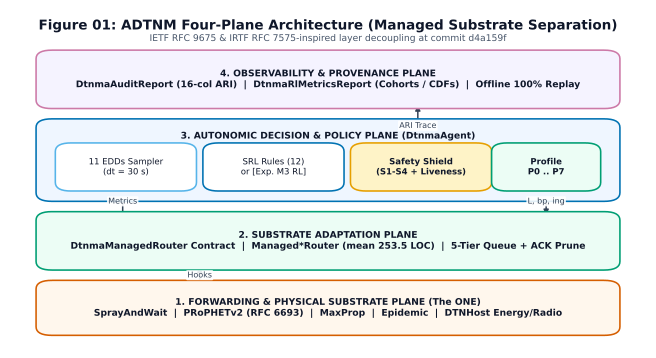
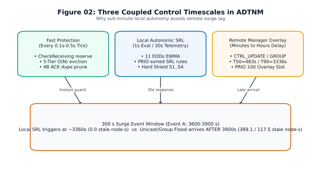

# Chapter 3: Architecture Overview

> **Documented Commit:** `d4a159f` | **Core Principle:** Routers are **managed substrates** governed by an RFC 9675/7575-inspired autonomic management layer.

---

## 1. Four-Plane Architectural Stack

ADTNM decomposes DTN operations into **four decoupled planes** inside `src/routing/` and `src/report/`:

```
+-----------------------------------------------------------------------------+
| 4. OBSERVABILITY & PROVENANCE PLANE                                         |
|    DtnmaAuditReport (16-col ARI trace) · DtnmaRlMetricsReport (Cohorts/CDF) |
|    DtnmaDecisionReport · DtnmaRecoveryTimelineReport · offline Replay Tool  |
+-----------------------------------------------------------------------------+
                                      ^  Records every EDD, rule, shield, ARI
+-----------------------------------------------------------------------------+
| 3. AUTONOMIC DECISION & POLICY PLANE (DtnmaAgent)                           |
|    SRL Rule Parser (12-line vDTN ruleset) · Optional M3 RL (experimental)    |
|    DtnmaSafetyShield (S1..S4 + Liveness) -> Active Control Profile (P0..P7) |
|    Remote Overlay Slot (upserts Manager DOWNLINK/GROUP rule, TTL/priority)   |
+-----------------------------------------------------------------------------+
        ^  11 EDDs (dt = 30 s)                        v  Actuates L, bp, ing
+-----------------------------------------------------------------------------+
| 2. SUBSTRATE ADAPTATION PLANE (DtnmaManagedRouter + Managed*Router)         |
|    Thin adapters (~253.5 mean non-comment LOC) for SnW, PRoPHETv2, MaxProp, |
|    Epidemic; shared 5-tier Queue + ACK-first eviction + ByteBudget Guard     |
+-----------------------------------------------------------------------------+
                                      ^  Native routing heuristics
+-----------------------------------------------------------------------------+
| 1. FORWARDING & PHYSICAL SUBSTRATE PLANE (The ONE Engine + Routers)         |
|    DTNHost · EnergyModel · MovementModel · ActiveRouter · SprayAndWait,     |
|    ProphetV2, MaxProp, Epidemic, DtnmaRouter                                |
+-----------------------------------------------------------------------------+
```

### Why This Layering Matters
- **Strict Separation of Concerns:** Changing a mobility model (`Layer 1`) or swapping `SprayAndWait` for `MaxProp` (`Layer 2`) does not alter `DtnmaAgent` rules (`Layer 3`) or audit logs (`Layer 4`).
- **Router-Agnostic Portability:** A single declarative rule file (`scenarios/rules_vdtn.txt`, `12` lines) governs four mathematically distinct forwarding algorithms without rewriting per-router Java scheduling logic.

---

## 2. Three Coupled Timescales of Control

ADTNM operates simultaneously across three distinct temporal scales (`implemented+tested`):

| Timescale | Cadence | Trigger / Actors | Responsibilities |
|---|---|---|---|
| **Fast Reactive Protection** | Per tick (`0.1 s`) & per packet | `checkReceiving`, `tryAllMessages`, `DtnmaRouter` queue/eviction | Reject un-ACKed `BULK_` when byte reservation full (`maxOvershoot = 1`); evict ACKed criticals first, then `BULK_`; respect active `ingressMode` (`0/1/2`) and hard energy floors; prune delivered copies via peer contact `ACK` IDs (`4 B/ID`) |
| **Local Autonomic Control** | Every `dt = 30.0 s` (`dtnmaTelemetryIntervalSec`) | `EddTelemetrySampler` -> `DtnmaAgent` -> `SRL` / (`M3`) -> `DtnmaSafetyShield` | Compute `11` local + neighbor EDDs from `16 B` contact beacons; evaluate priority-latched `SRL` rules (or optional `M3` RL Q-critic); filter `P0..P7` through hard constraints `S1–S4`; emit atomic snapshot + `ARI://...` audit row |
| **Remote Manager Overlay** | Minutes to hours (`DTN` propagation) | Ground/Manager host -> Uplink telemetry (`648 B` gossip / status) & Downlink `CTRL_` bundles (`M1-U`, `M1-F`, `M1-F-Group`, `M2`) | Inject or refresh time-bounded remote overlay rules via `applyDownlinkControlBundle()` (e.g., pre-configuring `shieldEnergyMin = 0.25`); logs adoption CDFs (`T10..T95`) and Age of Information (`AoI`) |

> [!IMPORTANT] FORMAL / CODE
> Because DTN propagation delays exceed surge durations (`300 s` Event A vs `483 s–3336 s` remote median/T90 adoption), the **Local Autonomic** loop (`30 s`) handles transient spikes (`VDTN_SURGE_THROTTLE`), while the **Remote Overlay** provides slower strategic configuration updates (`dtnmaControlPriority = 100` when active). See [`DtnmaAgent.java:634-733`](../../../src/routing/DtnmaAgent.java#L634-L733) and [`1200-1323`](../../../src/routing/DtnmaAgent.java#L1200-L1323).

---

## 3. Three Intervention Tiers (Architecture Decomposition)

| **Intervention Tier (1 / 2 / 3)** | `DtnmaConfig.interventionTier` | **Status:** `Implemented+tested` |

To separate *what critical protection contributes* from *what admission throttling or forwarding caps contribute*, Comparison A decomposes management cleanly into three additive layers:

| Tier | Constant Name | Active Capabilities | Touches Core Routing? |
|---|---|---|---|
| **Tier 1** | `TIER1_PROTECTION_ONLY` | Five-tier priority queue + byte reservation (`CRIT_`/`CTRL_` protected over `BULK_`) + critical ACK exchange & pruning | **No** (empirically verified bit-for-bit identical to hard-coded `PrioritySprayAndWaitRouter` in `E1`) |
| **Tier 2** | `TIER2_PROTECTION_INGRESS_ENERGY` | Tier 1 **plus** `BULK_` ingress admission throttling (`ing = 0/1/2`), `S1–S4` Shield, and local `SRL` rules | **Minimal** (admits/rejects `BULK_` at ingress & hold; keeps forwarding heuristics unchanged) |
| **Tier 3** | `TIER3_FULL_WITH_REPLICA_CAPS` | Tier 2 **plus** dynamic replica copy-limit `L` (`1..12`) / backpressure forwarding caps applied in adapters | **Yes** (modulates substrate forwarding breadth) |

---

## 4. Eight+ Evaluation Modes (`M0a` through `M3` + Exploratory Controls)

Comparison B compares **architecture operating modes** using a shared substrate (`SprayAndWait` / `DtnmaRouter` family with identical control transport accounting where enabled):

| Mode | Router Class (`src/routing/`) | Local Autonomy? | Remote Control? | Key Configuration (`v1.0` / Exploratory) | Status |
|---|---|---|---|---|---|
| **`M0a`** | `SprayAndWaitRouter` | None | None | Unmanaged stock router (baseline without protection) | `Implemented+tested` |
| **`M0b`** | `DtnmaM0bStaticRouter` | None | None | Static `P4`, **Protection Only** (no energy/congestion shield) | `Implemented+tested` |
| **`M0c`** | `DtnmaM0cV1GuardRouter` | None | None | Pre-installed V1 guard (`shieldEnergyMin=0.25`, `Q <= 0.88`, static throttle) | `Implemented+tested` |
| **`M0d`** | `DtnmaM0dConservativeRouter` | None | None | Always-conservative static profile (`P1: L=2, INGRESS_THROTTLE_BULK`) | `Implemented+tested` |
| **`M0e-20 / M0e-25`** | `DtnmaM0eEnergy20Router` / `25Router` | Energy cutoff only | None | Exploratory static SoC cutoff at `0.20` or `0.25` (no SRL/congestion rules) | `Implemented+tested` |
| **`M1-U`** | `DtnmaM1RemoteRouter` | None | Per-node Unicast | Manager sends sequential unicast `CTRL_UPDATE_` bundles (`shield + SRL` off locally except remote overlay) | `Implemented+tested` |
| **`M1-F`** | `DtnmaM1FloodRouter` | None | Per-node Flood | Confirmatory flood control (legacy per-target flooded bundles; `118.7 kJ` cost) | `Implemented+tested` |
| **`M1-F-Group`** | `DtnmaM1FloodGroupRouter` | None | Single-Copy Group Flood | Exploratory best-case remote (`CTRL_GROUP_` epidemic flood once per wave; `201.6 J`) | `Implemented+tested` |
| **`M2`** | `DtnmaM2SrlRouter` | **Yes (`SRL` + `S1–S4`)** | Remote Guard/Overlay | Primary ADTNM autonomic mode: `12` vDTN local rules (`dt = 30 s`) + `0.25` remote guard waves | `Implemented+tested` |
| **`M2-LocalOnly`** | `DtnmaM2LocalOnlyRouter` | **Yes (`SRL` + `S1–S4`)** | **None** | Purely disconnected local-rules ablation (`v1.0-exp-controls`) | `Implemented+tested` |
| **`M3`** | `DtnmaM3RlRouter` | Yes (`RL` + `S1–S4`) | Optional | Shielded 20-feature linear Q-agent + gossip; underperformed `M2` in `v1.0` | `Implemented, experimental` |

---

## 5. Where ADTNM Aligns with RFCs — And Explicit Boundaries

| Concept | RFC Source | ADTNM Realization (`d4a159f`) | Explicit Scope Boundary |
|---|---|---|---|
| **Agent / Manager split** | RFC 9675 Sec 3 | `DtnmaAgent` per node; remote `Manager` scenarios emit `CTRL_` rules | No interactive Manager GUI/CLI or automated remote policy synthesis (`v1.0`) |
| **EDD telemetry** | RFC 9675 Sec 4.2 | `11` named EDD metrics (`EDD_QUEUE_RATIO` .. `EDD_DEST_PROB`) | Internal Java array + string enum (`EddTelemetrySampler`), not ADMs/CBOR |
| **ARI identifiers** | RFC 9675 Sec 4.1 | Human-readable URIs (`ARI://DTNMA/SRL/<RULE_ID>`) in audit log | String tags for deterministic replay, not RFC 9171/DTN WG binary CBOR ARIs |
| **State-Based Rules (SRL)** | RFC 9675 Sec 4.4 | `DtnmaRuleParser` compiles `RULE / IF / THEN: CTRL_SET_*` rules | Deterministic flat `&&` / `\|\|` clauses over the `11` EDDs |
| **Self-\* + Bounded Autonomy** | RFC 7575 Sec 3–4 | Shield `S1–S4` hard-masks unsafe actions before actuator dispatch | Does **not** allow unconstrained dynamic goal invention outside safe bounds |

See [Chapter 4a](04a_mechanisms_telemetry_and_profiles.md) through [Chapter 4d](04d_mechanisms_rl_and_reporting.md) for full `11`-part specifications of all `23` mechanisms, and [Appendix A](../appendices/appendix_a_rfc_conformance.md) for clause-by-clause RFC traceability.

## Architectural Diagrams (`Figures 01–03`)






