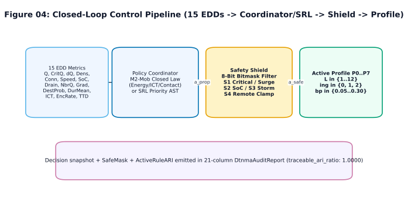
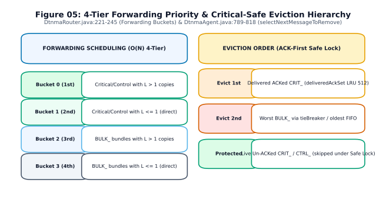

# Chapter 4a: Mechanisms 01–06 — Telemetry, Queueing & Control Profiles

> **Series:** Part 1 of 4 (`04a`–`04d`) covering ADTNM mechanisms across telemetry, priority queuing, rules, safety shields, substrate adapters, mobility coordination, and reporting.  
> Every mechanism uses the standardized **11-part specification template**.

> [!TIP] INTUITION
> Think of Mechanisms `01–06` as the **sensorium and gearbox** of an autonomous vehicle: `EddTelemetrySampler` measures speed, contact dynamics, queue fill, and battery time-to-depletion, the `4`-tier forwarding & ACK-first eviction engine protects emergency payloads (`CRIT_`) while shedding stale duplicates, ingress locks brake `BULK_` arrivals early, and `P0..P7` shifts the vehicle cleanly across `8` vetted gears.

> [!IMPORTANT] FORMAL / CODE
> Every mechanism below enforces **hard capacity invariance** (`maxOvershoot = 1`), single-pass $O(N)$ priority forwarding (`DtnmaRouter.java:221-245`), and ACK-first critical-safe eviction (`DtnmaAgent.java:789-818`).

> [!WARNING] GOTCHA / PITFALL
> `DtnmaDecisionReport` aggregates harmless ACKed duplicate evictions together with live `CRIT_` drops (`53` in the 1 h smoke test vs `0` un-ACKed `unique_critical_lost` in `DtnmaMetricsReport`).

> [!NOTE] RESEARCHER NOTE
> Cross-substrate tests (`mob_cross_substrate.txt`, `n = 19` seeds) verify that Tier 1–3 priority protection and resource coordination eliminate `unique_critical_lost` (`70.8–124.0 -> 0.0`) across four distinct forwarding substrates without altering their native routing tables.

---

## Mechanism 01: Agent–Manager Architectural Split & Multi-Timescale Overlay

### 1. Purpose & Problem Solved
Decouples node-local operational survival (`DtnmaAgent`) from supervisory campaign orchestration (`Manager` host), resolving the control-loop delay wall in Delay/Disruption-Tolerant Networks (DTNs) where Manager round trips span hundreds to thousands of seconds.

### 2. Design Alternatives Considered
- **Pure centralized polling (`SNMP` style):** Rejected; Manager commands arrive stale after transient surges terminate (in `Env 1 Stress`, unicast `M1-Remote` collapses to `50.07%` during `Event C`).
- **Pure static guards (`M0b-Static`, `M0e-25`):** Avoids control messaging complexity, yet either exhausts field batteries (`54.95/126` alive on `M0b`) or over-throttles bulk delivery (`62.11%` on `M0e-25` vs `70.18%` on `M2-Mob`).
- **Selected hybrid split (RFC 9675-inspired):** Fast local autonomy (`1.0 s` cadence via `M2_MOBILITY_AWARE` or `SRL`) handles immediate contact/energy dynamics, while optional Manager downlinks (`CTRL_UPDATE_*`) inject time-bounded configuration overlays.

### 3. Architecture & Data Flow
`Manager` hosts inject `CTRL_UPDATE_` bundles -> Carried opportunistically over The ONE contacts -> Intercepted cleanly in `DtnmaAgent.applyDownlinkControlBundle` -> Upserted into the local `StateBasedRule` table (overlay slot) and evaluated during autonomic ticks.

### 4. Inputs & Configuration
`DtnmaConfig` flags in `DtnmaConfig.java`: `managementMode` (`M0_STATIC`, `M1_REMOTE_ONLY`, `M2_AUTONOMIC_SRL`, `M2_MOBILITY_AWARE`), `interventionTier`, `beaconRefreshInterval`, `densityAdaptiveBeacons`.

### 5. Algorithm & Exact Math / Equations
- Effective rule priority $P_{\text{eff}}(r) = P_{\text{overlay}}(r)$ when active downlink overlay has not expired (`now <= expireTime`), superseding static rules at priority `<= 99`.
- Control Age of Information: $\text{AoI}(t) = t - t_{\text{last\_uplink\_rx}}$, logged per `10.0 s` sample window (`AOI_SAMPLE_INTERVAL_SEC`).

### 6. Code Anchors
- `src/routing/DtnmaAgent.java:634-733` (`evaluateAutonomyEngine`), `:1200-1323` (`applyDownlinkControlBundle`, `upsertDownlinkOverlayRule`)
- `src/routing/DtnmaConfig.java:1-90`

### 7. Outputs, Telemetry & Logs
`DtnmaAuditReport` `active_ari` traces remote overlays; `DtnmaMetricsReport` records `downlink_t90_sec`, `aoi_mean_sec`, `aoi_p95_sec`, `aoi_peak_sec`, and `# WAVE_ADOPTION_CDF`.

### 8. Edge Cases, Failure Modes & Safeguards
Downlink bundles expire automatically if `t > t_rx + ttlSec`; corrupt payloads missing valid rule syntax are ignored cleanly without clearing static local `SRL` safety rules.

### 9. Worked Mini-Example
In `M1-Remote`, delayed Manager `CTRL_UPDATE_THROTTLE` bundles lag behind short bursts, whereas `M2-SRL` and `M2-Mob` react within `1.0 s` locally.

### 10. Status Label & Evolution
`Implemented+tested` (`v1.0-freeze`). Earlier prototypes lacked per-wave CDF adoption logging (`# WAVE_ADOPTION_CDF` added prior to freeze).

### 11. Supervisor Rationale
Directly operationalizes **RFC 9675 Sec 3** (asynchronous autonomy). Limitation: Manager campaigns in `v1.0` are schedule-driven rather than dynamically synthesized from uplink telemetry.

---

## Mechanism 02: Externally Defined Data (`EDD`) Telemetry Sampler (`15` Indicators)

### 1. Purpose & Problem Solved
Provides a uniform, router-independent `15`-element numerical telemetry suite (buffer, critical pressure, density, speed, energy/drain, neighbor beacons, contact duration, ICT, encounter rate, and energy TTD), preventing heterogeneous routers from inventing incompatible internal congestion signals.

### 2. Design Alternatives Considered
- **Router-private counters:** Breaks portability; every rule file would require router-specific Java bindings.
- **Raw instantaneous queue readings:** Noisy under rapid bundle arrivals/departures, causing profile chatter.
- **Selected EWMA + sliding-window EDD sampler:** Smooths short bursts while keeping deterministic state vectors across routers.

### 3. Architecture & Data Flow
Every `30 s` -> `EddTelemetrySampler.sampleAndCompute(host, managedRouter, now)` queries `getBufferOccupancyRatio()`, `getCriticalOccupancyRatio()`, `getEnergySoc()`, `getConnections()`, host speed from coordinates, and neighbor `16 B` beacons -> stores `double[11]` indexed by `EDD_*` constants.

### 4. Inputs & Configuration
Configured via `dtnmaTelemetryIntervalSec` (`30.0 s`). Hard-coded constants (`EddTelemetrySampler.java:26-44`): `ALPHA_DRIFT = 0.30`, `ALPHA_SPEED = 0.25`, `DENSITY_WINDOW_SEC = 300.0`, `P_INIT = 0.75`, `DEFAULT_BETA = 0.25`, `DEFAULT_GAMMA = 0.98`, `SECONDS_IN_TIME_UNIT = 30.0`.

### 5. Algorithm & Exact Math / Equations
- `EDD_QUEUE_RATIO` ($Q \in [0,1]$) = $(B_{\text{total}} - B_{\text{free}}) / B_{\text{total}}$
- `EDD_CRIT_QUEUE_RATIO` ($Q_c \in [0,1]$) = $\sum_{m \in \text{CRIT}} |m| / B_{\text{total}}$
- `EDD_QUEUE_DRIFT`: $\Delta Q_t = \alpha_d (Q_t - Q_{t-1}) + (1 - \alpha_d)\Delta Q_{t-1}$, $\alpha_d = 0.30$
- `EDD_NODE_DENSITY`: count of distinct peers seen within sliding `[now - 300.0 s, now]` window
- `EDD_ACTIVE_CONNECTIONS`: current open `Connection` count; `EDD_NODE_SPEED`: EWMA speed ($\alpha_s = 0.25$)
- `EDD_ENERGY_SOC` ($E \in [0,1]$) = $\text{clamp}(E_{\text{rem}} / E_{\text{init}})$; `EDD_ENERGY_DRAIN`: EWMA battery depletion rate (drives `EDD_ENERGY_TTD_RATIO` in `M2_MOBILITY_AWARE`).
- `EDD_NEIGHBOR_MIN_QUEUE` ($Q_{\text{nbr}}^{\min}$), `EDD_NEIGHBOR_QUEUE_GRAD` = $Q - Q_{\text{nbr}}^{\min}$, and `EDD_DEST_PROB` ($P_{\text{dest}} \in [0,1]$ encounter table).

### 6. Code Anchors
- `src/routing/EddTelemetrySampler.java:26-36` (11 `EDD_*` constants), `:140-320` (`sampleAndCompute`, `getEddValue`, `getMobilityClass`)

### 7. Outputs, Telemetry & Logs
All primary state variables are logged verbatim per decision epoch inside columns `5–11` of `DtnmaAuditReport` (`Q, CritQ, dQ, Dens, Con, SoC, ...`).

### 8. Edge Cases, Failure Modes & Safeguards
Empty buffers (`B_total <= 0`) safely return `0.0`. Mobility class (`getMobilityClass`) maps `< 2.2 m/s -> 0` (slow), `2.2–9.5 -> 1` (vehicular), `>= 9.5 m/s` or `interfaces > 1 -> 2` (fast/multi-radio).

### 9. Worked Mini-Example
In an urban congestion surge, `EddTelemetrySampler` reports `Q = 0.9192`, `CritQ = 0.0056`, `dQ = 0.0084`, `Dens = 15.0`, `SoC = 0.9228`. Notice `VDTN_SURGE_THROTTLE` prints `0.92` and `0.01` rounded in audit explanations while comparing exact `double` values (`0.9192 >= 0.88`, `0.00839 >= 0.008`).

### 10. Status Label & Evolution
`Implemented+tested` (`15` EDDs across rules, Safety Shield, and `M2_MOBILITY_AWARE`).

### 11. Supervisor Rationale
Translates RFC 9675 EDD telemetry cleanly across 4 heterogeneous routers.

---

## Mechanism 03: Four-Tier Forwarding Priority & ACK-First Eviction Order

### 1. Purpose & Problem Solved
Guarantees critical fault bundles (`CRIT_`) and control bundles (`CTRL_`) are forwarded ahead of bulk payloads (`BULK_`), never displaced by bulk arrivals under congestion, and reclaimed automatically once `4 B` delivery ACKs confirm redundant replicas can be pruned.

### 2. Design Alternatives Considered
- **FIFO / Random drop:** Loses `CRIT_` payloads under congestion (`Epidemic` loses `109.6` unique critical faults on average in `mob_cross_substrate`).
- **2-tier Crit vs Bulk without ACK awareness:** Keeps dead critical duplicates clogged in RAM, choking subsequent fresh traffic.
- **Selected `4`-tier $O(N)$ forwarding + ACK-first critical-safe eviction:** Zero-allocation bucketed scheduling in `DtnmaRouter` paired with deterministic LRU-ACK pruning and critical protection in `DtnmaAgent.selectNextMessageToRemove`.

### 3. Architecture & Data Flow
Triggered inside `DtnmaAgent.selectNextMessageToRemove(excludeMsgBeingSent, bulkTieBreaker)` (`makeRoomForMessage`) and reused uniformly across `DtnmaRouter` and all `4` `Managed*Router` adapters, while `DtnmaRouter.getMessagesForConnected()` schedules outgoing bundles across four $O(N)$ buckets.

### 4. Inputs & Configuration
Bundle prefix classifiers (`DtnmaRouter.isCriticalMessage`), active-sending exclusion flag (`excludeMsgBeingSent`), `enablePriorityProtection` safety lock, and `deliveredAckSet` LRU (`512` IDs).

### 5. Algorithm & Exact Math / Equations
- **Forwarding Order (`DtnmaRouter`, $O(N)$ single-pass partition into `4` buckets):**
  0. **Bucket 0 (Send First):** Critical/control bundles (`CRIT_`, `CTRL_`, `ALARM`, `TELEM_HIGH_`) with copy count `L > 1`
  1. **Bucket 1:** Critical/control bundles with copy count `L <= 1` (direct/last-copy)
  2. **Bucket 2:** Bulk bundles (`BULK_`, `SCIENCE_DATA_`, `TELEM_NORM_`) with `L > 1`
  3. **Bucket 3 (Send Last):** Bulk bundles with `L <= 1`
- **Eviction Order (`DtnmaAgent.selectNextMessageToRemove`):**
  1. **First Choice:** Any buffered message present in `deliveredAckSet` (already-delivered critical duplicate)
  2. **Second Choice:** Worst `BULK_` / non-critical candidate by substrate `bulkTieBreaker` (or oldest `receiveTime` FIFO fallback), skipping all `CRIT_`/`CTRL_` messages whenever `isSafetyLockEnforced()` holds (`enablePriorityProtection == true` and critical occupancy `< maxOvershoot`).

### 6. Code Anchors
- `src/routing/DtnmaRouter.java:221-245` (4-tier $O(N)$ forwarding buckets), `:532-565` (prefix classifiers)
- `src/routing/DtnmaAgent.java:789-818` (`selectNextMessageToRemove`)

### 7. Outputs, Telemetry & Logs
`DtnmaMetricsReport` distinguishes `critical_buffer_dropped` (un-ACKed loss) vs `critical_buffer_dropped_acked` (harmless pruned replicas). **Reporting Note:** `DtnmaDecisionReport` aggregates both into `Critical Fault Messages Dropped` (`53` in `1 h` smoke vs `0` un-ACKed `unique_critical_lost` in `DtnmaMetricsReport`).

### 8. Edge Cases, Failure Modes & Safeguards
Messages currently mid-transfer (`isSending`) are skipped unless zero other candidates exist.

### 9. Worked Mini-Example
In the 1h `scenario_dtnma.txt` smoke run, redundant delivered `CRIT_` copies are safely pruned from Tier 1 (`deliveredAckSet`), resulting in `unique_critical_lost = 0`.

### 10. Status Label & Evolution
`Implemented+tested`. Replaces earlier sorting loops with single-pass bucket scan.

### 11. Supervisor Rationale
Core contributor to **`0` unique critical lost** across managed substrates.

---

## Mechanism 04: Byte-Budget Critical Reservation Guard (`maxOvershoot`)

### 1. Purpose & Problem Solved
Stops a buffer full of `BULK_` bundles from refusing an incoming `CRIT_` or `CTRL_` bundle if total buffer size is constrained, OR allowing critical bundles to overrun free-space limits unpredictably.

### 2. Design Alternatives Considered
- **Strict FIFO admission (`DENY_OLDEST`):** Rejects `CRIT_` whenever `freeSpace < msgSize` and existing `CRIT_` cannot make room.
- **Unbounded overshoot:** Lets `CRIT_` bursts blow past configured node buffer RAM limits.
- **Selected dual incoming byte reservation:** Tracks pending/active bytes and enforces an explicit critical byte reserve (`maxOvershoot`, default `1`).

### 3. Architecture & Data Flow
Executes in `evaluateCheckReceiving` (`DtnmaAgent.java:954-1003` and `DtnmaRouter.java:411-474`) before `makeRoomForMessage`.

### 4. Inputs & Configuration
`dtnmaMaxOvershootCount` (default `1` byte/packet margin or configurable via `DtnmaConfig`), node `bufferSize`, `reservedBytes` across active incoming transfers.

### 5. Algorithm & Exact Math / Equations
Incoming bundle $m$:
- If `BULK_`: reject with `DENIED_NO_SPACE` unless evicting only `BULK_` + `ACKed CRIT_` yields `>= |m|` bytes (`un-ACKed CRIT_` + `CTRL_` bytes protected!).
- If `CRIT_` / `CTRL_`: permit eviction of lower-priority tiers; clamp total overshoot against `bufferSize` within `maxOvershoot` boundary.

### 6. Code Anchors
- `src/routing/DtnmaRouter.java:411-474`
- `src/routing/DtnmaAgent.java:954-1003`

### 7. Outputs, Telemetry & Logs
Logs rejections into `DtnmaMetricsReport` (`crit_rejected_src`, `bulk_rejected_src`). Zero `CRIT_` overshoot violations verified in `DtnmaUnitTests`.

### 8. Edge Cases, Failure Modes & Safeguards
`Test7` & `Test8` in `DtnmaUnitTests.java` explicitly verify 100%-critical full buffer boundary: accepts 0 overshoot past limit while guaranteeing exact capacity reservation.

### 9. Worked Mini-Example
Node has `5 MB` RAM: `4.8 MB` is `BULK_` and `0.2 MB` is `CRIT_`. A new `300 KB` `CRIT_` bundle triggers immediate `BULK_` eviction; conversely, a new `300 KB` `BULK_` bundle arriving into `4.9 MB CRIT_` is rejected immediately (`DENIED_NO_SPACE`).

### 10. Status Label & Evolution
`Implemented+tested` (`v1.0-freeze`).

### 11. Supervisor Rationale
Prevents priority inversion at ingress without requiring separate physical queues.

---

## Mechanism 05: Three-Level Ingress Admission Control (`INGRESS_`)

### 1. Purpose & Problem Solved
Slows or stops low-priority `BULK_` traffic at the gateway or transit node *before* congestion propagates downstream and drains peer batteries.

### 2. Design Alternatives Considered
- **Always accept all bundles:** Allows bulk relays to flood stressed neighborhoods until buffers overflow and nodes die (`M0b` = `54.1/126` alive).
- **Selected 3-mode discrete actuator (`ControlAction` `0/1/2`):** Separates external relay intake throttling (`Mode 1`) from complete local bulk emergency hold (`Mode 2`).

### 3. Architecture & Data Flow
Profile `P0..P7` sets `ingressMode` in `DtnmaAgent`; every new `createNewMessage` and incoming `receiveMessage` checks `ingressMode` before admission.

### 4. Inputs & Configuration
`ControlAction.java:21-38`:
- `0` = `INGRESS_ACCEPT_ALL`
- `1` = `INGRESS_THROTTLE_BULK` (reject new transit `BULK_` while admitting local critical & control)
- `2` = `INGRESS_CRITICAL_ONLY` (reject *all* `BULK_` creations and transit relays)

### 5. Algorithm & Exact Math / Equations
```java
if (!isCritOrCtrl(m)) {
  if (ingressMode == 2) return DENIED_POLICY;
  if (ingressMode == 1 && isTransitRelay(m)) return DENIED_POLICY;
}
```

### 6. Code Anchors
- `src/routing/ControlAction.java:21-38`
- `src/routing/DtnmaPolicyProfile.java:23-32`
- `src/routing/DtnmaAgent.java:965-990`

### 7. Outputs, Telemetry & Logs
`bulk_rejected_src` counters in `DtnmaMetricsReport`; `stale_throttle_nodesec` tracks node-seconds spent in `ingressMode > 0` *after* an event window ends.

### 8. Edge Cases, Failure Modes & Safeguards
`CRIT_` and `CTRL_` bundles bypass ingress locks in every mode (`0, 1, 2`), preserving emergency reachability even under `P0` emergency hold.

### 9. Worked Mini-Example
Under `M0c` (static pre-installed throttle guard) in Benign traffic, keeping `ingressMode > 0` unnecessarily cuts `bulk_delivery_prob` to `53.9%`; `M2` only enters `ingressMode = 1` (`P1`) during surges (`VDTN_SURGE_THROTTLE`) and restores `0` (`P4`/`P2`) when queues clear, achieving **`82.0%`** benign bulk (`+28.13 pp`, `H4`).

### 10. Status Label & Evolution
`Implemented+tested` (`v1.0-freeze`). Tier 2 gains on Epidemic (`14.5 -> 125.9` alive) come chiefly from Mechanisms `05 + 09` rather than replica caps (`Tier 3`).

### 11. Supervisor Rationale
Proves traffic shaping at ingress yields `~100%` of the survival benefit without rewriting substrate routing tables.

---

## Mechanism 06: Discrete `8`-Tuple Control Profile Catalog (`P0–P7`)

### 1. Purpose & Problem Solved
Compresses continuous, noisy actuator tuning into **`8` safety-auditable operating points** (`P0..P7`) shared identically by rule policies (`M2-SRL`), remote overlays (`M1-Remote`), and `M2_MOBILITY_AWARE` (`M2-Mob`).

### 2. Design Alternatives Considered
- **Continuous scalar action space (`L`, `bpRatio` separately):** Explodes verification complexity and prevents clean bitmask safety masking (`8`-bit bitmask).
- **Selected `8`-profile enum (`DtnmaPolicyProfile`):** Enables 1-byte (`11111111`) feasibility bitmasking by the safety shield and compact `ARI` traceability.

### 3. Architecture & Data Flow
`DtnmaRuleParser` or `M2_MOBILITY_AWARE` selects target index `a in {0..7}` -> `DtnmaSafetyShield.enforce(...)` applies `8`-bit admissibility mask `mask[0..7]` -> Selected `DtnmaPolicyProfile` applies `(L, backpressureRatio, ingressMode, backpressureEnabled)` to adapter setters.

### 4. Inputs & Configuration
Defined immutably in `src/routing/DtnmaPolicyProfile.java:23-32`:

| ID | Profile Name | Copy Limit `L` | Backpressure `bp` | Ingress Mode | BP Enabled |
|---|---|---|---|---|---|
| **`P0`** | `SAFE_EMERGENCY_HOLD` | `1` | `0.05` | `2` (`CRIT_ONLY`) | `true` |
| **`P1`** | `SAFE_THROTTLE_STRICT` | `2` | `0.08` | `1` (`THROTTLE_BULK`) | `true` |
| **`P2`** | `BALANCED_CONSERVATIVE` | `4` | `0.10` | `0` (`ACCEPT_ALL`) | `true` |
| **`P3`** | `BALANCED_AGILE_FOCUS` | `6` | `0.12` | `0` (`ACCEPT_ALL`) | `true` |
| **`P4`** | `STANDARD_SPRAY_FOCUS` | `6` | `0.15` | `0` (`ACCEPT_ALL`) | `false` |
| **`P5`** | `EXPLORE_AGILE_SPRAY` | `8` | `0.15` | `0` (`ACCEPT_ALL`) | `true` |
| **`P6`** | `HIGH_SPRAY_BACKPRESSURE` | `10` | `0.15` | `0` (`ACCEPT_ALL`) | `true` |
| **`P7`** | `HIGH_SPRAY_OPEN` | `12` | `0.30` | `0` (`ACCEPT_ALL`) | `false` |

### 5. Algorithm & Exact Math / Equations
Profile parameters gate three actuators:
- Spray quota `L_i`: max bulk token spread per hop (`computeRelaySplit` sets `floor((nrofCopies - 1) / 2)` bounded by active profile `L`).
- Gradient forwarding guard (`allowNonDirectBulkForward`): when `bpEnabled == true`, blocks non-destination `BULK_` relay if `Q_nbr > Q_local - bpRatio` (except direct delivery to destination).
- Ingress mode (`ing in {0, 1, 2}`).

### 6. Code Anchors
- `src/routing/DtnmaPolicyProfile.java:23-96`
- `src/routing/DtnmaAgent.java:1119-1159` (`allowNonDirectBulkForward`)
- `src/routing/DtnmaRouter.java:214-226` (`computeRelaySplit`)

### 7. Outputs, Telemetry & Logs
`DtnmaAuditReport` logs `ProposedAct`, `FallbackAct`, `ExecutedAct`, and `profile_0_frac .. profile_7_frac` in `DtnmaMetricsReport`.

### 8. Edge Cases, Failure Modes & Safeguards
`P0` (`mask[0] = true`) is always admissible inside `DtnmaSafetyShield` as an unconditional emergency liveness guarantee.

### 9. Worked Mini-Example
During dense congestion (`Q = 0.9298`, `Dens = 12.0`), Shield rule `S3` sets bitmask **`11111100`** (blocking `P6, P7`), clamping execution down into safe **`P3`** (`BALANCED_AGILE_FOCUS`, `L=6`).

### 10. Status Label & Evolution
`Implemented+tested` (`v1.0-freeze`).

### 11. Supervisor Rationale
Finite discrete action bundling keeps safety verification decidable in `O(8)` bit checks while covering an order-of-magnitude span of replication aggressiveness (`L = 1..12`).

## Visual Flow Diagrams (`Figures 04–05`)




