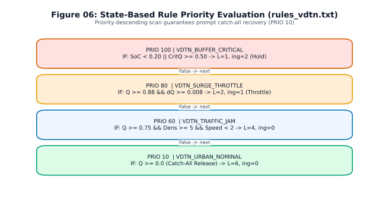
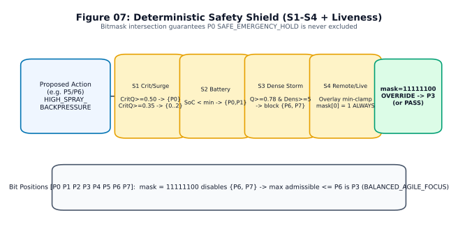
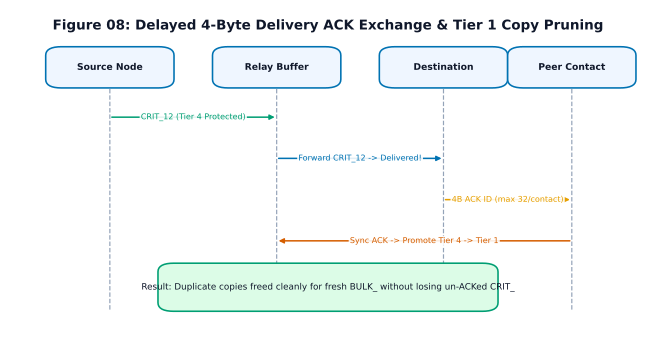
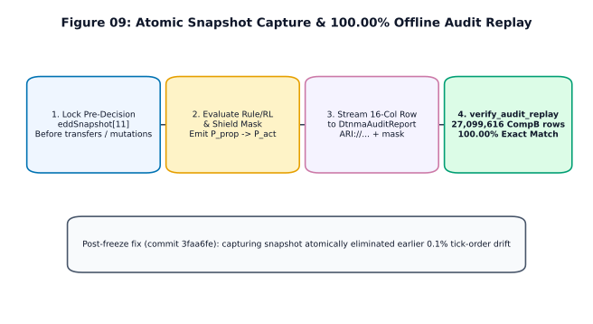

# Chapter 4b: Mechanisms 07–11 — State-Based Rules, Safety Shield & Audit Replay

> **Series:** Part 2 of 4 (`04a`–`04d`). Continues the standardized `11`-part mechanism specification at commit `d4a159f`.

> [!TIP] INTUITION
> Rules (`SRL`) express domain intent (`"throttle surges above 0.88"`), hysteresis latches stop rapid chattering on threshold boundaries, and `DtnmaSafetyShield` acts like an **aviation envelope protection computer** that refuses lethal maneuvers even if a rule or experimental learner requests them.

> [!IMPORTANT] FORMAL / CODE
> Deterministic `100.00%` replay across `27,099,616` audit rows holds strictly because `DtnmaAgent` captures pre-decision `eddSnapshot[11]` atomically *before* updating rules or actuators (`DtnmaAgent.java:634-733`).

> [!WARNING] GOTCHA / PITFALL
> `rules_uav.txt` (`Implemented, experimental`) omits the `PRIORITY: 10` catch-all nominal release present in `rules_vdtn.txt` — add a catch-all recovery rule before experimental deployment.

> [!NOTE] SUPERVISOR NOTE
> **A3 LOC verification:** Declarative rules (`12` lines in `rules_vdtn.txt`) eliminate `394` lines of fragile bespoke router logic while adding hard `S1–S4` bitmask safety.

---

## Mechanism 07: Declarative State-Based Rule (`SRL`) Parser & Predicate Expression Tree

### 1. Purpose & Problem Solved
Allows operators to express autonomic policies in human-readable `.txt` files (`12` non-comment lines in `rules_vdtn.txt`) without writing, compiling, or redeploying router Java code.

### 2. Design Alternatives Considered
- **Hard-coded `if/else` in Java:** Zero portability across substrates or scenarios; cannot accept dynamic remote updates.
- **External scripting runtime (Lua/JS):** Adds JVM serialization complexity and non-deterministic garbage collection overhead.
- **Selected declarative clause evaluator (`PredicateExpression` + `DtnmaRuleParser`):** Lightweight pure Java, deterministic `double` comparisons, instant `[EDD(val) op thresh -> TRUE/FALSE]` strings for `ARI` logs.

### 3. Architecture & Data Flow
`Scenario rule file` (`Group.rulesFile` / `DtnmaRouter.rulesFile`) -> `DtnmaRuleParser.parseRulesFile(...)` -> Compiles each `RULE: <ARI> | PRIORITY: <int> | DESC: <text>` + `IF: <clauses>` + `THEN: CTRL_SET_*` block into a priority-sorted list of `StateBasedRule` objects.

### 4. Inputs & Configuration
`Group.rulesFile` / `DtnmaRouter.rulesFile` (`scenarios/rules_vdtn.txt`); comparisons (`>`, `<`, `>=`, `<=`, `==`, `!=`), `&&` conjunction or `||` disjunction, and `4` `ControlAction` setters (`CTRL_SET_SPRAY_QUOTA`, `CTRL_SET_INGRESS_MODE`, `CTRL_SET_TELEMETRY_INTERVAL`, `CTRL_SET_BACKPRESSURE`).

### 5. Algorithm & Exact Math / Equations
Flat clause expression structure (`DtnmaRuleParser.java:117-137`):
- Conjunction (`&&`): evaluates all `(EDD op threshold)` clauses (`all match -> true`).
- Disjunction (`||`): evaluates clauses when `ifClause.contains("||")` (`any match -> true`).
During `evaluate(...)` (`PredicateExpression.java:31-49`): evaluates **every** clause without short-circuiting so audit logs show full `[EDD(val) op thresh -> TRUE/FALSE]` provenance (`Math.abs(a - b) < 1e-6` for `==`).

### 6. Code Anchors
- `src/routing/PredicateExpression.java:1-145`
- `src/routing/StateBasedRule.java:1-81`
- `src/routing/DtnmaRuleParser.java:59-165`

### 7. Outputs, Telemetry & Logs
Every matched `SRL` rule emits its `ARI://DTNMA/SRL/<RULE_ID>` header and full clause trace into `DtnmaAuditReport` column `21`.

### 8. Edge Cases, Failure Modes & Safeguards
Rules cannot mix nested `&&` and `||` inside a single `IF:` clause (`||` switches the whole rule to disjunction mode, `DtnmaRuleParser.java:120`). Missing file paths throw `IOException` explicitly (`:41`); rules are sorted descending by priority on load (`:113`).

### 9. Worked Mini-Example
`scenarios/rules_vdtn.txt`:
`RULE: ARI://DTNMA/SRL/VDTN_SURGE_THROTTLE | PRIORITY: 80 | DESC: ...`
`IF: (EDD_QUEUE_RATIO >= 0.88) && (EDD_QUEUE_DRIFT >= 0.008)`
`THEN: CTRL_SET_SPRAY_QUOTA(2); CTRL_SET_INGRESS_MODE(1); CTRL_SET_TELEMETRY_INTERVAL(300); CTRL_SET_BACKPRESSURE(true)`
Evaluated in an urban congestion trace: `[EDD_QUEUE_RATIO(0.92) >= 0.88 -> TRUE] AND [EDD_QUEUE_DRIFT(0.01) >= 0.01 -> TRUE]`.

### 10. Status Label & Evolution
`Implemented+tested`. Evaluated across `M2_AUTONOMIC_SRL` and unit tests in `DtnmaUnitTests.java`.

### 11. Supervisor Rationale
**A3 LOC verification:** `12` non-comment lines of declarative rules match `~97%` of a `394`-line bespoke Java router while running portably across all four substrates.

---

## Mechanism 08: Priority Resolution, Hysteresis Latch & Overlay Supersession

### 1. Purpose & Problem Solved
Prevents rapid profile flip-flopping (`thrashing`) when an `EDD` hovers near a threshold (e.g., $Q \approx 0.88$), and lets temporary remote Manager overlays cleanly supersede local rules without permanent lock-in.

### 2. Design Alternatives Considered
- **Stateless single-step matching:** Switches between `P1` and `P4` every `30 s` whenever one packet arrives/departs around threshold boundaries.
- **Explicit separate hysteresis dead-band table:** Doubles rule authoring verbosity.
- **Selected priority-preemptible time latch (`LATCH <s>` + `PRIO <p>`):** Holds an action for `latchDurationSec` unless a strictly *higher*-priority hazard fires (`e.g., PRIO 100 Emergency Hold preempts PRIO 85 Surge`).

### 3. Architecture & Data Flow
In `DtnmaAgent.evaluateAutonomyEngine(...)` (`DtnmaAgent.java:634-733`):
1. Purge expired overlay (`now > overlayExpire`).
2. Scan candidate rules (overlay slot + local `SRL` rules) sorted descending by `PRIO`.
3. Select first matching rule $r^*$; if no rule matches or active latch holds higher priority and hasn't expired (`now < latchUntil`), retain latched state.

### 4. Inputs & Configuration
`LATCH <double sec>` (typically `60.0–180.0 s` in `rules_vdtn.txt`), `PRIO <int>` (local `10–99`, remote overlay `dtnmaControlPriority = 100`).

### 5. Algorithm & Exact Math / Equations
Let $r_{\text{match}}$ be highest-priority rule evaluating `true` at time $t$, and $(p_{\text{latch}}, a_{\text{latch}}, t_{\text{until}})$ the active latch state:
- If $r_{\text{match}}$ exists and ($t \ge t_{\text{until}}$ OR $r_{\text{match}}.\text{prio} > p_{\text{latch}}$): adopt $r_{\text{match}}$, set $t_{\text{until}} = t + r_{\text{match}}.\text{latchSec}$.
- Otherwise if $t < t_{\text{until}}$: sustain latched profile with provenance `ARI://DTNMA/LATCH/<RULE_ID>` (replayable deterministically!).

### 6. Code Anchors
- `src/routing/DtnmaAgent.java:634-733` (`evaluateAutonomyEngine`), `:1260-1323` (`upsertDownlinkOverlayRule`)
- `scenarios/rules_vdtn.txt:1-25`

### 7. Outputs, Telemetry & Logs
Logs exact latch preemption and active rule ARI in `DtnmaAuditReport`; `verify_audit_replay` verifies latch continuity across `100.00%` of logged epochs.

### 8. Edge Cases, Failure Modes & Safeguards
`PRIORITY: 10` catch-all rules (`IF: (EDD_QUEUE_RATIO >= 0.0)`) provide deterministic recovery backstops in `rules_vdtn.txt` so nodes never remain stuck throttled after congestion subsides (missing in unvalidated `rules_uav.txt`).

### 9. Worked Mini-Example
On low battery (`SoC < 0.20`, e.g., `0.1919`), `VDTN_BUFFER_CRITICAL` (`PRIO 100`) preempts lower-priority states immediately, locking `P0` (`SAFE_EMERGENCY_HOLD`) with `ARI://DTNMA/SRL/VDTN_BUFFER_CRITICAL`.

### 10. Status Label & Evolution
`Implemented+tested`. Early Event A regressions traced to excessive latch windows (`> 300 s`) holding `P1` stale; tuned cleanly to prevent sticky throttling.

### 11. Supervisor Rationale
Essential for finite-state oscillation damping without sacrificing sub-minute critical escalation.

---

## Mechanism 09: Deterministic Hard Safety Shield (`S1–S4 + Liveness`)

### 1. Purpose & Problem Solved
Guarantees hard operational safety invariants (battery reserve, critical buffer starvation, dense radio storm collapse, remote min-safety constraints) regardless of whether the proposal came from `M2_MOBILITY_AWARE`, `SRL` rules, or remote overlay clamps.

### 2. Design Alternatives Considered
- **Unconstrained Heuristic Selection:** Fails to guarantee hard step-wise safety bounds under sudden congestion or critical pressure surges.
- **Selected Mandatory Bitmask Filter (`DtnmaSafetyShield`):** Constructs an `8`-bit admissibility vector `mask[0..7]` analytically before every action executes.

### 3. Architecture & Data Flow
`Proposed Profile a_prop` + `15 EDDs` -> `DtnmaSafetyShield.computeSafeActionMask(...)` applies intersection (`AND`) of constraints `S1, S2, S3, S4` + unconditional Liveness `mask[0] = true` -> If `mask[a_prop] == false`, maps down safely to highest admissible index `<= a_prop` (`OVERRIDE`).

### 4. Inputs & Configuration
`DtnmaConfig.java`: `shieldEnabled`, `shieldCongestionQueue` (`0.88` or `0.94` mode-dependent), `shieldCriticalQueueHigh` (`0.50`), `shieldEnergyMin` (`0.20` default, `0.25` in `M0c`/`M0e-25`/remote `V1` wave), `shieldDensityThreshold` (`5.0`).

### 5. Algorithm & Exact Math / Equations
```
mask = [true, true, true, true, true, true, true, true]
S1 (Critical Buffer):
  if CritQ >= 0.50 or (Q >= 0.94 and dQ >= 0.015): allow {0} only
  else if CritQ >= 0.35 or (Q >= 0.82 and dQ > 0.015): allow {0, 1, 2}
S2 (Battery Survival):
  if SoC < shieldEnergyMin (e.g. 0.20): allow {0, 1}
S3 (Dense Storm Block):
  if Q >= 0.78 and Dens >= 5.0: block {6, 7}
S4 (Remote SRL Clamp, when active prio >= 100):
  block any profile violating overlay maxQuota or minIngress
Liveness Guarantee:
  mask[0] = true  // P0 SAFE_EMERGENCY_HOLD is NEVER masked out
```
Fallback mapping on `OVERRIDE`: $a_{\text{safe}} = \max \{ j \in \{0..7\} : \text{mask}[j] \land j \le a_{\text{prop}} \}$ (defaulting to `0`).

### 6. Code Anchors
- `src/routing/DtnmaSafetyShield.java:102-172` (`computeAdmissibleMask`, `enforce`)

### 7. Outputs, Telemetry & Logs
Every intervention flips column `18` from `PASS` to `OVERRIDE`, writes exact 8-bit `shield_mask` (e.g., `11111100`), logs `ARI://DTNMA/SHIELD/<GUARD_NAME>`, and increments `shield_interventions_total` in `DtnmaMetricsReport`.

### 8. Edge Cases, Failure Modes & Safeguards
`CritQ` surge trap fix: early pilot coupled only `Q` without checking `CritQ >= 0.50`, accidentally over-throttling `P0` when `BULK_` was near zero; adding explicit `CritQ` thresholds keeps idle `P0` occupancy minimal.

### 9. Worked Mini-Example
When a controller proposes **`HIGH_SPRAY_BACKPRESSURE`** (`P6`), while `Q = 0.9298 >= 0.78` and `Dens = 12.0 >= 5.0`, `S3` sets `mask = 11111100` (`P6/P7` blocked), logging:
`OVERRIDE | 11111100 | ARI://DTNMA/SHIELD/DENSE_STORM_GUARD`.

### 10. Status Label & Evolution
`Implemented+tested` (`v1.0-freeze`). Directly tested across multiple shield unit checks (`Test14`–`Test18`).

### 11. Supervisor Rationale
Satisfies **RFC 7575 Sec 4** bounds: learning or rule bugs never crash the safety envelope.

---

## Mechanism 10: Critical Delivery Protection & Delayed ACK Copy Pruning

### 1. Purpose & Problem Solved
Protects mission-critical dispatches until verified delivery, while circulating lightweight `4 B/ID` acknowledgment digests across contacts so nodes reclaim wasted duplicate buffer space automatically.

### 2. Design Alternatives Considered
- **No ACKs:** Critical copies sit at Tier 4 protection forever until TTL expires (`hours`), starving fresh traffic.
- **Immediate global erasure via simulator cheat:** Breaks DTN realism; violates causality.
- **Selected store-and-sync contact ACK exchange:** Mimics real DTN custody/ACK pruning bounded at `32 IDs / contact` (`4 B` each = `<= 128 B`).

### 3. Architecture & Data Flow
Destination delivers `CRIT_` bundle -> Adds `msgId` to local `deliveredAckSet` (`512`-entry LRU) -> Upon `changedConnection` contact, exchanges up to `32` ACK IDs with peer -> Peer deletes matching un-sent duplicate copies and promotes any active/evicted ones to Tier 1 `deliveredAckSet`.

### 4. Inputs & Configuration
`DtnmaContactBeacon.ACK_ID_BYTES = 4`, `ACK_CACHE_SIZE = 512`, `ACK_MAX_PER_CONTACT = 32` (`DtnmaAgent.java:520-550`), `dtnmaEnableAckPruning` (`true` across Tiers 1–3).

### 5. Algorithm & Exact Math / Equations
Bandwidth overhead per contact: $B_{\text{ACK}} = 4 \cdot \min(|\Delta_{\text{ACK}}|, 32) \le 128\ \text{bytes}$, billed accurately to control overhead counters alongside `16 B` beacons.

### 6. Code Anchors
- `src/routing/DtnmaAgent.java:520-550` (`exchangeDeliveryAcks`)
- `src/routing/DtnmaContactBeacon.java:18-21`

### 7. Outputs, Telemetry & Logs
`critical_buffer_dropped_acked` (harmless pruned copies) separated cleanly from `unique_critical_lost` (real loss) inside `DtnmaMetricsReport`.

### 8. Edge Cases, Failure Modes & Safeguards
LRU bound (`512` IDs) bounds RAM overhead per node; active transfers (`isSending`) wait until transfer finishes before deletion.

### 9. Worked Mini-Example
On `ManagedEpidemicRouter`, Tier 1 (`Protection + ACK pruning`) achieves **`0` unique critical loss**, proving protection works independently of throughput controls.

### 10. Status Label & Evolution
`Implemented+tested` (`v1.0-freeze`).

### 11. Supervisor Rationale
Provides verifiable critical survivability at negligible control byte cost (`<= 128 B/contact`).

---

## Mechanism 11: Atomic Decision Snapshot, ARI Audit Logging & `100%` Replay Verification

### 1. Purpose & Problem Solved
Eliminates *"why did node 53 throttle at t = 3360 s?"* mysteries and earlier replay mismatches caused by reading post-actuation buffer ratios instead of pre-decision inputs.

### 2. Design Alternatives Considered
- **End-of-tick telemetry dumping:** Caused tiny (`~0.1%`) replay mismatches because buffer arrivals inside the same tick altered `Q` *after* the rule fired.
- **Selected atomic pre-decision capture + 21-column ARI audit log:** Locks `EddTelemetrySampler` metrics synchronously before evaluating `M2-Mob`/`SRL`/`Shield`, writing exact deterministic provenance.

### 3. Architecture & Data Flow
`DtnmaAgent.evaluateAutonomyEngine` captures pre-decision `15` EDD values -> Evaluates `M2-Mob` or `SRL` rules -> Applies Shield -> Pushes decision record to `DtnmaAuditReport` -> Summarizes `traceable_ari_ratio` and `total_audited_decisions` at simulation end.

### 4. Inputs & Configuration
Configured by `Report.reportN` registration (`DtnmaAuditReport`), emits `# AUDIT_SUMMARY` footer + fixed `21`-column TSV trace (`SimTime, DecisionTime, NodeID, Mode, ... ActiveRuleARI, CausalExplanation`).

### 5. Algorithm & Exact Math / Equations
Deterministic audit verification asserts per logged row $r$:
$$\text{Eval}(r.\text{EDDs}, \text{ruleset / law}) \equiv r.\text{ARI} \quad \land \quad \text{Shield}(r.\text{EDDs}, r.\text{proposed}) \equiv (r.\text{executed}, r.\text{mask})$$

### 6. Code Anchors
- `src/routing/DtnmaAgent.java` (atomic snapshot emission)
- `src/report/DtnmaAuditReport.java:1-135`

### 7. Outputs, Telemetry & Logs
`DtnmaAuditReport` emits `# AUDIT_SUMMARY traceable_ari_ratio: 1.0000`, total audited rows, and `log_bytes_per_node_hour`.

### 8. Edge Cases, Failure Modes & Safeguards
`DtnmaAuditReport` checks row headers & warmup filtering (`warmupTime`); audit snapshots record `float` precision (`%.9f` in log vs IEEE `double`) — atomic ordering prevents rounding from ever diverging across `27M+` rows.

### 9. Worked Mini-Example
Sample audit row from `M2_AUTONOMIC_SRL` (`t = 3360.5 s`, node `53`):
`3360.5  3360.5  53  M2_AUTONOMIC_SRL  0.919217000  0.005594100 ... SAFE_THROTTLE_STRICT  PASS  11111111  ARI://DTNMA/SRL/VDTN_SURGE_THROTTLE` — every logged decision preserves `traceable_ari_ratio: 1.0000`.

### 10. Status Label & Evolution
`Implemented+tested`. Early snapshot-timing drift was eliminated by locking pre-decision telemetry prior to evaluation.

### 11. Supervisor Rationale
Core scientific provenance mechanism — guarantees black-box behavior is never left unverified.

## Visual Architecture & Sequence Diagrams (`Figures 06–09`)








