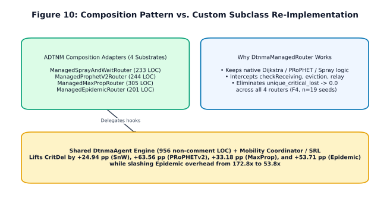

# Chapter 4c: Mechanisms 12–16 — Router Adapters, Remote Overlay & Neighbor Coordination

> **Series:** Part 3 of 4 (`04a`–`04d`). Covers the Substrate Adaptation Plane, remote Manager overlay (`M1-Remote`, `M2-SRL`, `M2-Mob`), and `16 B` peer contact coordination.

> [!TIP] INTUITION
> Instead of rewriting every routing protocol into a brand-new class, `DtnmaManagedRouter` slips a uniform remote-control receiver and governor (`DtnmaAgent`) onto stock routers (`SnW`, `PRoPHETv2`, `MaxProp`, `Epidemic`) like a standardized electronic speed limiter on different engine designs.

---

## Mechanism 12: `DtnmaManagedRouter` Thin-Adapter Composition Contract

### 1. Purpose & Problem Solved
Establishes a single router-agnostic Java interface decoupling forwarding substrates from `DtnmaAgent`, avoiding duplication of management logic across every routing protocol.

### 2. Design & Data Flow
`Router Adapter (extends StockRouter implements DtnmaManagedRouter)` owns one `private final DtnmaAgent agent`, exposes buffer/connection/energy getters + `4` actuator setters (`setDynamicSprayQuota`, `setIngressMode`, `setRoutineTelemetryInterval`, `setBackpressureEnabled`), and delegates forwarding/eviction/admission hooks cleanly to `agent`.

### 3. Code Anchors
- `src/routing/DtnmaManagedRouter.java:1-46`
- `src/routing/ManagedEpidemicRouter.java`, `ManagedSprayAndWaitRouter.java`, `ManagedProphetV2Router.java`, `ManagedMaxPropRouter.java`

### 4. Outputs, Telemetry & Logs
`DtnmaAgent` attaches identically to all four adapters, enabling unified `DtnmaAuditReport` and `DtnmaMetricsReport` emission across heterogeneous substrates (`mob_cross_substrate.txt`).

---

## Mechanism 13: Substrate-Specific Relay Adaptations (`SnW`, `PRoPHETv2`, `MaxProp`, `Epidemic`)

- **`ManagedSprayAndWaitRouter`:** Clamps binary token splitting (`MSG_COUNT_PROPERTY`) dynamically under Tier 3 when active profile quota `L_i < defaultQuota`.
- **`ManagedProphetV2Router`:** Keeps native RFC 6693 aging/transitivity untouched; filters `BULK_` relays via `allowNonDirectBulkForward` and schedules `CRIT_/CTRL_` tuples first.
- **`ManagedMaxPropRouter`:** Keeps Dijkstra encounter probabilities and cost tables untouched; guards congestion & ACKed duplicate eviction cleanly.
- **`ManagedEpidemicRouter`:** Retains unrestricted flooding under nominal `P4`, throttling bulk flooding under `S1–S4` and ingress guards.

---

## Mechanism 14: Remote Manager Overlay (`CTRL_UPDATE_`) & Rule Upsert

### 1. Purpose & Data Flow
Allows a central DTN Manager to issue time-bounded configuration waves (e.g., `CTRL_UPDATE_V1_*`, `CTRL_UPDATE_THROTTLE_*`, `CTRL_UPDATE_NOMINAL_*`) over opportunistic DTN links without rebooting agents. Upon destination reception at `applyDownlinkControlBundle()`, nodes with `supportsDynamicControlReconfig() == true` record adoption latency (`downlink_t90_sec`), adjust profile (`M1-Remote`) or install a priority-110 overlay rule (`M2`), and update shield bounds.

### 2. Code Anchors
- `src/routing/DtnmaAgent.java` (`applyDownlinkControlBundle`, `upsertDownlinkOverlayRule`)
- `src/report/DtnmaMetricsReport.java` (`# WAVE_ADOPTION_CDF` computation)

---

## Mechanism 15: Unicast Remote (`M1-Remote`) vs. Local Autonomic Control (`M2-SRL`, `M2-Mob`)

- **`M1-Remote` (`DtnmaM1RemoteRouter`):** `M1_REMOTE_ONLY` — disables local autonomous SRL/mobility loops and relies strictly on Manager `CTRL_UPDATE_*` waves (`T50`/`T90` propagation lag).
- **`M2-SRL` (`DtnmaM2SrlRouter`):** `M2_AUTONOMIC_SRL` — runs local `SRL` rules (`rules_vdtn.txt`) at `1.0 s` cadence plus optional `CTRL_UPDATE_*` overlays.
- **`M2-Mob` (`DtnmaM2MobRouter`):** `M2_MOBILITY_AWARE` — runs the closed-form mobility-aware coordinator (`Ch. 04d`) plus optional `CTRL_UPDATE_*` overlays.

---

## Mechanism 16: Compact `16 B` Contact Beacon & Density-Adaptive Refresh

### 1. Purpose & Data Flow
Supplies neighbors with quantized `16 B` telemetry (`DtnmaContactBeacon`: `hostAddress`, `timestamp`, `queueRatio`, `queueDrift`, `energySoc`, `nodeSpeed`, `mobilityClass`, `activeDegree`) upon wireless contact without heavy state dumps. When `DtnmaConfig.densityAdaptiveBeacons = true`, `getEffectiveBeaconRefreshInterval()` scales the refresh interval linearly above degree 5 (`beaconRefreshInterval * max(1.0, density / 5.0)`).

### 2. Code Anchors
- `src/routing/DtnmaContactBeacon.java` (`BEACON_SIZE_BYTES = 16`, `ACK_ID_BYTES = 4`)
- `src/routing/DtnmaAgent.java` (`getEffectiveBeaconRefreshInterval`, `onChangedConnection`, `allowNonDirectBulkForward`)
- `DtnmaMetricsReport` (`beacon_overhead_bytes`, `ack_overhead_bytes`, `control_bytes_total`, `control_to_payload_ratio`)

## Adapter Composition Diagram (`Figure 10`)

