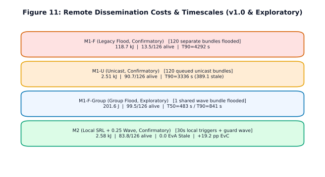

# Chapter 4d: Mechanisms 17–22 — Mobility Coordination, Active Modes & Reporters

> **Series:** Part 4 of 4 (`04a`–`04d`). Covers the closed-form mobility-aware coordinator (`M2_MOBILITY_AWARE`), active benchmark presets (`M0b`, `M0e-25`, `M1-Remote`, `M2-SRL`, ablations), the `CongestionAwareSnWRouter` baseline, and the four-stream reporting & event-cohort pipeline (`DtnmaMetricsReport`, `DtnmaRecoveryTimelineReport`, `DtnmaAuditReport`, `DtnmaDecisionReport`, plus ONE's `MessageStatsReport`).

---

## Mechanism 17: Mobility-Aware Distributed Resource Coordination (`M2_MOBILITY_AWARE`)

### 1. Purpose & Problem Solved
Static congestion/energy rules cannot adapt jointly across sparse vehicular, commuter, and disaster-relief mobility regimes: short contact durations waste burst spray tokens on partial transfers, long inter-contact times (`ICT`) demand earlier queue surge warnings, and unsustainable discharge relative to remaining mission time threatens premature battery blackout.

### 2. Coordination Law (`DtnmaAgent.evaluateMobilityAwareController`)
Every `1.0 s` evaluation tick, each node computes:
- `ttdRatio = eddSampler.getEnergyTtdRatio(config.mobHorizonSec)` (estimated time-to-depletion normalized by evaluation horizon)
- `durMean = eddSampler.getContactDurationMeanSec()`, `ictEff = eddSampler.getEffectiveInterContactTimeSec()`, `encRate = eddSampler.getEncounterRatePerMin()`
- ICT-scaled surge threshold:
  $$\theta_Q = \text{useBuf} \ ? \ \text{clamp}\!\left(0.88 - 0.10 \cdot \min\!\left(1.0,\ \frac{\text{ictEff}}{\max(30.0,\ \text{mobLongIctSec})}\right),\ 0.78,\ 0.88\right) : 0.88$$

Priority cascade before Safety Shield filtering (`DtnmaAgent.java:588-615`):
1. Critical pressure (`critQ >= 0.50`), depleted battery (`soc < shieldEnergyMin`), or energy-horizon critical (`useEnergy && soc < 0.45 && ttdRatio < mobTtdCritRatio`) -> Profile `P0` (`SAFE_EMERGENCY_HOLD`: `L=1`, `ing=2`).
2. Energy-horizon warning throttle (`useEnergy && soc < 0.55 && ttdRatio < ttdThrottle`) or ICT-adjusted queue surge (`useBuf && q >= theta_Q && dq >= 0.008`) -> Profile `P1` (`SAFE_THROTTLE_STRICT`: `L=2`, `ing=1`).
3. Energy-horizon cap (`useEnergy && soc < 0.70 && ttdRatio < mobTtdWarnRatio`), short-contact cap (`useRep && durMean < mobShortContactSec && q >= 0.55`), or dense cluster congestion (`q >= 0.75 && dens >= 5.0`) -> Profile `P2` (`BALANCED_CONSERVATIVE`: `L=4`, `ing=0`).
4. Sparse long-contact boost (`useRep && durMean >= 25.0 && encRate < 1.5 && q < 0.60 && (!useEnergy || ttdRatio >= 1.25)`) -> Profile `P5` (`EXPLORE_AGILE_SPRAY`: `L=8`, `ing=0`).
5. Nominal balanced -> Profile `P3` (`BALANCED_AGILE_FOCUS`: `L=6`, `ing=0`, `bpEnabled=true`).

Every proposal passes through `safetyShield.enforce(proposed, 0, eddSampler, ruleDatabase)` before actuating knobs and recording exact `ARI://DTNMA/MOB/*` or `ARI://DTNMA/SHIELD/*` provenance.

### 3. Single-Module Ablations
`DtnmaConfig.mobAblationMode` isolates each component strictly via dedicated preset routers:
- `DtnmaM2MobRouter` (`JOINT`): enables energy-horizon, ICT buffer, and contact-duration replication terms simultaneously.
- `DtnmaM2MobEnergyOnlyRouter` (`ENERGY_ONLY`): isolates energy time-to-depletion (`ttdRatio`) gating.
- `DtnmaM2MobBufferOnlyRouter` (`BUFFER_ONLY`): isolates ICT-scaled buffer surge thresholds ($\theta_Q$).
- `DtnmaM2MobReplicaOnlyRouter` (`REPLICA_ONLY`): isolates contact-duration replica caps and sparse-contact boosts.

---

## Mechanism 18: Active Management Presets & `CongestionAwareSnWRouter` Baseline

- **`M0b` (`DtnmaM0bStaticRouter`):** `M0_STATIC` — Tier 1 priority protection + `4 B` ACK pruning with static `L=6`, zero energy/congestion shield actuation, and `supportsDynamicControlReconfig() == false`.
- **`M0e-25` (`DtnmaM0eEnergy25Router`):** Static energy cutoff (`SoC < 0.25 -> P0`) with `supportsDynamicControlReconfig() == false` (isolates static energy threshold effect without mobility or congestion coordination).
- **`M1-Remote` (`DtnmaM1RemoteRouter`):** `M1_REMOTE_ONLY` — Adopts in-band `CTRL_UPDATE_*` manager bundles (`L=2` throttle / nominal recovery) with zero local autonomous loop.
- **`M2-SRL` (`DtnmaM2SrlRouter`):** `M2_AUTONOMIC_SRL` — Declarative `StateBasedRule` reflex engine (`rules_vdtn.txt`) + optional `CTRL_UPDATE_*` overlays.
- **`M2-Mob` (`DtnmaM2MobRouter`):** `M2_MOBILITY_AWARE` — Closed-form mobility coordinator + `S1–S4` Shield + optional overlays.
- **`CongestionAwareSnWRouter` (`CA-SnW` Baseline):** Independent non-DTNMA baseline (`src/routing/CongestionAwareSnWRouter.java`) combining binary Spray-and-Wait with queue-gradient throttling and local energy guard, without DTNMA critical class separation or ACK pruning — preserving high survival/bulk volume at the expense of high critical fault losses.

---

## Mechanism 19: Three-Tier Reporting & Event-Cohort Pipeline (`DtnmaMetricsReport`)

`src/report/DtnmaMetricsReport.java` (`1,036` non-comment LOC) implements `MessageListener` + `UpdateListener` and writes `key: value` summaries at simulation end:
- **Header:** `DTNMA metrics for scenario <name>`
- **Tier 1 Critical Protection & AoI:** `unique_critical_lost`, `critical_delivery_prob`, `critical_buffer_dropped`, `critical_buffer_dropped_acked`, `critical_ttl_expired`, `critical_creation_rejected`, `critical_latency_avg`, `critical_latency_p95`, `aoi_mean_sec`, `aoi_p95_sec`, `aoi_peak_sec`, `max_buffer_occupancy`.
- **Tier 2 Bulk & Downlink Waves:** `bulk_delivery_prob`, `bulk_latency_avg`, `downlink_created`, `downlink_delivered`, `downlink_delivery_prob`, `downlink_t90_sec`, `downlink_consistency_ratio`, `control_version_adopted_frac`, `# WAVE_ADOPTION_CDF` (1-min bins `0..60`).
- **Tier 3 Shield, Mobility & Survival:** `shield_decisions_total`, `shield_interventions_total`, `shield_intervention_rate`, `alive_nodes_2h`, `alive_nodes_4h`, `alive_nodes_end`, `depleted_nodes_count`, `avg_energy_remaining_soc`, `total_energy_J`, `total_ctrl_tx_J`, `ctrl_energy_share`, `avg_contact_duration_s`, `avg_ict_s`, `avg_encounter_rate_per_min`.
- **Tier 4 Compute & Control Overhead:** `beacon_overhead_bytes`, `ack_exchanges`, `ack_overhead_bytes`, `control_bytes_total` (`= beacon + ack`), `control_to_payload_ratio`, `decision_cpu_us_mean`, `agent_state_bytes_per_node`, `profile_0_frac`..`profile_7_frac`.
- **Fixed-Horizon Disruption Cohorts (`eventA_*`, `eventB_*`, `eventC_*`):** Isolate messages created during each surge (`Event A: 3600–3900 s`, `Event B: 7200–9000 s`, `Event C: 21600–28800 s`) evaluated over `3,600 s` horizon without right-censoring, tracking delivery, median/p95 latency, eviction/TTL/rejection loss breakdown, `peak_occ`, `nodesec_q90`, `energy_J`, `ctrl_tx_J`, `depleted_new`, `throttle_coverage`, `stale_throttle_nodesec`, `react_med_s`, and `react_censored_frac`.

> [!WARNING] ACCOUNTING CAVEATS FOR ANALYSTS
> 1. `critical_delivery_prob` pools uplink `CRITICAL_FAULT_` dispatches (`379` in Env 1) and Manager downlink `CTRL_UPDATE_*` waves (`720` in Env 1 = `1,099` total; `0` downlink in `mob_cross_substrate` = `379` total). Inspect `downlink_delivery_prob` separately to decouple control-wave delivery.
> 2. `critical_latency_{avg,p95}`, `bulk_latency_avg`, and `eventC_bulk_lat_{med,p95}_s` are computed strictly over **delivered** bundles (survivor-biased when delivery probability `< 1.0`).
> 3. `total_energy_J` and `alive_nodes_end` include all `126` hosts (120 field nodes + 6 high-capacity `500 kJ` zero-drain manager nodes).
> 4. Non-DTNMA baselines (`SprayAndWaitRouter`, `CongestionAwareSnWRouter`) log `0.0` for DTNMA agent mobility fields (`avg_ict_s`, `avg_contact_duration_s`) and `0` audit rows.

---

## Mechanism 20: Health & Recovery Timeline (`DtnmaRecoveryTimelineReport`)

`src/report/DtnmaRecoveryTimelineReport.java` samples all `n_hosts` every `300 s`, emitting unsmoothed `AliveNodes`, `MeanSoC`, `ShieldSafeFrac`, `RollingDeliv`, `RollingCritDeliv`, `MeanAoI`, and `V1Frac` trajectories uniformly across both DTNMA routers and stock baselines (`CongestionAwareSnWRouter`, `SprayAndWaitRouter`).

---

## Mechanism 21: `21`-Column Deterministic `ARI` Audit Schema (`DtnmaAuditReport`)

`src/report/DtnmaAuditReport.java` logs every node decision every `30.0 s` (or `1.0 s` in smoke scenarios), ending with `# AUDIT_SUMMARY total_audited_decisions` and `# AUDIT_SUMMARY traceable_ari_ratio: 1.0000`. Columns record:
`SimTime`, `DecisionTime`, `NodeID`, `Mode`, `Q`, `CritQ`, `dQ`, `Density`, `Speed`, `SoC`, `ActiveConn`, `CtrlVer`, `ShieldEnergyMin`, `ShieldWarnCritQ`, `ProposedAct`, `FallbackAct`, `ExecutedAct`, `ShieldStatus`, `SafeMask`, `ActiveRuleARI`, and `CausalExplanation`.

---

## Mechanism 22: Summary Decision Logger (`DtnmaDecisionReport`) & Companion `MessageStatsReport`

- **`src/report/DtnmaDecisionReport.java`:** Emits a compact high-level mission summary (`Delivered`, `Dropped`, `Critical Fault Messages Created/Delivered/Dropped`, and per-router shield intervention totals). Remember that its `Critical Fault Messages Dropped` count includes harmless `ACK`-pruned duplicate evictions; always consult `DtnmaMetricsReport.unique_critical_lost` (`0` vs un-ACKed drops) for live loss verification.
- **Stock `MessageStatsReport` (The ONE):** Paired alongside DTNMA reporters in every run to provide `created`, `started`, `relayed`, `delivered`, `delivery_prob`, `overhead_ratio` `(relayed - delivered) / delivered`, `latency_{avg,med}`, and `buffertime_{avg,med}` across all pooled bundle classes.

## Controller Paradigm Comparison (`Figure 11`)

