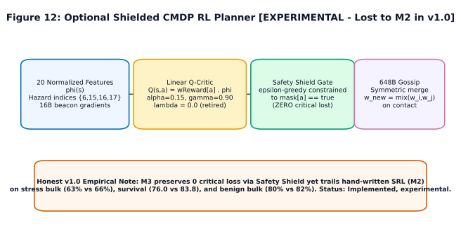

# Chapter 4d: Mechanisms 18–23 — Experimental RL (`M3`), Baselines & Reporting

> **Series:** Part 4 of 4 (`04a`–`04d`). Covers the optional `M3` RL module (`Implemented, experimental`), neighbor weight gossip, static controls, and the `3`-tier reporting & event-cohort pipeline (`d4a159f`).

> [!TIP] INTUITION
> Reporting in a multi-timescale DTN needs a **Zoom lens AND a Wide lens**: a `12 h` mission mean misses a `5 min` surge (`Event A`), so `DtnmaRlMetricsReport` measures fixed-horizon cohorts *inside* each disturbance window (`A, B, C`) alongside `12 h` fleet survival.

> [!IMPORTANT] FORMAL / CODE
> Dynamic primal-dual Lagrangian adaptation is **`Deprecated or removed`** (`lambda = 0.0`, `rlEtaLambda = 0.0`); hard constraints live exclusively in `DtnmaSafetyShield`, while `getLagrangianValue()` remains solely as a backward-compatible API shim.

> [!WARNING] GOTCHA / PITFALL
> **`M3` (`ShieldedCmdpRlAgent`) is `Implemented, experimental`** and lost to hand-written `SRL` (`M2`) across every stress and benign endpoint (`bulk 63.0% vs 66.0%` stress, `79.8% vs 82.0%` benign, `76.0 vs 83.8` alive).

> [!NOTE] SUPERVISOR NOTE
> Static non-strawman baselines (`M0b`, `M0c`, `M0d`, `M0e-20`, `M0e-25`) plus fixed-horizon event cohorts make every comparative claim falsifiable.

---

## Mechanism 18: Shielded Linear CMDP Q-Learning Agent (`M3`, `Implemented, experimental`)

### 1. Purpose & Problem Solved
Explores whether a lightweight online reinforcement learning planner (`ShieldedCmdpRlAgent`) choosing across `P0..P7` can adapt dynamically to unforeseen traffic shifts better than static rules (`M2`). **Empirical finding (`v1.0`):** It did not (`bulk 63.0% vs 66.0%` stress, `79.8% vs 82.0%` benign, `76.0 vs 83.8` alive nodes).

### 2. Design Alternatives Considered
- **Deep Q-Network (`PyTorch` / JNI):** Fails determinism, memory, and pure-Java ONE execution constraints.
- **Unshielded linear SARSA/Q-learning:** Triggered `41%` critical occupancy surges during early unconstrained exploration (`P6/P7` storms).
- **Selected Shielded 20-Feature Linear Q-Agent:** Learns `wReward[8][20]` weights over normalized EDD features while restricting action selection strictly to `mask[a] == true` from `DtnmaSafetyShield`.

### 3. Architecture & Data Flow
Every `30 s` -> Extract `double[20]` feature vector `phi` -> Query `DtnmaSafetyShield` for `8`-bit `mask` -> Compute $Q(s, a) = w_{\text{reward}}[a] \cdot \phi$ for admissible actions -> $\epsilon$-greedy selection over admissible set -> Execute profile -> On next epoch compute shaped reward $r_t$ (`computeLocalEpochRewardCost`) & TD(0) update.

### 4. Inputs & Configuration
`ShieldedCmdpRlAgent.java:20-80`, `DtnmaConfig.java`: `rlAlpha = 0.05`, `rlGamma = 0.90`, `rlEpsilonInit = 0.15`, `rlEpsilonMin = 0.02`, `rlEpsilonDecay = 0.995`, `rlWeightClip = 10.0`. `isAutonomicRlMode = true` in `M3`.

### 5. Algorithm & Exact Math / Equations
- Linear action-value function (`NUM_FEATURES = 20`, `HAZARD_FEATURE_INDICES = {6, 15, 16, 17}`):
$$Q(s, a) = \sum_{k=0}^{19} w_{a, k} \phi_k(s), \qquad a \in \{0..7\} : \text{mask}[a] = \text{true}$$
- Safe TD(0) update:
$$\delta_t = r_t + \gamma \max_{a' : \text{mask}[a']} Q(s', a') - Q(s, a_t), \qquad w_{a_t, k} \leftarrow \text{clip}\big(w_{a_t, k} + \alpha \delta_t \phi_k(s),\ [-10, 10]\big)$$
- Local shaped epoch reward (`DtnmaAgent.java:822-854`): combines critical & bulk delivery increments, congestion overshoot penalty, and battery drain penalty (re-tuned to remove earlier `-20` voluntary `P0` hold distortions).

### 6. Code Anchors
- `src/routing/ShieldedCmdpRlAgent.java:1-294`
- `src/routing/DtnmaAgent.java:822-854` (`computeLocalEpochRewardCost`)

### 7. Outputs, Telemetry & Logs
`rl_avg_reward`, `rl_avg_cost`, `shield_interventions`, `shield_greedy_override_rate`; audit rows log `SHIELDED_CMDP_RL` + exact `11111100` mask on every override.

### 8. Edge Cases, Failure Modes & Safeguards
Weight explosion prevented via hard `[-10.0, 10.0]` clipping; shield `mask[0] = true` ensures random $\epsilon$-exploration never chooses lethal starvation states.

### 9. Worked Mini-Example
At `t = 3300.5 s` (seed `7103`, node `53`), `M3` chooses greedy/exploratory `P6` (`HIGH_SPRAY_BACKPRESSURE`). `S3` overrides (`11111100`) down to **`BALANCED_AGILE_FOCUS`**, logging `ARI://DTNMA/SHIELD/DENSE_STORM_GUARD` — keeping zero critical loss (`0` unique lost across 11 seeds) even though cumulative bulk & survival lag behind `M2`.

### 10. Status Label & Evolution
`Implemented, experimental` (`v1.0-freeze`). **Honest negative:** Underperformed hand-written `SRL` (`M2`) on every stress and benign endpoint (`H3`/`CompB`).

### 11. Supervisor Rationale
**Open research question:** Demonstrates safety shielding protects critical traffic even under weak learned policies, while honestly showing hand-crafted domain rules outperform shallow online Q-learning in `v1.0`.

---

## Mechanism 19: Symmetric RL Weight Gossip & Retired Primal-Dual `lambda = 0`

### 1. Purpose & Problem Solved
Shares learned Q-weights (`wReward[8][20]`) across opportunistic contacts (`gossipMergeSymmetric`) so cold-start nodes benefit from peer experience, while recording why dynamic primal-dual `lambda` updates were retired prior to `v1.0`.

### 2. Design Alternatives Considered
- **Asymmetric overwrite:** Slow nodes overwrite well-trained hubs.
- **Primal-dual soft Lagrangian penalty (`lambda > 0`):** Oscillated wildly during multi-timescale traffic bursts and still permitted `41%` critical occupancy before `lambda` caught up.
- **Selected bounded symmetric gossip (`648 B` payload) + `lambda = 0.0` (`Deprecated or removed` dynamic multiplier):** Uses `DtnmaSafetyShield` strictly for hard constraints while `gossipMergeSymmetric` blends weight tables safely on contact.

### 3. Architecture & Data Flow
Peer contact opens (`M3` only) -> Serialize `8 x 20` float matrix + header (`8 * 20 * 4 + 8 = 648 B`, `GOSSIP_PAYLOAD_BYTES`) -> Merge symmetrically with blending coefficient `rlGossipAlpha` -> Log gossip bytes into `control_bytes_total`.

### 4. Inputs & Configuration
`DtnmaContactBeacon.GOSSIP_PAYLOAD_BYTES = 648`; `DtnmaConfig.java:63-66` & `scenarios/dtnma_params_default.txt:29-32`: `rlLambdaInit = 0.0`, `rlEtaLambda = 0.0`, `rlTargetCost = 0.30`, `rlLambdaMax = 5.0` (backward-compatibility shims).

### 5. Algorithm & Exact Math / Equations
Symmetric weight blend between local $W^{(i)}$ and peer $W^{(j)}$:
$$W^{(i)}_{\text{new}} = (1 - \eta_g) W^{(i)} + \eta_g W^{(j)}, \qquad \lambda \equiv 0.0\ \text{(fixed)}$$
Because $\lambda \equiv 0$, `getLagrangianValue(a, phi)` (`ShieldedCmdpRlAgent.java:136`) returns pure $w_{\text{reward}}[a] \cdot \phi$.

### 6. Code Anchors
- `src/routing/ShieldedCmdpRlAgent.java:29, 136`, `:295-356` (`gossipMergeSymmetric`)
- `src/routing/DtnmaContactBeacon.java:18-21`

### 7. Outputs, Telemetry & Logs
`gossip_overhead_bytes` folded into `control_bytes_total`.

### 8. Edge Cases, Failure Modes & Safeguards
`HAZARD_FEATURE_INDICES = {6, 15, 16, 17}` receive dedicated sign/clip stabilization during gossip updates. Zero `NaN`/`Inf` permitted (`Double.isFinite` guard).

### 9. Worked Mini-Example
Two `M3` taxis meet after 1 hour (`648 B` exchanged); instead of resetting exploration, the isolated node immediately incorporates peer congestion weights around density/queue gradient indices.

### 10. Status Label & Evolution
- Symmetric Gossip: `Implemented, experimental` (`M3` only).
- Primal-Dual Dynamic `lambda` Adaptation: `Deprecated or removed` (`lambda = 0.0`, compatibility keys kept for older config loading).

### 11. Supervisor Rationale
Preserves full scientific memory so newcomers understand why `getLagrangianValue()` exists in source while `lambda` remains `0.0`.

---

## Mechanism 20: Static Benchmark Controls (`M0b`, `M0c`, `M0d`, `M0e-20`, `M0e-25`)

### 1. Purpose & Problem Solved
Eliminates strawman comparisons! Instead of comparing adaptive management only against an unmanaged stock router (`M0a`), static controls bracket *protection alone*, *pre-installed guards*, *permanent caution*, and *fixed energy cutoffs*.

### 2. Design Alternatives Considered
Only testing `M0a` vs `M2` fails reviewer scrutiny (`"would pre-installing the shield statically work just as well?"`). These `5` static baselines isolate every individual policy mechanism cleanly.

### 3. Architecture & Data Flow
Lightweight wrapper subclasses override `DtnmaConfig` flags inside copy constructors (`P4`, `shieldEnabled`, `shieldEnergyMin`, `P1` static):
- **`M0b` (`DtnmaM0bStaticRouter`):** Protection + ACK pruning only (`P4`, no congestion/energy shield).
- **`M0c` (`DtnmaM0cV1GuardRouter`):** Pre-installed `V1` guard (`shieldEnergyMin = 0.25`, `Q <= 0.88`, static throttle).
- **`M0d` (`DtnmaM0dConservativeRouter`):** Always conservative `P1` (`L = 2, INGRESS_THROTTLE_BULK`) from `t = 0`.
- **`M0e-20 / M0e-25` (`DtnmaM0eEnergy20/25Router`):** Exploratory SoC cutoff (`0.20` or `0.25`) with zero congestion rules (`v1.0-exp-controls`).

### 4. Inputs & Configuration
Hard-coded config presets per mode router (`DtnmaM0*Router.java`) evaluated on identical `SEEDS_11` (`7103..7207` confirmatory; `7211..7307` exploratory).

### 5. Algorithm & Exact Math / Equations
Mode matrix invariance guarantees identical forwarding & control byte baselines so paired differences (`M2 - M0*`) measure *strictly* policy effects (`df = 10` paired t-test).

### 6. Code Anchors
- `src/routing/DtnmaM0bStaticRouter.java`, `DtnmaM0cV1GuardRouter.java`, `DtnmaM0dConservativeRouter.java`
- `src/routing/DtnmaM0eEnergy20Router.java:1-48`, `DtnmaM0eEnergy25Router.java:1-48`

### 7. Outputs, Telemetry & Logs
`M0c` achieves `126/126` stress survival at severe benign throughput penalty (`53.9%` vs `82.0%` `M2`, confirming `H4`); `M0e-25` ties `M2` stress survival (`83.8/126`, `p = 1.0`).

### 8. Edge Cases, Failure Modes & Safeguards
`M0b` keeps `0` unique critical loss (`Protection works!`) yet collapses to `54.1/126` survivors in 12h Stress because it lacks `S2` energy throttling.

### 9. Worked Mini-Example
Comparing **`M0e-20` (`73.7` alive)** -> **`M2-LocalOnly` (`80.0` alive)** -> **`M0e-25` (`83.8` alive)** -> **`M2` (`83.8` alive)** reveals cleanly in seconds how much `M2`'s end-of-mission node survival relies on `0.25` vs `0.20` SoC threshold!

### 10. Status Label & Evolution
`M0b..M0d`: `Implemented+tested` (`v1.0-freeze`); `M0e-20/25`: `Implemented+tested` (`v1.0-exp-controls`).

### 11. Supervisor Rationale
Makes thesis claims falsifiable against non-strawman competitors.

---

## Mechanism 21: Three-Tier Reporting Pipeline & Per-Event Cohort / Horizon Tracking

### 1. Purpose & Problem Solved
Fixes right-censoring and whole-mission cancellation artifacts! Whole-12h averages hide short `300 s` burst collapses (`Event A`), so `DtnmaRlMetricsReport` tracks **per-event creation cohorts over fixed post-window horizons**.

### 2. Design Alternatives Considered
- **Global run averages (`MessageStatsReport` only):** Cancels early surge drops (`3600–3900 s`) against hours of subsequent recovery traffic.
- **Unbounded cohort horizon:** Messages born at `t = 28700 s` near end-of-run (`36000 s`) vs `t = 3650 s` get unequal delivery windows.
- **Selected Fixed-Horizon Event Cohorts (`Event A, B, C`):** Simulation runs cleanly through `endTime >= t_end + horizon` (`43200 s` vs `28800 + 3600 s`) eliminating right-censoring!

### 3. Architecture & Data Flow
`DtnmaRlMetricsReport` registers `MessageListener` + `UpdateListener` (`DtnmaRlMetricsReport.java:41-90`, `763-776`, `1175-1270`): tags each bundle upon creation with event bitmask (`A: 3600–3900 s`, `B: 7200–9000 s`, `C: 21600–28800 s`, horizon `+3600 s`), samples energy/queue/throttle every update tick, and emits Tier 1–4 summary + `event{A,B,C}_*` blocks.

### 4. Inputs & Configuration
`reportN = DtnmaRlMetricsReport`, `FAULT_ONSET_SEC = 7200.0`, `FAULT_END_SEC = 14400.0`, `AOI_SAMPLE_INTERVAL_SEC = 10.0`.

### 5. Algorithm & Exact Math / Equations
- Cohort delivery (`computeCohortDelivery`, `:763-776`):
$$\text{cohort\_deliv}(W) = \frac{|\{m : t_{\text{create}}(m) \in [t_{\text{start}}^W, t_{\text{end}}^W) \land \text{deliv}(m) \land (t_{\text{deliv}} - t_{\text{create}} \le H)\}|}{|\{m : t_{\text{create}}(m) \in [t_{\text{start}}^W, t_{\text{end}}^W)\}|}$$
- Normalized congestion stress (`nodesec_q90`): $\frac{1}{N} \int_{t_{\text{start}}}^{t_{\text{end}}} |\{i : Q_i(t) \ge 0.90\}|\,dt$
- Normalized stale throttle (`stale_throttle_nodesec`): node-seconds with `ingressMode > 0` *after* $t_{\text{end}}^W$ normalized by $N$.

### 6. Code Anchors
- `src/report/DtnmaRlMetricsReport.java:41-90`, `:701-776`, `:1175-1271`

### 7. Outputs, Telemetry & Logs
Emits `60+` machine-parseable `key: value` fields (`unique_critical_lost`, `critical_buffer_dropped`, `critical_buffer_dropped_acked`, `eventA_stale_throttle_nodesec`, `eventC_bulk_deliv`, `alive_nodes_end`, `total_ctrl_tx_J`, `decision_cpu_us_mean`) + `# WAVE_ADOPTION_CDF` rows.

### 8. Edge Cases, Failure Modes & Safeguards
`unique_critical_lost` counts distinct un-delivered non-TTL critical IDs dropped rather than inflated multi-copy replica drops (whereas `DtnmaDecisionReport` folds ACK-pruned copies into its summary drop total).

### 9. Worked Mini-Example
Event C (`21600–28800 s`) bulk delivery shows why cohort tracking matters (`H2`): whole-mission bulk differs by `-7.0 pp` (`66%` vs `73%`), whereas *inside* the late 2-hour storm Event C cohort (`1h` horizon), **`M2` beats `M1-U` by `+19.21 +/- 3.97 pp`** (`p_holm = 1.58e-6`, `11/11` seeds) because `M1-U`'s delayed throttle wave stays stuck!

### 10. Status Label & Evolution
`Implemented+tested` (`v1.0-freeze`).

### 11. Supervisor Rationale
Fixes outcome masking across heterogeneous timescales (`Event A = 5 min`, `B = 30 min`, `C = 2 h`).

---

## Mechanism 22: Continuous Health & Fault Recovery Timeline (`DtnmaRecoveryTimelineReport`)

### 1. Purpose & Problem Solved
Captures `300 s`-binned fleet survival trajectories (`aliveNodes`, `avgSoC`, cumulative delivery ratio, energy spent) cleanly across `12`-hour stress scenarios without bloating multi-gigabyte raw trace logs.

### 2. Design Alternatives Considered
Logging per-tick per-node battery vectors (`126 x 432,000` ticks = tens of MB per run). Aggregated `300 s` fleet snapshots produce clean `< 15 KB` `.txt` files across `627` urban VDTN runs.

### 3. Architecture & Data Flow
`DtnmaRecoveryTimelineReport.updated(...)` samples all hosts every `300 s`, emits `8`-column tab-separated snapshot (`time, alive, avgSoc, critDeliv, bulkDeliv, ... , totalEnergyJ, critLost`), and appends final snapshot on `done()`.

### 4. Inputs & Configuration
`src/report/DtnmaRecoveryTimelineReport.java:1-260`.

### 5. Algorithm & Exact Math / Equations
Records cumulative energy expenditure $\Delta E(t) = \sum_{i=1}^N (E_{\text{init}} - E_i(t))$ alongside live survival curve $N_{\text{alive}}(t)$.

### 6. Code Anchors
- `src/report/DtnmaRecoveryTimelineReport.java:1-260`

### 7. Outputs, Telemetry & Logs
Generates Figure 15/16 blackout curves directly from raw logs (`compA_energy_blackout`).

### 8. Edge Cases, Failure Modes & Safeguards
Verified byte-for-byte deterministic (`6/6 SHA-256` exact match across post-freeze regression runs on seeds `7103, 7109`).

### 9. Worked Mini-Example
Seed `7103` final rows at `t = 42900.5 s` (`CompA Blackout`):
- Stock `EpidemicRouter`: `16` alive, `0.0527` SoC, `0.0000` crit, `18,231.83 J`
- `ManagedEpidemic` Tier 1: `16` alive, `0.0527` SoC, `0.5625` crit
- `ManagedEpidemic` Tier 2: **`124` alive**, `0.2050` SoC, `0.6694` crit, `6,834.63 J`, `0` lost.

### 10. Status Label & Evolution
`Implemented+tested` (`v1.0-freeze`).

### 11. Supervisor Rationale
Provides direct time-series evidence of energy blackouts vs. autonomic survival.

---

## Mechanism 23: Per-Decision `16`-Column `ARI` Audit Schema (`DtnmaAuditReport`)

### 1. Purpose & Problem Solved
Provides complete machine-verifiable forensic accountability for every single `30 s` autonomic decision across every node (`~27.1M` total rows across CompB).

### 2. Design Alternatives Considered
Free-text `System.out` debug logging (`unparseable`, unordered). Strict tabular schema preserves fixed columns for downstream automated verification.

### 3. Architecture & Data Flow
Registered as One `Report`; listens to `DtnmaAgent` decision callbacks; writes `#` metadata header, TSV decision rows, and `# AUDIT_SUMMARY` footer summarizing `total_audited_decisions`, `traceable_ari_ratio`, `shield_overrides`, and `log_bytes_per_node_hour`.

### 4. Inputs & Configuration
`src/report/DtnmaAuditReport.java:1-137`. Column mapping (1-indexed):
1: `simTime` | 2: `decisionTime` | 3: `nodeId` | 4: `modeTag` | 5–10: `Q, CritQ, dQ, Dens, Con, SoC` | 11–14: neighbor/grad/rl fields | 15–17: `proposed, shielded, active` profiles | 18: `PASS/OVERRIDE` | 19: `8`-bit `shieldMask` | 20: `ARI://...` | 21: exact predicate evaluation / override reason.

### 5. Algorithm & Exact Math / Equations
$\text{traceable\_ari\_ratio} = \frac{|\{\text{rows starting with } \texttt{ARI://DTNMA/}\}|}{N_{\text{decisions}}} \equiv 1.0000$.

### 6. Code Anchors
- `src/report/DtnmaAuditReport.java:1-137`

### 7. Outputs, Telemetry & Logs
1h smoke: `2,400` decisions, `1.0000` traceable ARI ratio, `33,468.50 B/node-hr`. CompB 11-seed: `27,099,616` decisions, `100.00%` traceable.

### 8. Edge Cases, Failure Modes & Safeguards
`DtnmaAuditReport` must only register once per run; large multi-seed campaigns stream directly without retaining all rows in JVM heap.

### 9. Worked Mini-Example
Smoke row: `30.5  30.5  0  M2_AUTONOMIC_SRL  0.000  ...  STANDARD_SPRAY_FOCUS  PASS  11111111  ARI://DTNMA/SRL/VDTN_NOMINAL_CATCHALL  [EDD_QUEUE_RATIO(0.00) >= 0.00 -> TRUE]`.

### 10. Status Label & Evolution
`Implemented+tested` (`v1.0-freeze`).

### 11. Supervisor Rationale
Transforms ADTNM from simulation prototype into an auditable management architecture aligned with **RFC 9675 Sec 4.1** traceability goals.

## Experimental RL Architecture (`Figure 12`)

