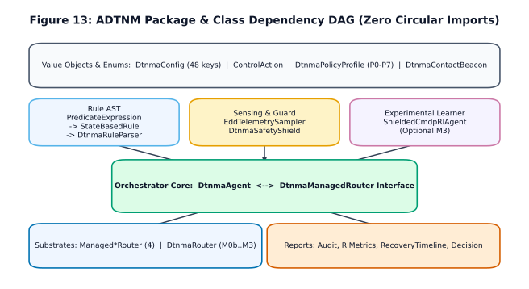

# Chapter 5: Codebase Tour & Developer Architecture Guide

> **Audience:** Developers extending ADTNM adapters, telemetry indicators, safety rules, or report analyzers, and reviewers auditing code organization and test coverage.  
> **Programmatic Inventory:** Regenerated cleanly in [`data/code_inventory.json`](../data/code_inventory.json) (`29` Java files = `5,660` non-comment LOC; `16` scenario/rule configs = `2,421` non-comment LOC; `1` test suite = `1,197` non-comment LOC; `9` tool files = `4,192` non-comment LOC).

---

## 1. Repository Layout & Exact Module Inventory

The ADTNM workspace sits beside its host simulator `the-one` (`..\the-one\`) and deploys into `target\` via [`install.py`](../../../install.py):

| Directory | Files | Non-Comment LOC | Primary Responsibility |
|---|---:|---:|---|
| **`src/routing/`** | `25` `.java` | `4,131` | Core autonomic engine (`10` files, `2,319` LOC), `DtnmaRouter` + `8` mode/ablation presets (`9` files, `661` LOC), `DtnmaManagedRouter` + `4` `Managed*Router` adapters (`5` files, `1,014` LOC), and `CongestionAwareSnWRouter` (`135` LOC) |
| **`src/report/`** | `4` `.java` | `1,529` | `DtnmaMetricsReport` (`1,036` LOC), `DtnmaRecoveryTimelineReport` (`229` LOC), `DtnmaDecisionReport` (`153` LOC), `DtnmaAuditReport` (`111` LOC) |
| **`scenarios/`** | `16` `.txt` | `2,421` | Smoke (`scenario_dtnma.txt`), defaults (`dtnma_params_default.txt`), local `SRL` rules (`rules_vdtn.txt`), `9` confirmatory `mob_*.txt` scenarios, and `4` isolated sensitivity `sens_*.txt` sweeps |
| **`tests/`** | `1` `.java` | `1,197` | [`DtnmaUnitTests.java`](../../../tests/DtnmaUnitTests.java): `17` test methods executing `21` assertions (`Results: 21 passed, 0 failed.`) |
| **`tools/`** | `9` files | `4,192` | `validate_mobility_scenarios.py`, `run_mobility_campaign.py`, `run_sensitivity_exploratory.py`, `parallel_batch_runner.py`, `analyze_mobility_campaign.py`, `build_publication_package.py`, `plot_mobility_figures.py`, `plot_publication_figures.py`, `README.md` |
| **Root & CI** | `.md`, `.yml`, `install.*` | `—` | [`README.md`](../../../README.md), [`LICENSE`](../../../LICENSE), [`CLAIMS_LEDGER.md`](../../../CLAIMS_LEDGER.md), [`SEED_ROLES.md`](../../../SEED_ROLES.md), [`CONTRIBUTING.md`](../../../CONTRIBUTING.md), [`install.py`](../../../install.py), [`.github/workflows/ci.yml`](../../../.github/workflows/ci.yml) |

### Complete Java Source File Breakdown

- **Core Autonomic Engine (`src/routing/`, `10` files):**
  - `DtnmaAgent.java` (`956` LOC): Orchestrates `M2_MOBILITY_AWARE`, `M2_AUTONOMIC_SRL`, `M1_REMOTE_ONLY`, `M0_STATIC`, ACK cache/pruning, `16 B` beacon exchange, backpressure gating, byte-budget check, and audit logging.
  - `EddTelemetrySampler.java` (`358` LOC): Maintains all `15` `EDD_*` metrics including EWMA queue drift, speed, energy drain/TTD, contact duration, effective ICT, encounter rate, and neighbor queue gradients.
  - `DtnmaConfig.java` (`275` LOC): Loads `26` typed configuration parameters (defaults -> `configFile` -> `DtnmaRouter.*` -> `Group.*` -> safety clamping).
  - `DtnmaSafetyShield.java` (`203` LOC): Computes `8`-bit `S1–S4` admissibility masks, rule sanitization, and down-clamping with `P0` liveness guarantee.
  - `DtnmaRuleParser.java` (`125` LOC), `PredicateExpression.java` (`121` LOC), `ControlAction.java` (`90` LOC), `StateBasedRule.java` (`61` LOC): Plain-text `RULE / IF / THEN` AST parser and evaluator.
  - `DtnmaPolicyProfile.java` (`71` LOC) & `DtnmaContactBeacon.java` (`59` LOC): `8` immutable control profiles (`P0..P7`) and `16 B` contact beacon container.
- **Standalone Routers & Mode Presets (`src/routing/`, `10` files):**
  - `DtnmaRouter.java` (`518` LOC): Spray-and-Wait-based router exposing `4`-tier forwarding buckets and `DtnmaAgent` integration.
  - `DtnmaM2MobRouter.java` (`17`), `DtnmaM2MobEnergyOnlyRouter.java` (`15`), `DtnmaM2MobBufferOnlyRouter.java` (`15`), `DtnmaM2MobReplicaOnlyRouter.java` (`15`), `DtnmaM2SrlRouter.java` (`17`), `DtnmaM1RemoteRouter.java` (`17`), `DtnmaM0eEnergy25Router.java` (`32`), `DtnmaM0bStaticRouter.java` (`17`).
  - `CongestionAwareSnWRouter.java` (`135` LOC): Non-DTNMA congestion- and energy-aware Spray-and-Wait baseline.
- **Substrate Adaptation Interfaces (`src/routing/`, `5` files):**
  - `DtnmaManagedRouter.java` (`31` LOC), `ManagedSprayAndWaitRouter.java` (`233` LOC), `ManagedProphetV2Router.java` (`244` LOC), `ManagedMaxPropRouter.java` (`305` LOC), `ManagedEpidemicRouter.java` (`201` LOC; mean adapter = `245.8` non-comment LOC).

---

## 2. Boot-to-Decision Execution Lifecycle Inside The ONE

Every simulation instantiates one prototype router per host group via `Settings` reflection, cloning per-node state via `replicate()`:

```
DTNSim.main -> SimScenario parses dtnma_params_default.txt + scenario.txt
  -> Host group calls router.replicate() -> constructs DtnmaRouter or Managed*Router(prototype)
     -> loads DtnmaConfig (26 keys) & compiles rulesFile via DtnmaRuleParser
  -> Loop every dt_tick (0.1 s or 0.5 s) until endTime:
     1. World moves nodes -> NetworkInterface opens/closes Connection -> changedConnection(con)
        -> DtnmaAgent.onChangedConnection(con)
           -> updates contact duration, ICT, & encounter rate EDDs
           -> exchanges 16 B DtnmaContactBeacon (densityAdaptiveBeacons refresh scaling)
           -> exchanges <= 32 ACK IDs (4 B each) -> promotes delivered CRIT_ replicas
     2. Router.update() calls DtnmaAgent.onBeforeUpdate(now):
        -> If now - lastEval >= autonomyEvalInterval (1.0 s):
           a. EddTelemetrySampler samples 15 EDDs (queue, energy/TTD, density, speed, ICT, duration)
           b. M2_MOBILITY_AWARE evaluates closed-form cascade [or M2_AUTONOMIC_SRL scans StateBasedRules]
           c. DtnmaSafetyShield enforces S1..S4 + Liveness mask[0]=true -> ACTIVE profile (P0..P7)
           d. Applies L_i, bpRatio, ingressMode, backpressureEnabled to router hooks
           e. Logs 21-col ARI decision row to DtnmaAuditReport listeners
        -> substrate update() executes forwarding filtered by:
           - critical-first scheduling (CRIT_ -> CTRL_ -> BULK_)
           - allowNonDirectBulkForward(m, peer) backpressure guard
           - dynamic Tier 3 copy quota clamping (SprayAndWait / ManagedSprayAndWaitRouter)
     3. Incoming transfer checks: DtnmaAgent.evaluateCheckReceiving -> ByteBudget + Ingress
     4. Buffer full eviction: DtnmaAgent.selectNextMessageToRemove -> ACK-first critical-safe scan
  -> End of run: Reports flush MessageStatsReport, DtnmaMetricsReport, DtnmaAuditReport, Timeline
```

---

## 3. Core Dependency DAG & Zero Circular Imports

- **Strict Acyclic Layering:**
  `DtnmaConfig` & `ControlAction` & `DtnmaPolicyProfile` & `DtnmaContactBeacon` -> `PredicateExpression` -> `StateBasedRule` -> `DtnmaRuleParser` -> `DtnmaSafetyShield` & `EddTelemetrySampler` -> `DtnmaAgent` <-> `DtnmaManagedRouter` -> `Managed*Router` / `DtnmaRouter` -> `src/report/*`.
- **Two Clean Router Hierarchies:**
  - `DtnmaRouter` (`src/routing/DtnmaRouter.java`): Direct Spray-and-Wait-based router subclassed by mode and ablation presets (`DtnmaM2Mob*Router`, `DtnmaM2SrlRouter`, `DtnmaM1RemoteRouter`, `DtnmaM0eEnergy25Router`, `DtnmaM0bStaticRouter`).
  - `Managed*Router`: Wraps stock ONE protocols (`SprayAndWaitRouter`, `ProphetV2Router`, `MaxPropRouter`, `EpidemicRouter`) via `DtnmaManagedRouter` delegation.



---

## 4. Validation Suite & Automated Quality Assurance

ADTNM enforces four complementary validation layers before and after running simulations:

1. **Java Unit Test Suite (`tests/DtnmaUnitTests.java` -> `21 passed, 0 failed.`):**
   - `test1SafetyShieldInvariantsAndLiveness`: Verifies `S1–S4` bitmask clamping and unconditional `P0` liveness.
   - `test5BeaconQuantizationAndWireSizes`: Asserts exact `BEACON_SIZE_BYTES == 16` and `ACK_ID_BYTES == 4`.
   - `test6BinaryTokenConservationAtRelay`: Verifies binary replica token conservation across relays and caps.
   - `test7AllCriticalFullBufferZeroOvershoot` & `test9ProtectedFifoEvictionAndCriticalOccupancy`: Verifies `maxOvershoot` byte reservation and critical buffer safety lock.
   - `test11..test12` & `test15..test21`: Verifies downlink `CTRL_UPDATE_*` wave adoption, `M0`/`M1`/`M2` paradigm separation, Tier `1–3` decomposition, `rules_vdtn.txt` catch-all release, nominal backpressure, and `ACK`-eviction separation.
   - `test13ComposedStockRoutersProtection` & `test26CrossSubstrateMobAndAblationPresets`: Verifies `Managed{SprayAndWait,ProphetV2,MaxProp,Epidemic}Router` critical protection and ablation presets.
   - `test23..test25` & `test27`: Verifies first-class mobility EDDs (`EDD_CONTACT_DURATION_MEAN`, `EDD_INTER_CONTACT_TIME`, `EDD_ENCOUNTER_RATE`, `EDD_ENERGY_TTD_RATIO`), closed-form `M2_MOBILITY_AWARE` & `ENERGY_ONLY`/`BUFFER_ONLY`/`REPLICA_ONLY` ablations, `DtnmaMetricsReport` overhead metrics (`shield_decisions_total`, `control_bytes_total`), and `CongestionAwareSnWRouter`.
2. **Pre-Run Scenario & Smoke Validator (`tools/validate_mobility_scenarios.py --smoke`):**
   - Verifies router/seed array coprimality, resolves every `mapFile`, `rulesFile`, and `configFile`, checks host group index bounds, and executes a headless `10 s` ONE smoke simulation on every `mob_*.txt` (`9/9 [PASS]`) and `sens_*.txt` (`4/4 ok=True`) scenario.
3. **1-Hour Smoke Benchmark & `ARI` Provenance (`scenarios/scenario_dtnma.txt`):**
   - Runs headless `DTNSim -b 1` end-to-end, confirming `DtnmaMetricsReport` emits `shield_decisions_total:` and `DtnmaAuditReport` emits `traceable_ari_ratio: 1.0000`.
4. **Continuous Integration & Campaign Integrity Checks:**
   - GitHub Actions (`.github/workflows/ci.yml`) deploys into a fresh clone of `the-one`, compiles all sources, runs `DtnmaUnitTests`, and asserts `scenario_dtnma.txt` `ARI` + `DtnmaMetricsReport` integrity on every push/PR to `main`.
   - Dataset validation on the full campaign verified `1,216/1,216` confirmatory runs (`4,864` files) + `176/176` exploratory runs (`704` files), `0` zero-size files, `0` duplicate `(stage, router, seed)` keys, and `2,432/2,432` SHA-256 manifest matches.

---

## 5. Safe Extension Recipes (`How Do I Extend ADTNM?`)

### Recipe A: Add a New `SRL` Policy Without Recompiling Java
1. Author `RULE: ARI://DTNMA/SRL/... | PRIORITY: <int> | DESC: ...`, `IF: ...`, and `THEN: CTRL_SET_*` blocks using valid `EDD_*` names (`appendix_c_reference_tables.md`).
2. Include a low-priority catch-all recovery rule (`PRIORITY: 10`, e.g., `IF: (EDD_QUEUE_RATIO >= 0.0)`) so nodes release throttling promptly when congestion subsides.
3. Set `DtnmaRouter.managementMode = M2_AUTONOMIC_SRL` and point `Group.rulesFile` / `DtnmaRouter.rulesFile` to your file, then verify `traceable_ari_ratio: 1.0000` in `DtnmaAuditReport.txt`.

### Recipe B: Wrap Another Stock ONE Router
1. Subclass `StockOneRouter implements DtnmaManagedRouter`.
2. Instantiate `private final DtnmaAgent agent` in both constructor and copy constructor (normalizing `initialEnergy`, defaulting to `1.0` when mains-powered).
3. Implement all getters and setters in `DtnmaManagedRouter.java:1-46`, delegating `update()`, `createNewMessage()`, `checkReceiving()`, `makeRoomForMessage()`, and `changedConnection()`, while sorting `CRIT_`/`CTRL_` tuples ahead of bulk relays.
4. Run `DtnmaUnitTests` and `validate_mobility_scenarios.py --smoke`.
