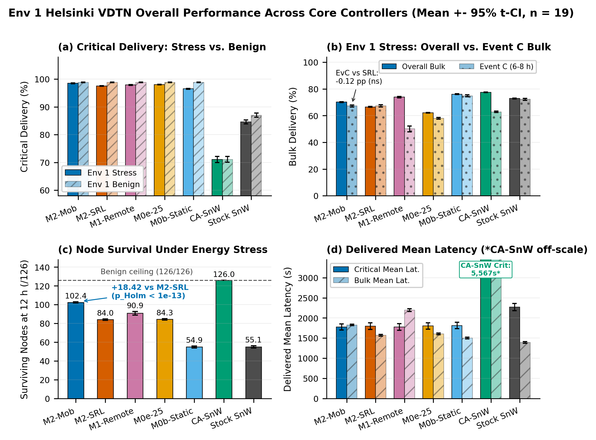
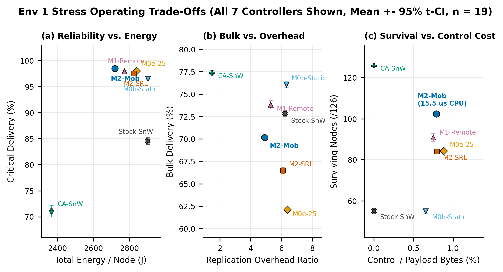
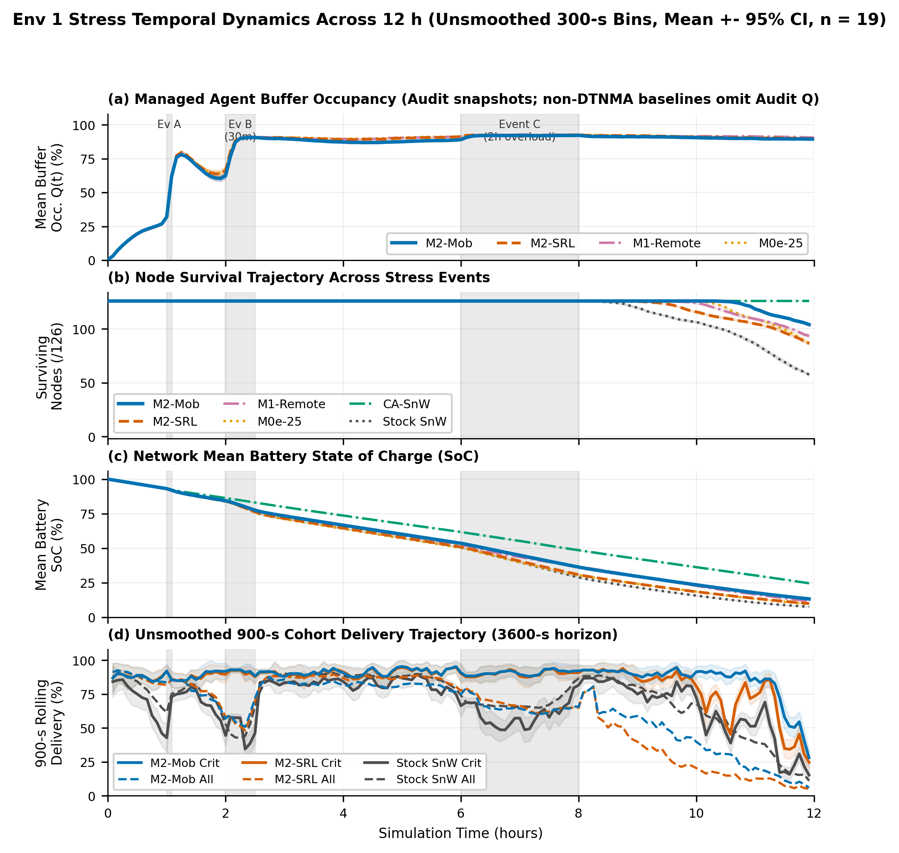
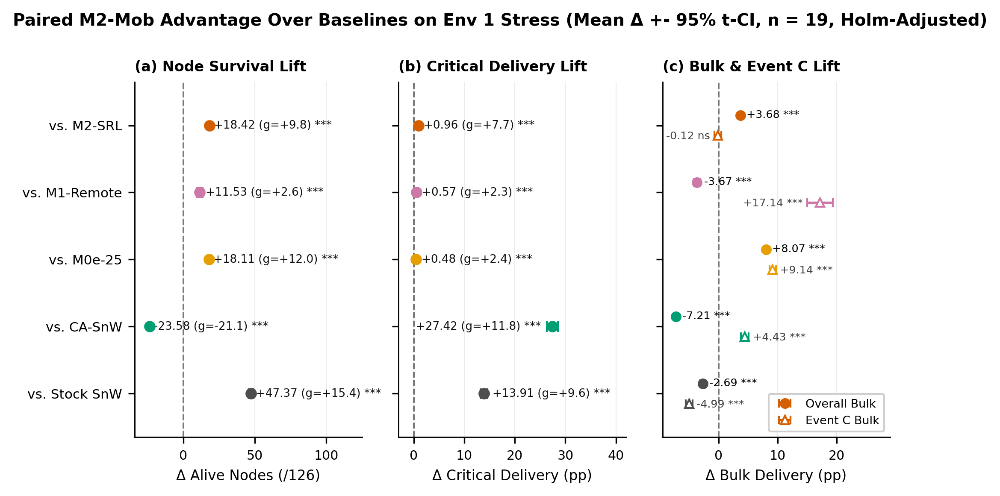
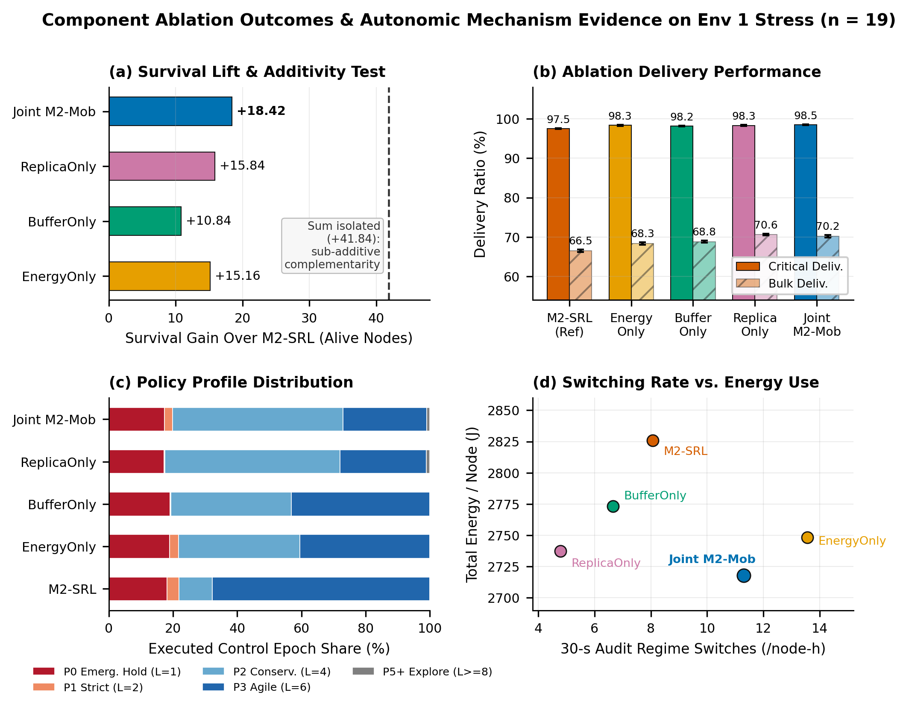
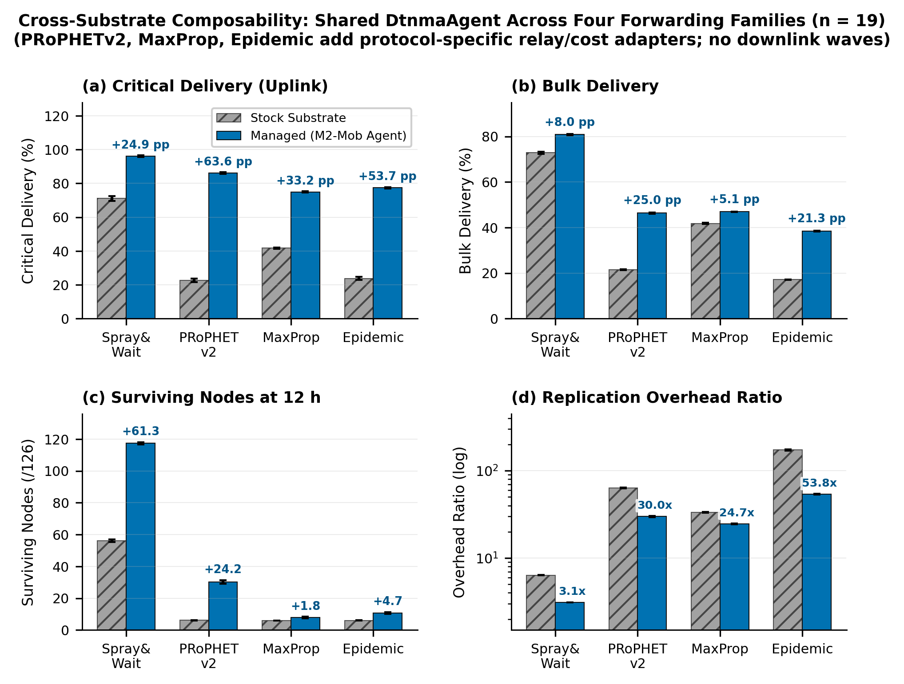
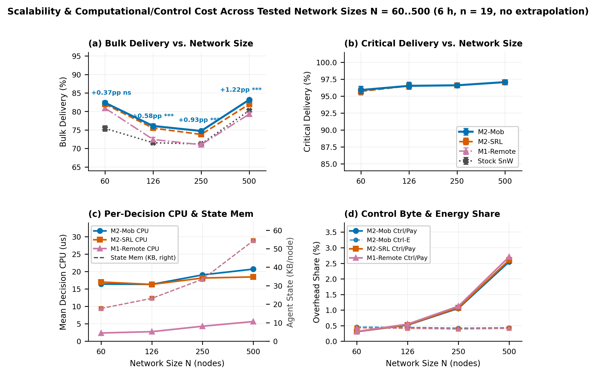
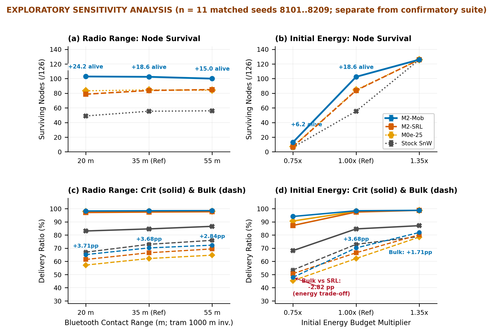

# Chapter 6: Simulation Configurations, Methodology & Empirical Findings

> **Campaign Scope:** `1,216` confirmatory runs (`n = 19` matched prime seeds `8101..8269`) and `176` strictly isolated exploratory sensitivity runs (`n = 11` matched primes `8101..8209`), audited with zero missing or zero-size reports (`4,864 + 704` files) and `2,432/2,432` SHA-256 checksum matches.

---

## 1. Experimental Design, Seed Governance & Statistical Methodology

1. **Matched Trajectory Pairing:** Within each stage, coprime router/seed arrays fix identical node mobility tracks (`MovementModel.rngSeed`), radio encounters, traffic arrival schedules, and battery parameters across every compared controller.
2. **Seed Partitions (`SEED_ROLES.md`):**
   - **Confirmatory Pool (`mob_*.txt`, `1,216` runs):** `19` primes `8101..8269` (coprime to router counts `{4, 8, 10}`).
   - **Isolated Exploratory Pool (`sens_*.txt`, `176` runs):** First `11` matched primes `8101..8209`, kept strictly outside all confirmatory Holm-Bonferroni families and tables.
3. **Eight Predeclared Holm–Bonferroni Families (`112` Confirmatory Tests):** Family-wise error rate (`FWER`) is controlled via step-down Holm–Bonferroni (`p_holm`) independently within `F1_Env1_Stress_Core` ($m=18$), `F1b_Env1_Stress_EventC` ($m=6$), `F1c_Env1_Stress_NonDtnma` ($m=8$), `F2_Env1_Benign_NonInterference` ($m=10$), `F3a_Env2_WorkingDay` ($m=9$), `F3b_Env3_DisasterRelief` ($m=9$), `F4_CrossSubstrate` ($m=16$), and `F5_Scalability_Joint` ($m=36$). Effect sizes report bias-corrected **Hedges' $g_z$** alongside two-sided $95\%$ $t$-confidence intervals (`+-`), paired $p_t$, and Wilcoxon signed-rank $p_w$.
4. **Statistical Discipline & Scope Boundaries:**
   - Varying only `MovementModel.rngSeed` measures robustness across independent mobility realizations under matched traffic/energy schedules, not general multi-stream Monte Carlo variance.
   - Non-significance ($p_{\text{holm}} > 0.05$) indicates no detected difference at $n=19$ precision, not formal statistical equivalence (`TOST`).
   - Observing `unique_critical_lost = 0` over `19` seeds implies a Rule-of-Three $95\%$ upper confidence bound of $\approx 3/19 = 15.8\%$ per-run event rate rather than zero failure risk under out-of-distribution stress.

---

## 2. Simulation Configurations & Environment Parameters

Every scenario uses The ONE's heterogenous radio/energy engine (`scanEnergy = 0.05 W`, `scanResponseEnergy = 0.02 W`, `transmitEnergy = 0.90 W`, field `bufferSize = 10M`, `msgTtl = 300 min`; zero-drain `500 kJ` manager nodes in heterogeneous `126`-node fleets):

| Stage (`scenarios/*.txt`) | Track | Mobility Model | World (m) | Fleet (Field+Mgr) | Duration (h) | Radio Interfaces | Initial Energy (J) | Traffic / Events | Routers (`x` Seeds) |
|---|---|---|---:|---:|---:|---|---:|---|---:|
| **`mob_env1_vdtn_stress`** | Confirmatory | SPMBM + 3 Tram Routes | `4,500 × 3,400` | `126` (`120+6`) | `12` | BT `250k/35m`; Tram `10M/1000m` | `2,650–3,650` | Bulk + Telem + Crit + Ev A/B/C + 6 Waves | `10 × 19 = 190` |
| **`mob_env1_vdtn_benign`** | Confirmatory | SPMBM + 3 Tram Routes | `4,500 × 3,400` | `126` (`120+6`) | `12` | BT `250k/35m`; Tram `10M/1000m` | `5,500–7,500` | Bulk + Telem + Crit + Ev A/B/C + 6 Waves | `10 × 19 = 190` |
| **`mob_env2_workingday`** | Confirmatory | 3-District WDM + Bus | `10,000 × 8,000` | `126` (`120+6`) | `12` | BT `250k/50m`; Bus `2M/250m` | `2,650–3,650` | Bulk + Telem + Crit + AM/Office/PM + 4 Waves | `10 × 19 = 190` |
| **`mob_env3_disaster_relief`** | Confirmatory | 4-Cluster + RWP + Convoy | `1,000 × 1,000` | `126` (`120+6`) | `8` | BT `250k/45m`; Convoy `2M/120m` | `2,000–3,000` | Bulk + Telem + HighCrit + Triage + 4 Waves | `10 × 19 = 190` |
| **`mob_cross_substrate`** | Confirmatory | SPMBM + 3 Tram Routes | `4,500 × 3,400` | `126` (`120+6`) | `12` | BT `250k/35m`; Tram `10M/1000m` | `2,650–3,650` | Bulk + Telem + Crit (`379`, 0 DL waves) | `8 × 19 = 152` |
| **`mob_scale_{60,126,250,500}`** | Confirmatory | SPMBM + 3 Tram Routes | `4,500 × 3,400` | `60, 126, 250, 500` | `6` | BT `250k/35m`; Tram `10M/1000m` | `2,650–3,650` | Density-scaled Bulk/Crit + 2 Waves | `4 × 4 × 19 = 304` |
| **`sens_range_{20m,55m}`** | Exploratory | SPMBM + 3 Tram Routes | `4,500 × 3,400` | `126` (`120+6`) | `12` | BT `20m` or `55m`; Tram `1000m` | `2,650–3,650` | Same as Env 1 Stress | `4 × 2 × 11 = 88` |
| **`sens_energy_{075x,135x}`** | Exploratory | SPMBM + 3 Tram Routes | `4,500 × 3,400` | `126` (`120+6`) | `12` | BT `250k/35m`; Tram `1000m` | `1,988–2,738` / `3,578–4,928` | Same as Env 1 Stress | `4 × 2 × 11 = 88` |

---

## 3. Finding 1 — Env 1 Urban VDTN Stress & Benign Non-Interference

In **Env 1 Stress** (`n = 19`), finite batteries (`2,650–3,650 J`) meet sustained bursts (`Events A/B/C`). `M2-Mob` coordinates energy time-to-depletion, ICT-scaled surge thresholds, and contact-duration replica caps to avert late-run node collapse after Hour 8:

| Regime / Controller | CritDel (%) | BulkDel (%) | EvC Bulk (%) | Alive (`/126`) | Overhead | Energy/Node (J) | CritLat (s) | Ctrl/Pay (%) | CPU (`us`) |
|---|---:|---:|---:|---:|---:|---:|---:|---:|---:|
| **Stress / `M2-Mob`** | **`98.48 +- 0.14`** | `70.18 +- 0.31` | `67.22 +- 0.77` | **`102.42 +- 0.52`** | `4.90 +- 0.02` | `2718.0 +- 1.0` | `1776 +- 73` | `0.79` | `15.5` |
| Stress / `M2-SRL` | `97.52 +- 0.12` | `66.50 +- 0.32` | `67.33 +- 0.87` | `84.00 +- 0.77` | `6.08 +- 0.02` | `2825.8 +- 1.2` | `1797 +- 82` | `0.79` | `13.3` |
| Stress / `M1-Remote` | `97.91 +- 0.16` | `73.85 +- 0.49` | `50.07 +- 2.14` | `90.89 +- 1.91` | `5.28 +- 0.05` | `2771.7 +- 7.1` | `1778 +- 83` | `0.75` | `2.9` |
| Stress / `M0e-25` | `98.00 +- 0.09` | `62.11 +- 0.23` | `58.08 +- 0.61` | `84.32 +- 0.75` | `6.38 +- 0.02` | `2838.9 +- 1.2` | `1801 +- 80` | `0.88` | `5.8` |
| Stress / `M0b-Static` | `96.49 +- 0.12` | `76.09 +- 0.30` | `74.79 +- 0.75` | `54.95 +- 1.05` | `6.31 +- 0.02` | `2902.1 +- 1.2` | `1813 +- 79` | `0.65` | `2.9` |
| Stress / `CongestionAwareSnW` | `71.06 +- 1.07` | `77.39 +- 0.22` | `62.79 +- 0.54` | `126.00 +- 0.00` | `1.47 +- 0.01` | `2364.9 +- 1.0` | `5567 +- 210` | `0.00` | `0.0` |
| Stress / `SprayAndWait` | `84.57 +- 0.69` | `72.87 +- 0.32` | `72.21 +- 0.77` | `55.05 +- 1.15` | `6.21 +- 0.03` | `2900.6 +- 1.2` | `2273 +- 89` | `0.00` | `0.0` |
| **Benign / `M2-Mob`** | `98.80 +- 0.11` | **`82.41 +- 0.21`** | **`76.07 +- 0.81`** | `126.00 +- 0.00` | `4.82 +- 0.01` | `2396.1 +- 1.6` | `1777 +- 79` | `0.69` | `15.9` |
| Benign / `M2-SRL` | `98.80 +- 0.12` | `81.73 +- 0.22` | `74.92 +- 0.85` | `126.00 +- 0.00` | `5.92 +- 0.02` | `2574.3 +- 1.5` | `1784 +- 79` | `0.69` | `15.9` |
| Benign / `M1-Remote` | `98.80 +- 0.12` | `75.90 +- 0.56` | `50.07 +- 2.14` | `126.00 +- 0.00` | `5.26 +- 0.04` | `2381.6 +- 10.2` | `1768 +- 82` | `0.76` | `3.1` |
| Benign / `SprayAndWait` | `87.02 +- 0.71` | `78.77 +- 0.30` | `72.30 +- 0.79` | `126.00 +- 0.00` | `6.07 +- 0.02` | `2619.7 +- 1.6` | `2254 +- 84` | `0.00` | `0.0` |

**Key Takeaways:**
- **`M2-Mob` vs. `M2-SRL` (Stress):** `+18.42 +- 0.87` alive nodes ($p_{\text{holm}} = 1.17\times 10^{-18}$), `+3.68 +- 0.31 pp` bulk delivery ($p_{\text{holm}} = 3.38\times 10^{-14}$), and `+0.96 +- 0.06 pp` critical delivery ($p_{\text{holm}} = 7.15\times 10^{-17}$). Note that because both use the shared Safety Shield (`> 97.5%` CritDel), the practical advantage over `M2-SRL` is late-run battery survival and overall bulk throughput.
- **`M2-Mob` vs. `M1-Remote`:** `M1-Remote` collapses during `Event C` (`50.07%` vs `67.22%`, `M2-Mob` `+17.14 +- 2.18 pp`, $p_{\text{holm}} = 1.02\times 10^{-11}$) and loses `+11.53` more nodes because delayed unicast waves run out of phase.
- **`M2-Mob` vs. `CongestionAwareSnW`:** `CA-SnW` saves `126/126` batteries (`2,364.9 J/node`) and attains `77.39%` bulk delivery, yet drops `58.63` unique critical alerts (`71.06%` CritDel vs `98.48%`, `-27.42 pp`) with `5,567 s` (`>92 min`) critical latency.
- **Benign Non-Interference (`F2`):** With ample energy (`5,500–7,500 J`), `M2-Mob` does not degrade benign traffic (`82.41%` bulk, `+0.67 pp` over `M2-SRL`, `+3.63 pp` over `SprayAndWait`).

---

## 4. Finding 2 — Ablation & Mechanism Attribution (`Env 1 Stress`, `n = 19`)

Isolating individual coordination terms (`EnergyOnly`, `BufferOnly`, `ReplicaOnly`) reveals how `M2-Mob` achieves its survival gain and shifts operating regimes in `DtnmaAuditReport`:

| Variant | Alive (vs `M2-SRL`) | CritDel (vs `M2-SRL`) | BulkDel (vs `M2-SRL`) | EvC Bulk | E/Node (J) | Audit Mean $Q$ | Reconf/Node-h | Profiles `P0 / P2 / P3` (%) |
|---|---:|---:|---:|---:|---:|---:|---:|---:|
| **`M2-Mob` (`JOINT`)** | **`102.42` (`+18.42`)** | **`98.48%` (`+0.96`)** | `70.18%` (`+3.68`) | `67.22%` | **`2718.0`** | `0.816` | `11.29` | `17.4 / 53.0 / 26.1` |
| `M2-Mob (EnergyOnly)` | `99.16` (`+15.16`) | `98.35%` (`+0.82`) | `68.32%` (`+1.82`) | `64.55%` | `2748.4` | `0.820` | `13.56` | `19.0 / 37.7 / 40.5` |
| `M2-Mob (BufferOnly)` | `94.84` (`+10.84`) | `98.20%` (`+0.68`) | `68.82%` (`+2.32`) | `68.27%` | `2773.3` | `0.820` | `6.66` | `19.1 / 37.5 / 43.1` |
| `M2-Mob (ReplicaOnly)` | `99.84` (`+15.84`) | `98.33%` (`+0.81`) | **`70.64%` (`+4.14`)** | **`70.85%`** | `2737.6` | `0.816` | `4.80` | `17.2 / 54.6 / 26.9` |
| `M2-SRL` (Ref) | `84.00` (`+0.00`) | `97.52%` (`+0.00`) | `66.50%` (`+0.00`) | `67.33%` | `2825.8` | `0.824` | `8.07` | `18.1 / 10.4 / 67.7` |

- **Mechanism Evidence:** `M2-Mob` shifts epoch execution from aggressive `P3 BALANCED_AGILE_FOCUS` (`L=6: 67.7% -> 26.1%`) to `P2 BALANCED_CONSERVATIVE` (`L=4: 10.4% -> 53.0%`).
- **Sub-Additive Complementarity:** Comparing `Joint - (EnergyOnly + BufferOnly + ReplicaOnly)` lifts over `M2-SRL` yields `+18.42` vs linear sum `+41.84` surviving nodes ($p = 1.73\times 10^{-14}$), showing overlapping mitigation of congested/battery-stressed bottlenecks rather than super-additive multiplication, while `Joint` achieves both highest survival (`102.42`) and lowest total energy (`2718.0 J/node`). Meanwhile, `ReplicaOnly` retains slightly higher bulk delivery (`70.64%`) with fewer switches (`4.80/node-h`).

---

## 5. Finding 3 — Cross-Substrate Composability (`F4`, `n = 19`)

In `mob_cross_substrate.txt` (`379` uplink critical faults, `0` manager waves), wrapping four stock forwarding algorithms with `M2-Mob` via `DtnmaManagedRouter` completely eliminates unique critical losses (`19/19` seeds):

| Substrate | CritDel (`Stock -> Managed`) | BulkDel (`Stock -> Managed`) | Alive (`/126`) | Unique Crit Lost | Overhead Ratio |
|---|---:|---:|---:|---:|---:|
| **`SprayAndWait`** | `71.14% -> 96.09%` (`+24.94 pp, ***`) | `72.82% -> 80.80%` (`+7.98 pp, ***`) | `56.16 -> 117.42` (`+61.26`) | `70.8 -> 0.0` | `6.4 -> 3.1` |
| **`PRoPHETv2`** | `22.58% -> 86.14%` (`+63.56 pp, ***`) | `21.40% -> 46.36%` (`+24.97 pp, ***`) | `6.11 -> 30.26` (`+24.16`) | `124.0 -> 0.0` | `63.4 -> 30.0` |
| **`MaxProp`** | `41.72% -> 74.89%` (`+33.18 pp, ***`) | `41.81% -> 46.92%` (`+5.11 pp, ***`) | `6.00 -> 7.84` (`+1.84`) | `85.5 -> 0.0` | `33.4 -> 24.7` |
| **`Epidemic`** | `23.76% -> 77.47%` (`+53.71 pp, ***`) | `17.10% -> 38.43%` (`+21.33 pp, ***`) | `6.05 -> 10.74` (`+4.68`) | `109.6 -> 0.0` | `172.8 -> 53.8` |

---

## 6. Finding 4 — Multi-Mobility Boundary Regimes (`Env 2` & `Env 3`)

Two structural regimes define the operating envelope boundaries (`n = 19` each):
- **Env 2 Working-Day (`10,000 × 8,000 m`, `avg_ict_s = 8,846 s`):** Extreme sparsity imposes a `~6.3%` bulk delivery floor across all DTNMA modes (`6.26%` `M2-Mob` vs `6.34%` `M2-SRL`, `ns`), and critical delivery is statistically tied (`25.98%` vs `25.81%`, `ns`), yet `M2-Mob` preserves `+2.79` more alive nodes over `M2-SRL` (`117.84` vs `115.05`, $p_{\text{holm}} = 4.75\times 10^{-6}$) and `+4.16` over `M1-Remote`.
- **Env 3 Disaster Relief (`1,000 × 1,000 m`, `8 h`, `avg_ict_s = 32.6 s`):** Short mission time leaves `M2-Mob` and `M2-SRL` near the `126`-node survival ceiling (`125.79` vs `125.53`, `ns`) and `~60.6%` critical delivery (`ns`), though `M2-Mob` gains `+0.68 pp` bulk over `M2-SRL` ($p_{\text{holm}} = 8.97\times 10^{-9}$) and `+13.37` alive over `M0e-25` ($p_{\text{holm}} = 4.61\times 10^{-18}$).

---

## 7. Finding 5 — Scalability & Resource Footprint (`N = 60..500`, `6 h`)

Across four fleet sizes (`F5`, `n = 19`), `M2-Mob` widens its bulk delivery advantage with scale (`+0.37 pp ns` at `N=60`, `+0.58 pp ***` at `N=126`, `+0.93 pp ***` at `N=250`, `+1.22 pp ***` at `N=500`), while keeping per-decision compute at **`16.3–20.7 us`**, control energy at **`0.42–0.46%`**, control byte overhead at **`0.30% -> 2.55%`** of payload bytes, and per-node agent state growing linearly from **`17.7` to `54.3 KB/node`**. No scaling claims are made beyond `N = 500` or constant $O(1)$ RAM.

---

## 8. Finding 6 — Exploratory Sensitivity Sweeps (`sens_*.txt`, Strictly Isolated)

Executed on `n = 11` matched seeds (`8101..8209`) **outside** the confirmatory pipeline:
- **Bluetooth Range Sweep (`20 / 35 / 55 m`, Tram `1000 m` invariant):** `M2-Mob` outperforms `M2-SRL` across every range on survival (`+24.18`, `+18.64`, `+15.00` alive) and bulk delivery (`+3.71`, `+3.68`, `+2.84 pp`).
- **Energy Budget Sweep (`0.75x / 1.00x / 1.35x`):** At `1.35x` (`126/126` alive), `M2-Mob` delivers `+1.71 pp` more bulk than `M2-SRL`. Under extreme scarcity (`0.75x`, `1,988–2,738 J`), `M2-Mob` preserves **`+6.18` alive nodes (`12.91 vs 6.73`)** and **`+6.85 pp` CritDel (`94.09% vs 87.25%`)** while trading off **`-2.82 pp` BulkDel (`47.86% vs 50.68%`)** because energy-TTD throttling sheds bulk traffic earlier.

---

## 9. Explicit Trade-Offs, Unsupported Claims & Instrumentation Caveats

1. **Trade-Offs Exposed:**
   - `M2-Mob` trades `+257 s` longer delivered bulk latency (`1825 vs 1568 s`) and `+642 s` longer buffer residence vs `M2-SRL` to save batteries for Hours 8–12; `Event C` matches `M2-SRL` (`-0.12 pp`, `ns`).
   - `M1-Remote` achieves higher overall bulk (`73.85%`) by failing to throttle surges promptly (`Event C` drops to `50.07%` and loses `11.53` more nodes).
   - `CongestionAwareSnW` achieves lower energy (`2364.9 J`) and higher bulk (`77.39%`) at an unacceptable cost to critical fault preservation (`71.06%` CritDel, `58.63` lost, `5,567 s` critical latency).
2. **Claims NOT Supported:** Do **not** claim universal Pareto dominance, super-additive ablation synergy, $O(1)$ memory / `N > 500` extrapolation, multi-stream Monte Carlo variance, or Env 2/3 zero-shot superiority across arbitrary topologies.
3. **Instrumentation Caveats:** Mean-only CPU time (`decision_cpu_us_mean`, no `p95`/`p99` tails); delivered-only latency without overall `bulk_latency_{med,p95}`; pooled `buffertime` without bulk/critical split; scan energy pooled inside `total_energy_J - total_ctrl_tx_J`; pooled `critical_delivery_prob` (except isolated `downlink_delivery_prob`); and zero `DtnmaAuditReport` rows on stock non-DTNMA baselines.
