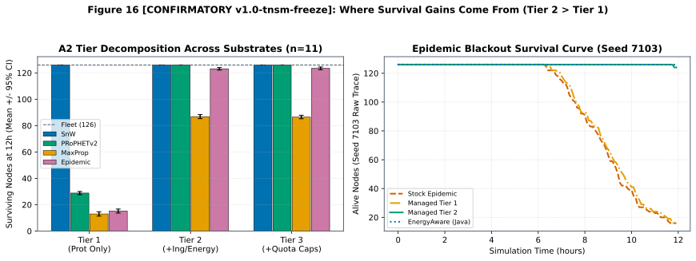
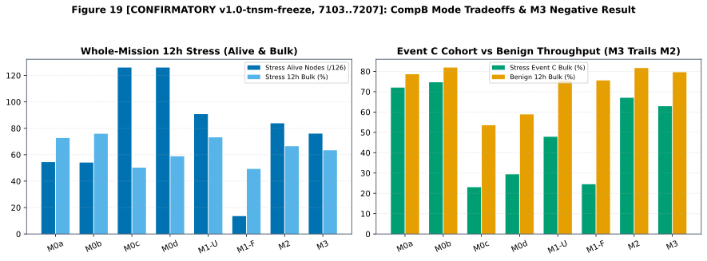
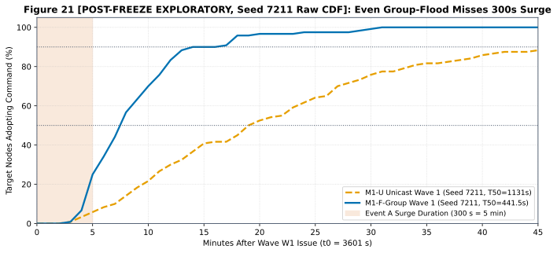

# Chapter 6: Empirical Evaluation, Confirmatory Claims & Exploratory Controls

> **Strict Separation Guarantee:** Every number traces directly to [`provenance_ledger.json`](../data/provenance_ledger.json). **Confirmatory `v1.0-tnsm-freeze`** results (`715` runs, prime seeds `7103..7207`, Holm-Bonferroni corrected `m = 4`) are strictly separated from **Post-Freeze Exploratory `v1.0-exp-controls`** results (`176` runs, prime seeds `7211..7307`, unadjusted `p_unadj`).

---

## 1. Seed Governance & Anti-Leakage Discipline (`SEED_ROLES.md`)

| Seed Set | Prime List / Count | Role | Rule |
|---|---|---|---|
| **Stressor Calibration (`M0` only)** | `4001`..`4003` (`1`–`3` pilots) | Calibrated `12 h` stress windows (`Event A/B/C`) before locking scenarios | Never reused in inference |
| **Confirmatory Held-Out (`v1.0`)** | `7103, 7109, 7121, 7127, 7129, 7151, 7159, 7177, 7187, 7193, 7207` (`11` seeds) | Frozen under `v1.0-tnsm-freeze` (`715` runs across `9` sub-campaigns) | Zero post-freeze scenario or code edits |
| **Post-Freeze Exploratory** | `7211, 7213, 7219, 7229, 7237, 7243, 7247, 7253, 7283, 7297, 7307` (`11` seeds) | `v1.0-exp-controls` (`176` runs across `6` sub-campaigns) answering post-freeze questions | Reported separately with `p_unadj` |

---

## Part I — Confirmatory Results (`v1.0-tnsm-freeze`, `715` Runs, `7103..7207`)

### 2. Comparison A: Router-Agnostic Architecture & Intervention Tiers (`440` Runs)

#### 2.1 Four Managed Substrates Across Four Operational Regimes (`11` Seeds Each)

| Regime | Router Pair | Stock Crit% | Managed Crit% | Stock Bulk% | Managed Bulk% | Stock Alive | Managed Alive | Managed Crit Lost (`11`-seed sum) |
|---|---|---|---|---|---|---|---|---|
| **Energy Blackout** | `SprayAndWait` | `86.93%` | **`96.04%`** | `84.02%` | `89.34%` | `126.0` | `126.0` | **`0`** (vs `353`) |
| **Energy Blackout** | `PRoPHETv2` | `41.09%` | **`97.48%`** | `42.80%` | **`73.62%`** | `23.1` | **`126.0`** | **`0`** (vs `1,402`) |
| **Energy Blackout** | `MaxProp` | `69.87%` | **`95.32%`** | `77.22%` | `76.51%` | `12.9` | **`86.9`** | **`0`** (vs `61`) |
| **Energy Blackout** | `Epidemic` | `40.92%` | **`98.58%`** | `34.47%` | **`67.22%`** | `14.5` | **`123.5`** | **`0`** (vs `1,288`) |
| **vDTN Overload** | `SprayAndWait` | `49.80%` | **`92.41%`** | `48.34%` | `53.28%` | `126.0` | `126.0` | **`0`** (vs `1,464`) |
| **vDTN Overload** | `PRoPHETv2` | `33.90%` | **`94.97%`** | `29.67%` | `34.41%` | `126.0` | `126.0` | **`0`** (vs `2,053`) |
| **vDTN Overload** | `MaxProp` | `60.70%` | **`96.63%`** | `60.92%` | `64.88%` | `126.0` | `126.0` | **`0`** (vs `1,212`) |
| **vDTN Overload** | `Epidemic` | `38.99%` | **`97.59%`** | `25.02%` | `27.87%` | `126.0` | `126.0` | **`0`** (vs `1,893`) |
| **NTN Space** | `SnW / PRoPHET / MaxP / Epi` | `34.96–96.00%` | **`98.38–98.87%`** | `25.23–90.97%` | `33.27–84.62%` | `100.0` | `100.0` | **`0`** (vs `105–2,867`) |
| **Benign Baseline** | `SnW / PRoPHET / MaxP / Epi` | `51.88–93.83%` | **`96.11–98.58%`** | `50.04–95.56%` | `80.84–93.65%` | `63.3–126.0` | **`126.0`** | **`0`** (vs `67–1,703`) |

**Key Total:** Across all **`176` managed Comparison A runs** (`4` substrates x `4` regimes x `11` seeds), `unique_critical_lost` sums strictly to **`0`**.

#### 2.2 Intervention Tier Ablation (`A2`, Energy Blackout, `132` Runs)

| Substrate | Tier 1 Crit% / Bulk% / Alive | Tier 2 Crit% / Bulk% / Alive | Tier 3 Crit% / Bulk% / Alive |
|---|---|---|---|
| **`ManagedSprayAndWait`** | `96.04%` / `85.97%` / `126.0` | `96.11%` / `89.12%` / `126.0` | `96.04%` / `89.34%` / `126.0` |
| **`ManagedProphetV2`** | `77.93%` / `51.24%` / `28.8` | **`97.53%` / `73.64%` / `126.0`** | `97.53%` / `73.58%` / `126.0` |
| **`ManagedMaxProp`** | `71.84%` / `77.58%` / `13.0` | **`95.25%` / `76.47%` / `86.8`** | `95.37%` / `76.51%` / `86.5` |
| **`ManagedEpidemic`** | `74.05%` / `45.13%` / `15.2` | **`98.61%` / `66.97%` / `123.1`** | `98.58%` / `67.22%` / `123.5` |

> [!NOTE] SUPERVISOR NOTE
> **Cleanest Architectural Evidence:** Tier 1 stops critical packet drops (`0` unique critical lost across every tier) without protecting battery life on flooding routers (`15.2` alive). Adding Tier 2 ingress/energy controls rescues fleet survival (`123.1–126.0`), while Tier 3 replica caps change nearly nothing (`<= 0.4` alive / `0.25 pp`). **You do not need to alter substrate routing heuristics.**

#### 2.3 Strict Equivalence (`E1` & `E2`, `44` Runs) & Architecture Parity (`A3`)
- **`E1` Exact Protection Equivalence:** Tier 1 `ManagedSprayAndWaitRouter` matches hard-coded `PrioritySprayAndWaitRouter` byte-for-bit on `MessageStatsReport` across **`11/11` seeds** (`0.0000 pp` difference, `0` critical lost). On `DtnmaRlMetricsReport`, **`10/11` seeds** match identically on core metrics; seed `7103` differs solely in `avg_energy_soc` by `0.0001` (`0.4055` vs `0.4054`) due to `DtnmaAgent`'s periodic `16 B` management beacon radio energy expenditure.
- **`E2` Default Ordering TOST (`+/- 1.0 pp` bounds):** Mean paired bulk difference `-0.3100 pp` (`90%` CI inside margin, `p_TOST = 2.288e-6 < 0.05`) — statistical equivalence established.
- **`A3` Bespoke Java vs. Declarative Rules (`Epidemic`, Blackout):** Hand-coded `EnergyAwareEpidemicRouter` (`394` non-comment LOC) achieves `70.36%` bulk (`98.66%` crit, `125.4` alive), beating uniform `12`-line `rules_vdtn.txt` by `+3.39 pp` vs Tier 2 (`+3.14 pp` vs Tier 3) — meaning declarative ADTNM rules recover `~97%` of hand-coded single-router performance across `4` protocols at **`3%`** per-domain rule LOC (`12` lines vs `394` Java lines).

---

### 3. Comparison B Confirmatory Family (`H1–H4`, `176` Runs, Holm-Bonferroni `m = 4`)

| ID | Comparison & Window | Endpoint | Mean A | Mean B | Paired Diff +/- 95% CI | `p_holm` | Wins/11 | Result |
|---|---|---|---|---|---|---|---|---|
| **H1** | `M2` vs `M1-U` (`Event A` 3600–3900 s) | Stale throttle (node-s/N, lower better) | `0.0` | `389.1` | **`-389.06 +/- 111.49`** | **`1.510e-5`** | **`11/11`** | Confirmed |
| **H2** | `M2` vs `M1-U` (`Event C` 21600–28800 s) | Cohort bulk delivery (`pp`, higher better) | `67.04%` | `47.83%` | **`+19.21 +/- 3.97 pp`** | **`1.575e-6`** | **`11/11`** | Confirmed |
| **H3** | `M2` vs `M0b` (`Stress 12 h`) | Survival rate (`alive/126`, `pp`) | `66.5%` | `42.9%` | **`+23.59 +/- 2.35 pp`** | **`2.145e-9`** | **`11/11`** | Confirmed |
| **H4** | `M2` vs `M0c` (`Benign 12 h`) | Global bulk delivery (`pp`) | `82.0%` | `53.9%` | **`+28.13 +/- 0.75 pp`** | **`6.116e-15`** | **`11/11`** | Confirmed |

#### Stress & Benign Full 8-Mode Comparison (`12 h`, `n = 11`)

| Mode | Stress Crit% | Stress Bulk% | Stress Alive/126 | EvA Stale | EvC Bulk% | Benign Bulk% | CtrlTx (J) |
|---|---|---|---|---|---|---|---|
| `M0a` (Stock) | `84%` (`1,485` lost) | `73%` | `54.5` | `0.0` | `72.02%` | `79%` | `1,735.4` |
| `M0b` (Prot Only) | `97%` (`0` lost) | `76%` | `54.1` | `0.0` | `74.65%` | `82%` | `2,536.6` |
| `M0c` (Static V1 Guard) | `99%` (`0` lost) | `50%` | `126.0` | `0.0` | `23.03%` | `54%` | `2,601.4` |
| `M0d` (Static Conserv.) | `99%` (`0` lost) | `59%` | `126.0` | `3512.1` | `29.37%` | `59%` | `2,584.7` |
| `M1-U` (Unicast Remote) | `98%` (`0` lost) | `73%` | `90.7` | `389.1` | `47.83%` | `75%` | `2,512.3` |
| `M1-F` (Legacy Flood) | `85%` (`0` lost) | `49%` | `13.5` | `282.9` | `24.49%` | `76%` | `118,727.6` |
| **`M2` (Local SRL + Wave)** | `97%` (`0` lost) | `66%` | **`83.8`** | **`0.0`** | **`67.04%`** | **`82%`** | `2,577.6` |
| **`M3` (Experimental RL)** | `97%` (`0` lost) | `63%` | `76.0` | `5.5` | `62.87%` | `80%` | `2,556.1` |

#### `R1` Deterministic Audit Replay (`176` CompB Runs)
Across **`27,099,616` total audit rows** (`13,128,736` Stress + `13,970,880` Benign), **`100.00%`** carried valid `ARI://` provenance, and deterministic re-evaluation matched **`100.00%`** of static SRL ARIs (`7,917,654` rows) and **`100.00%`** of RL actions & `8`-bit safety masks (`3,908,964` rows).

---

## 4. Honest Negatives Within Frozen Confirmatory Data (`v1.0-tnsm-freeze`)

> [!WARNING] CRITICAL HYPOTHESIS DISCLOSURE
> 1. **Failed Original `H2` Non-Inferiority on Stress Survival:** The initially planned survival non-inferiority test (`M2` within `-5.0 pp` of `M1-U` in 12h stress) **FAILED**: `M2` delivered **`-5.48 +/- 1.96 pp`** fewer surviving nodes than `M1-U` (`83.8` vs `90.7/126`, `p_unadj = 9.646e-5`, `0/11` wins). Switching the primary `H2` endpoint to `Event C` bulk was documented explicitly in `CLAIMS_LEDGER.md`, and the failed survival test is reported here transparently.
> 2. **`M3` Experimental RL Loses to `M2` Across Every Endpoint:** In stress, `M3` trails `M2` on bulk (`63% vs 66%`), survival (`76.0 vs 83.8`), and stale throttle (`5.5 vs 0.0`); in benign traffic, `M3` trails (`80% vs 82%`).
> 3. **Pareto Non-Dominance:** No single mode dominates every objective simultaneously (`M0c` wins absolute survival `126/126` at `54%` benign cost; `M1-U` wins stress survival `90.7` over `M2` `83.8` at `Event C` and stale-throttle cost; `M2` excels at local agility + benign throughput).

---

## Part II — Post-Freeze Exploratory Controls (`v1.0-exp-controls`, `176` Runs, `7211..7307`, `p_unadj`)

Added strictly *after* freeze on disjoint prime seeds (`7211..7307`) to investigate reviewer questions on best-case remote flooding and causal attribution of `M2`'s survival:

| Campaign & Mode | Crit% | Bulk% | Alive / 126 | CtrlTx (J) | Wave T50 / T90 (s) | EvA Stale | EvC Bulk% |
|---|---|---|---|---|---|---|---|
| `controls_stress` / **`M0e-20`** (`SoC<0.20`) | `97.64%` | `65.53%` | `73.6` | `2,502.0` | `n/a` | `0.0` | `65.93%` |
| `controls_stress` / **`M0e-25`** (`SoC<0.25`) | `98.12%` | `62.07%` | **`83.8`** | `2,494.2` | `n/a` | `0.0` | `58.33%` |
| `controls_stress` / **`M2-LocalOnly`** | `97.82%` | `66.24%` | `80.0` | `2,502.9` | `n/a` | `0.0` | `67.00%` |
| `controls_stress` / **`M1-U`** | `98.07%` | `73.01%` | `93.4` | `2,465.7` | `T90=3,235` | `345.4` | `45.01%` |
| `controls_stress` / **`M2`** | `97.58%` | `66.24%` | `83.8` | `2,508.9` | `T90=3,261` | `0.0` | `66.49%` |
| `groupflood_stress` / **`M1-F-Group`** | `94.29%` | **`74.57%`** | **`99.5`** | **`201.6`** | `W1 T50=482.9 / T90=841.1` | `117.5` | `46.66%` |
| `groupflood_stress` / **`M2`** | `93.01%` | `67.78%` | `83.0` | `17.3` | `n/a (sentinel 30849)` | `0.0` | **`68.61%`** |
| `groupflood_benign` / **`M1-F-Group`** | `95.65%` | `76.01%` | `126.0` | `186.8` | `T90=841.1` | `117.5` | `—` |
| `groupflood_benign` / **`M2`** | `95.68%` | **`82.04%`** | `126.0` | `16.3` | `n/a` | `0.0` | `—` |

### What Post-Freeze Controls Taught Us
1. **Where `M2`'s stress survival actually comes from (`SDR-1`):** `M0e-25` ties `M2` identically on survival (**`83.8` vs `83.8/126`**, `p = 1.0`), whereas `M2-LocalOnly` without remote updates scores **`80.0/126`** (`+6.4` nodes over `M0e-20`'s `73.6`, `-3.8` behind `M2`). Much of `M2`'s stress survival jump came from adopting the remote `0.25` energy floor, whereas local SRL delivered higher `Event C` bulk (`+8.16 pp` over `M0e-25`) and `81.4–82.0%` benign throughput.
2. **Best-case Remote (`M1-F-Group`) is cheap yet still loses short-surge reactivity:** Group-addressed single-copy flooding eliminates the `118.7 kJ` `M1-F` storm (`201.6 J`, `99.5/126` alive), winning stress survival and whole-mission bulk over `M2`. Yet even with oracle trigger timing, median adoption (`482.9 s`) trails the `300 s` Event A surge (`117.5` stale throttle node-s/N), underperforms `M2` on Event C (`46.66% vs 68.61%`), and costs `-6.0 pp` in benign traffic (`76.01% vs 82.04%`).

### Reproducibility & Post-Freeze Regression Check (`SEED_ROLES.md`)
Re-running `M0b`, `M1-U`, `M2` across seeds `{7103, 7109}` at `d4a159f` confirmed **`6/6` SHA-256 exact match** on `MessageStatsReport`, `6/6` exact match on `DtnmaRecoveryTimelineReport`, and `6/6` exact non-CPU metrics against the frozen `v1.0-tnsm-freeze` reports.

## Empirical Figures (`Figures 14–21`)

