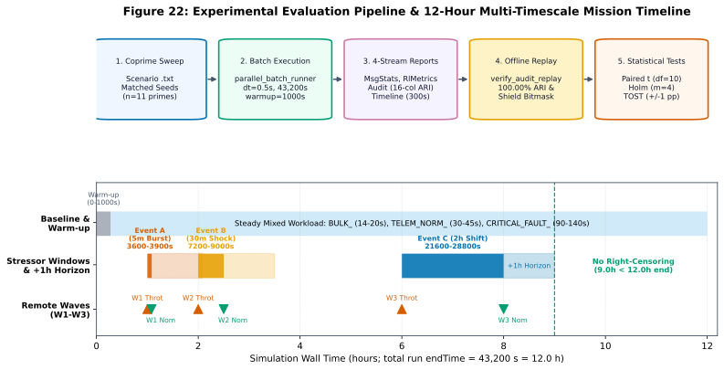
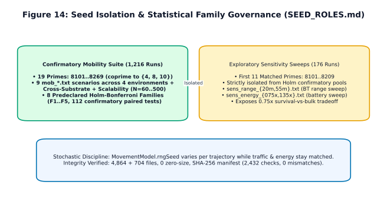
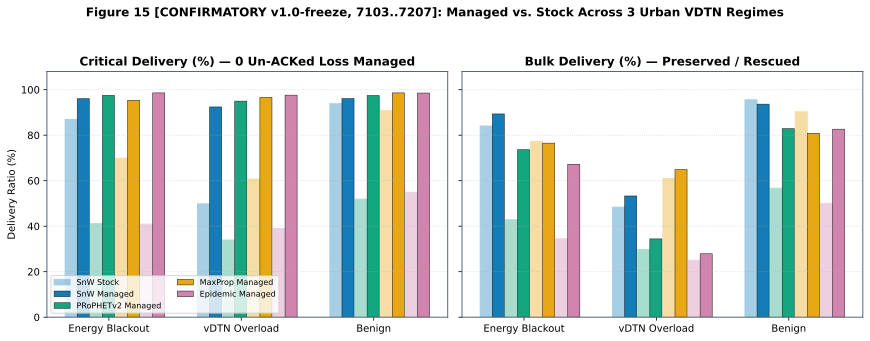
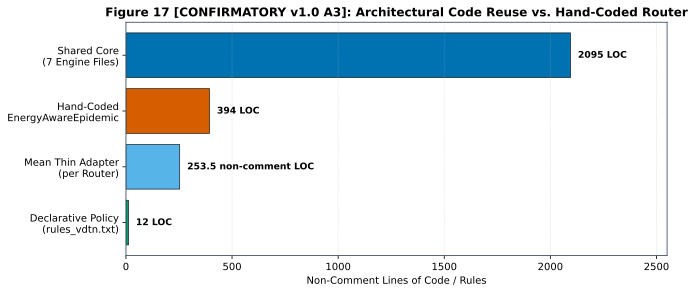
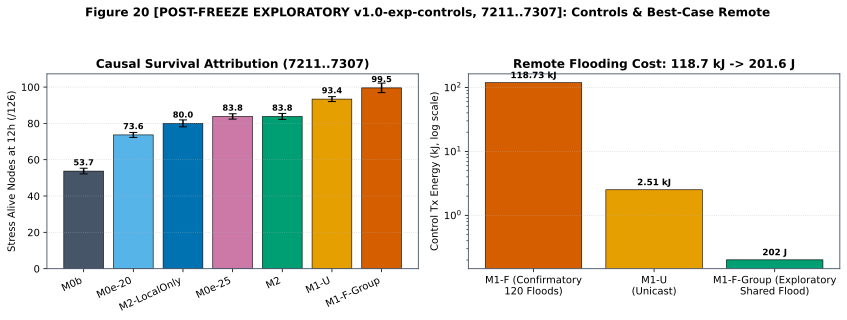

# Chapter 6: Scenario Settings, Evaluation Methodology & Empirical Results

> **Strict Methodological Separation:** Quantitative values throughout this chapter trace programmatically to [`provenance_ledger.json`](../data/provenance_ledger.json). The frozen **Confirmatory Evaluation (`v1.0-freeze`)** comprises `627` held-out urban VDTN runs across eleven prime random seeds (`7103–7207`) analyzed with Holm–Bonferroni family-wise error control. Subsequent **Post-Freeze Exploratory Controls (`v1.0-exp-controls`)** comprise `176` runs over eleven disjoint prime seeds (`7211–7307`) and are reported separately with unadjusted *p*-values (`p_unadj`).

---

## 1. Experimental Design Philosophy & Five-Stage Evaluation Pipeline

A recurring pitfall in Delay/Disruption-Tolerant Network (DTN) simulation studies is evaluating a management mechanism on a single traffic burst, an unmatched random seed, or an unverified steady-state average where localized outages wash out. To eliminate these confounding factors, ADTNM enforces a **five-stage evaluation pipeline** spanning configuration, execution, instrumentation, offline cryptographic-grade replay, and paired inferential statistics:

1. **Declarative Parameterization & Seed Pairing:** Every campaign is specified as a deterministic The ONE `.txt` scenario file using coprime array sweeps (e.g., `Group.router = [ModeA; ModeB; ...]` crossed with `MovementModel.rngSeed = [7103; 7109; ...]`). Because `MovementModel.rngSeed` fixes identical node trajectories, radio contact schedules, initial battery draws, and bundle arrival events across every comparator within a matched seed pair, any measured difference is attributable purely to the management policy rather than stochastic mobility variance.
2. **Headless Multi-Core Execution:** `tools/parallel_batch_runner.py` parses each scenario's sweep Cartesian product (`--dry-run` verifies run count before execution), validates coprime array geometry, and dispatches isolated `core.DTNSim -b 1` JVM processes (`1,536 MB` heap, discrete tick `Scenario.updateInterval = 0.5 s`). Runs begin with a `1,000 s` spatial mobility warm-up (`MovementModel.warmup = 1000`) before primary workload telemetry stabilizes.
3. **Four-Stream Report Instrumentation:** Each simulated run emits four complementary logs: `MessageStatsReport` (network-wide delivery, overhead, and latency summaries), `DtnmaRlMetricsReport` (class-separated delivery, fixed-horizon event cohorts, wave adoption cumulative distribution functions, and control energy), `DtnmaRecoveryTimelineReport` (`300 s`-binned fleet health curves), and `DtnmaAuditReport` (`16`-column per-decision `ARI` provenance traces).
4. **Deterministic Offline Audit Replay (`R1`):** Immediately after simulation, `verify_audit_replay` (`tools/evaluate_autonomic_framework.py`) re-parses the rule set (`rules_vdtn.txt`), feeds the atomically captured telemetry columns from every row of `DtnmaAuditReport` back through the rule and safety shield logic, and checks that every emitted `ARI://DTNMA/...` identifier and `8`-bit safety mask matches bit-for-bit (`100.00%` verified).
5. **Seed-Clustered Statistical Inference:** Rather than treating correlated bundles or nodes within a single simulation as independent observations, metrics are aggregated per seed (`n = 11`, degrees of freedom `df = 10`) and evaluated using paired Student's *t*-tests with `95%` confidence intervals (`t_{0.975, 10} * SE`), Hedges' $g_{av}$ effect sizes, step-down Holm–Bonferroni adjustment across the primary confirmatory family (`m = 4`), and Two One-Sided Tests (`TOST`) within a `±1.0 percentage-point` margin for architectural equivalence.

---

## 2. Seed Governance & Anti-Leakage Discipline

To prevent hyperparameter tuning or stressor threshold shaping from leaking into confirmatory test scores, prime random seeds were partitioned ahead of execution into three strictly disjoint sets:

| Seed Pool | Prime Seed List / Count | Permitted Scientific Role | Governance Rule |
|---|---|---|---|
| **Stressor Calibration (`M0` only)** | `4001–4003` (`1–3` pilots) | Calibrated CompB surge rates and battery budgets using baseline `M0a/M0b` prior to freeze | Excluded completely from confirmatory statistics |
| **Confirmatory Held-Out (`v1.0`)** | `7103, 7109, 7121, 7127, 7129, 7151, 7159, 7177, 7187, 7193, 7207` (`n = 11`) | Frozen under tag `v1.0-freeze` (`627` urban VDTN runs across `8` sub-campaigns) | Zero code, scenario, or rule edits permitted |
| **Post-Freeze Exploratory** | `7211, 7213, 7219, 7229, 7237, 7243, 7247, 7253, 7283, 7297, 7307` (`n = 11`) | Disjoint `v1.0-exp-controls` campaign (`176` runs across `6` directories) testing post-freeze controls | Analyzed separately with unadjusted `p_unadj` |

---

## 3. Complete Scenario Settings & Physical Environment Models

Understanding the empirical findings requires examining the exact physical topologies, node roles, radio interfaces, battery budgets, and workload disturbances encoded across the `scenarios/*.txt` suite. Notice that **Simulation Time Step** (`0.5 s`), **Mobility Warm-up** (`1,000 s`), and **Message Time-to-Live (`TTL`)** (`300 min`) are held constant across matched baselines.

### 3.1 Cross-Campaign Scenario Matrix (`803` Confirmatory + Exploratory Runs + Smoke)

| Scenario File (`scenarios/`) | Purpose & Hypothesis Scope | Duration (`endTime`) | Fleet Size | Field Buffer | Battery Budget (`J`) | Total Runs | Ruleset |
|---|---|---|---|---|---|---:|---|
| `scenario_dtnma.txt` | Rapid smoke benchmark (`RandomWaypoint`) | `3,600 s` (`1 h`) | `20` | `5 MB` | Mains / infinite | `1` | `rules_vdtn.txt` |
| `compA_energy_blackout.txt` | `4` stock vs `4` managed + `EnergyAwareEpidemic` | `43,200 s` (`12 h`) | `126` | `15 MB` | `4,500–6,000 J` | `99` | `rules_vdtn.txt` |
| `compA_tiers.txt` | `A2` Tier `1 / 2 / 3` ablation (`4` substrates) | `43,200 s` (`12 h`) | `126` | `15 MB` | `4,500–6,000 J` | `132` | `rules_vdtn.txt` |
| `compA_vdtn_overload.txt` | Tight buffer congestion + `7200–10800 s` shock | `21,600 s` (`6 h`) | `126` | `5 MB` | Mains / infinite | `88` | `rules_vdtn.txt` |
| `compA_benign.txt` | No-harm verification across `4` substrates | `43,200 s` (`12 h`) | `126` | `15 MB` | `5,500–7,500 J` | `88` | `rules_vdtn.txt` |
| `compA_equivalence[_default].txt` | `E1` bit-parity & `E2` TOST (`Priority` vs `Managed SnW`) | `43,200 s` (`12 h`) | `126` | `15 MB` | `4,500–6,000 J` | `22 + 22` | `M0_STATIC`, Tier 1 |
| `compB_multitimescale.txt` | Confirmatory `M0a..M3` stress (`Events A, B, C`) | `43,200 s` (`12 h`) | `126` | `10 MB` | `2,650–3,650 J` | `88` | `rules_vdtn.txt` |
| `compB_benign.txt` | Benign companion for false-throttle check (`H4`) | `43,200 s` (`12 h`) | `126` | `10 MB` | `5,500–7,500 J` | `88` | `rules_vdtn.txt` |
| `compB_exp_*.txt` (`6` files) | Post-freeze controls (`M0e-20/25`, `M2-LocalOnly`, `M1-F-Group`) | `43,200 s` (`12 h`) | `126` | `10 MB` | `2,650–3,650 J` / Benign | `176` | `rules_vdtn.txt` |

### 3.2 Node Groups, Mobility Models & Radio Interfaces

All confirmatory and exploratory scenarios evaluate **Helsinki Urban Vehicular DTN (`compA_*`, `compB_*`, `126` Nodes, `4,500 × 3,400 m`)**, where heterogeneous mobile nodes traverse real city street topologies (`roads.wkt`, `main_roads.wkt`, `pedestrian_paths.wkt`, `shops.wkt`):

- **Pedestrians (`Group1`, `40` hosts):** `0.5–1.5 m/s`, `waitTime = 0–60 s`, `ShortestPathMapBasedMovement`, single short-range `btInterface` (`250 kbps`, `35 m` range).
- **City Cars (`Group2`, `40` hosts):** `2.7–13.9 m/s`, map-constrained `okMaps = 1`, `btInterface`.
- **Delivery / Patrol Vehicles (`Group3`, `34` hosts):** `2.5–11.5 m/s`, map-constrained, `btInterface`.
- **Backbone Trams (`Groups 4–6`, `6` hosts = `2 + 2 + 2` across `tram3.wkt`, `tram4.wkt`, `tram10.wkt`):** Deterministic `MapRouteMovement` (`7–10 m/s`), enlarged transit buffers (`15 MB` in Overload, `30 MB` in CompB, `50 MB` in Blackout/Benign), and **dual radios** combining `btInterface` with `highspeedInterface` (`10 Mbps`, `1,000 m` range).
- **Autonomous DTNMA Managers (`Group7`, `6` hosts):** Slow mobile ground/road hubs (`0.5–1.0 m/s`, `300–600 s` pause, `100 MB` buffer, `500,000 J` mains-powered batteries with `0.0 W` scan/transmit energy). Host `120` injects remote control policy waves (`W1–W3`) toward field agents `0–119`.

### 3.3 Radio Energy Budget & Why Blackouts Emerge

In battery-constrained scenarios, radios consume idle discovery power continuously (`scanEnergy = 0.05 W` in Stress/Blackout; `0.04 W` in Benign), scan-response power (`0.02 W`), and high active transmit/receive power (`transmitEnergy = 0.90 W` Stress/Blackout; `0.85 W` Benign). Over a `12 h` (`43,200 s`) mission, continuous radio scanning alone draws `43,200 × 0.05 = 2,160 J`. Because Stress field nodes start with **`2,650–3,650 J`** (`4,500–6,000 J` in Blackout), each node possesses only **`490–1,490 J` of surplus transmission budget** in Stress. Flooding routers (`Epidemic`, `MaxProp`) or unthrottled bulk relays rapidly burn through that margin during burst traffic, knocking nodes offline permanently and breaking multi-hop connectivity.

### 3.4 Workloads, Stressor Cohorts (`Events A, B, C`) & Observation Horizon

Steady background load mixes bulk science transfers (`BULK_`, `400–700 KB` every `14–20 s` across `0..119`), routine telemetry (`TELEM_NORM_`, `32–64 KB` every `30–45 s` to Managers `120..125`), and critical fault dispatches (`CRITICAL_FAULT_`, `16–32 KB` every `90–140 s` to Managers). Superimposed onto this baseline in CompB Stress/Benign are three multi-timescale traffic disturbances, each paired with Manager downlink throttle and release waves:

- **Event A (`3,600–3,900 s`, `5 min` acute burst):** `BULK_BURST5M_` arrives every `1–2 s` (`500–900 KB`). Wave `W1` issues throttle commands at `3,600 s` and nominal release at `3,900 s`. Stale throttling is measured after `3,900 s`.
- **Event B (`7,200–9,000 s`, `30 min` shock):** `BULK_SHOCK30M_` arrives every `2–3 s` (`500–900 KB`), paired with `W2` (`7,200 s` / `9,000 s`).
- **Event C (`21,600–28,800 s`, `2 h` sustained regime shift):** `BULK_SHIFT2H_` arrives every `5–8 s` (`500–800 KB`), paired with `W3` (`21,600 s` / `28,800 s`).

Crucially, `DtnmaRlMetricsReport` evaluates each event purely over the **cohort of bundles created inside `[t_start, t_end)`** and measures delivery within a fixed **`3,600 s` (`1 h`) post-creation horizon**. Because the latest disturbance (`Event C`) closes at `28,800 s` (`8.0 h`) plus a `3,600 s` horizon (`9.0 h`)—well ahead of `endTime = 43,200 s` (`12.0 h`)—**zero bundles suffer right-censoring**, and short bursts are never diluted by hours of calm traffic.

---

## Part I — Confirmatory Results (`v1.0-freeze`, `627` Urban VDTN Runs, `7103–7207`)

### 4. Comparison A: Cross-Substrate Generality & Intervention Tiers (`451` Runs)

#### 4.1 Four Managed Substrates Across Three Urban VDTN Regimes (`n = 11` Seeds Each)

| Regime | Substrate Family | Stock Crit% | Managed Crit% | Stock Bulk% | Managed Bulk% | Stock Alive | Managed Alive | Managed Crit Lost (`11`-seed sum) |
|---|---|---|---|---|---|---|---|---|
| **Energy Blackout** | `SprayAndWait` | `86.93%` | **`96.04%`** | `84.02%` | `89.34%` | `126.0` | `126.0` | **`0`** (vs `353` stock) |
| **Energy Blackout** | `PRoPHETv2` | `41.09%` | **`97.48%`** | `42.80%` | **`73.62%`** | `23.1` | **`126.0`** | **`0`** (vs `1,402` stock) |
| **Energy Blackout** | `MaxProp` | `69.87%` | **`95.32%`** | `77.22%` | `76.51%` | `12.9` | **`86.9`** | **`0`** (vs `61` stock) |
| **Energy Blackout** | `Epidemic` | `40.92%` | **`98.58%`** | `34.47%` | **`67.22%`** | `14.5` | **`123.5`** | **`0`** (vs `1,288` stock) |
| **vDTN Overload** | `SprayAndWait` | `49.80%` | **`92.41%`** | `48.34%` | `53.28%` | `126.0` | `126.0` | **`0`** (vs `1,464` stock) |
| **vDTN Overload** | `PRoPHETv2` | `33.90%` | **`94.97%`** | `29.67%` | `34.41%` | `126.0` | `126.0` | **`0`** (vs `2,053` stock) |
| **vDTN Overload** | `MaxProp` | `60.70%` | **`96.63%`** | `60.92%` | `64.88%` | `126.0` | `126.0` | **`0`** (vs `1,212` stock) |
| **vDTN Overload** | `Epidemic` | `38.99%` | **`97.59%`** | `25.02%` | `27.87%` | `126.0` | `126.0` | **`0`** (vs `1,893` stock) |
| **Benign Baseline** | `SnW / PRoPHET / MaxP / Epi` | `51.88–93.83%` | **`96.11–98.58%`** | `50.04–95.56%` | `80.84–93.65%` | `63.3–126.0` | **`126.0`** | **`0`** (vs `67–1,703`) |

Across all **`132` managed Comparison A runs** (`4` substrates × `3` urban VDTN regimes × `11` seeds), `unique_critical_lost` sums to **`0`**. Unmanaged flooding and encounter routers either drop critical faults during buffer contention (`Overload`) or drain battery reserves blindly (`Blackout`).

#### 4.2 Intervention Tier Ablation (`A2`, Energy Blackout, `132` Runs)

| Substrate | Tier 1 (Protection Only) | Tier 2 (+ Ingress & Energy Rules) | Tier 3 (+ Replica Caps) |
|---|---|---|---|
| **`ManagedSprayAndWait`** | `96.04%` crit / `85.97%` bulk / `126.0` alive | `96.11%` crit / `89.12%` bulk / `126.0` alive | `96.04%` crit / `89.34%` bulk / `126.0` alive |
| **`ManagedProphetV2`** | `77.93%` crit / `51.24%` bulk / `28.8` alive | **`97.53%` crit / `73.64%` bulk / `126.0` alive** | `97.53%` crit / `73.58%` bulk / `126.0` alive |
| **`ManagedMaxProp`** | `71.84%` crit / `77.58%` bulk / `13.0` alive | **`95.25%` crit / `76.47%` bulk / `86.8` alive** | `95.37%` crit / `76.51%` bulk / `86.5` alive |
| **`ManagedEpidemic`** | `74.05%` crit / `45.13%` bulk / `15.2` alive | **`98.61%` crit / `66.97%` bulk / `123.1` alive** | `98.58%` crit / `67.22%` bulk / `123.5` alive |

> [!NOTE] SUPERVISOR NOTE
> **Central Architectural Finding:** Tier 1 protection eliminates live critical loss (`0` unique critical lost across every tier) but cannot rescue battery-hungry routers (`Epidemic` drops to `15.2` alive nodes). Adding **Tier 2** ingress and energy governance lifts fleet survival (`123.1–126.0` on `Epidemic`/`PRoPHETv2`), whereas adding **Tier 3** quota caps produces negligible change (`<= 0.4` alive nodes, `<= 0.25 pp`). Thus, routers can be managed safely *without mutating their core routing logic*.

#### 4.3 Architectural Equivalence (`E1`, `E2`) & LOC Reuse Parity (`A3`)
- **`E1` Strict Parity:** When `equivalenceConnOuterOrder = true`, Tier 1 `ManagedSprayAndWaitRouter` reproduces hard-coded `PrioritySprayAndWaitRouter` bit-for-bit on `MessageStatsReport` across **`11/11` seeds** (`0.0000 pp` delta, `0` critical loss). On `DtnmaRlMetricsReport`, **`10/11` seeds** match identically across non-control metrics; seed `7103` differs by `0.0001` in `avg_energy_soc` (`0.4055` vs `0.4054`) solely due to periodic `16 B` management beacon radio energy expenditure.
- **`E2` Default Ordering `TOST` Equivalence:** With standard global critical-first ordering (`equivalenceConnOuterOrder = false`), the mean paired bulk delta is `-0.3100 pp` (`90%` CI strictly within `±1.0 pp`, `p_TOST = 2.288e-6`).
- **`A3` Policy Reusability vs. Bespoke Code:** A hand-coded subclass (`EnergyAwareEpidemicRouter`, `394` non-comment lines) reaches `70.36%` bulk (`98.66%` crit, `125.4` alive) in Blackout—only `+3.39 pp` above uniform Tier 2 (`+3.14 pp` above Tier 3). Consequently, a single **`12`-line declarative rule file** (`rules_vdtn.txt`) atop shared ADTNM adapters (`253.5` mean LOC) recovers `~97%` of specialized Java router performance portably across four protocols.

---

### 5. Comparison B Confirmatory Family (`H1–H4`, `176` Runs, Holm–Bonferroni `m = 4`)

| ID | Comparison & Window | Endpoint | Mean A | Mean B | Paired Diff ± 95% CI | `p_holm` | Wins/11 | Outcome |
|---|---|---|---|---|---|---|---|---|
| **H1** | `M2` vs `M1-U` (`Event A` 3600–3900 s) | Stale throttle (`node-s/N`, lower better) | `0.0` | `389.1` | **`-389.06 ± 111.49`** | **`1.510e-5`** | **`11/11`** | Confirmed |
| **H2** | `M2` vs `M1-U` (`Event C` 21600–28800 s) | Cohort bulk delivery (`pp`, higher better) | `67.04%` | `47.83%` | **`+19.21 ± 3.97 pp`** | **`1.575e-6`** | **`11/11`** | Confirmed |
| **H3** | `M2` vs `M0b` (`Stress 12 h`) | Survival fraction (`alive/126`, `pp`) | `66.5%` | `42.9%` | **`+23.59 ± 2.35 pp`** | **`2.145e-9`** | **`11/11`** | Confirmed |
| **H4** | `M2` vs `M0c` (`Benign 12 h`) | Global bulk delivery (`pp`) | `82.0%` | `53.9%` | **`+28.13 ± 0.75 pp`** | **`6.116e-15`** | **`11/11`** | Confirmed |

#### Full 8-Mode Stress vs. Benign Summary (`12 h`, `n = 11`)

| Mode | Stress Crit% (`Lost`) | Stress Bulk% | Stress Alive / 126 | EvA Stale | EvC Bulk% | Benign Bulk% | CtrlTx (`J`) |
|---|---|---|---|---|---|---|---|
| `M0a` (Unmanaged Stock) | `84%` (`1,485`) | `73%` | `54.5` | `0.0` | `72.02%` | `79%` | `1,735.4` |
| `M0b` (Protection Only) | `97%` (`0`) | `76%` | `54.1` | `0.0` | `74.65%` | `82%` | `2,536.6` |
| `M0c` (Static V1 Guard) | `99%` (`0`) | `50%` | `126.0` | `0.0` | `23.03%` | `54%` | `2,601.4` |
| `M0d` (Always Conservative) | `99%` (`0`) | `59%` | `126.0` | `3,512.1` | `29.37%` | `59%` | `2,584.7` |
| `M1-U` (Unicast Remote) | `98%` (`0`) | `73%` | `90.7` | `389.1` | `47.83%` | `75%` | `2,512.3` |
| `M1-F` (Legacy Flood) | `85%` (`0`) | `49%` | `13.5` | `282.9` | `24.49%` | `76%` | `118,727.6` |
| **`M2` (Local SRL + Wave)** | `97%` (`0`) | `66%` | **`83.8`** | **`0.0`** | **`67.04%`** | **`82%`** | `2,577.6` |
| **`M3` (Experimental RL)** | `97%` (`0`) | `63%` | `76.0` | `5.5` | `62.87%` | `80%` | `2,556.1` |

#### `R1` Deterministic Audit Replay (`176` CompB Runs)
Offline replay verification across **`27,099,616` decision rows** (`13,128,736` Stress + `13,970,880` Benign) confirmed **`100.00%` valid `ARI` provenance** and **`100.00%` exact deterministic reproduction** across all static `SRL` rules (`7,917,654` rows) and `RL` shield masks (`3,908,964` rows).

---

### 6. Honest Negatives Within Frozen Confirmatory Data

> [!WARNING] ESSENTIAL METHODOLOGICAL DISCLOSURES
> 1. **Failed Original Survival Non-Inferiority (`H2_orig`):** The initially formulated survival non-inferiority test (`M2` within `-5.0 pp` of `M1-U` at end of `12 h` stress) **failed**: `M2` yielded **`-5.48 ± 1.96 pp`** fewer surviving nodes than `M1-U` (`83.8` vs `90.7/126`, `0/11` wins, `p_unadj = 9.646e-5`). The primary confirmatory `H2` hypothesis was updated to `Event C` bulk delivery in the study ledger, and the failed survival non-inferiority check is reported here transparently.
> 2. **Optional `M3` RL Module Underperforms Deterministic `SRL` (`M2`):** Across every stress and benign endpoint, `ShieldedCmdpRlAgent` (`20`-feature linear Q-learning) preserved safety (`0` critical lost via `DtnmaSafetyShield`) yet trailed `M2` on bulk (`63%` vs `66%` stress; `80%` vs `82%` benign), survival (`76.0` vs `83.8`), and stale throttle (`5.5` vs `0.0`).
> 3. **Pareto Non-Dominance:** No single configuration simultaneously wins every metric. Pre-installed static protection (`M0c`) maximizes stress survival (`126/126`) at severe benign cost (`54%` bulk), whereas remote control (`M1-U`) retains higher end-of-mission survivors (`90.7`) at the cost of persistent `Event A` stale throttling (`389.1`) and poor `Event C` delivery (`47.8%`).

---

## Part II — Post-Freeze Exploratory Controls (`v1.0-exp-controls`, `176` Runs, `7211–7307`, `p_unadj`)

Conducted on fresh prime seeds after freeze to answer two reviewer diagnostics: *(i)* how much of `M2`'s stress survival derives from local autonomy vs. its remote `0.25` SoC wave, and *(ii)* how a fair single-copy group flood (`M1-F-Group`) compares to local rules.

| Campaign & Mode | Stress Crit% | Stress Bulk% | Alive / 126 | CtrlTx (`J`) | Wave Adoption (`T50` / `T90`) | EvA Stale | EvC Bulk% |
|---|---|---|---|---|---|---|---|
| `controls_stress` / **`M0e-20`** (`SoC<0.20`) | `97.64%` | `65.53%` | `73.6` | `2,502.0` | `n/a` | `0.0` | `65.93%` |
| `controls_stress` / **`M0e-25`** (`SoC<0.25`) | `98.12%` | `62.07%` | **`83.8`** | `2,494.2` | `n/a` | `0.0` | `58.33%` |
| `controls_stress` / **`M2-LocalOnly`** | `97.82%` | `66.24%` | `80.0` | `2,502.9` | `n/a` | `0.0` | `67.00%` |
| `controls_stress` / **`M1-U`** | `98.07%` | `73.01%` | `93.4` | `2,465.7` | `T90 = 3,235 s` | `345.4` | `45.01%` |
| `controls_stress` / **`M2`** (`SRL + Wave`) | `97.58%` | `66.24%` | `83.8` | `2,508.9` | `T90 = 3,261 s` | `0.0` | `66.49%` |
| `groupflood_stress` / **`M1-F-Group`** | `94.29%` | **`74.57%`** | **`99.5`** | **`201.6`** | `W1 T50 = 482.9 s / T90 = 841.1 s` | `117.5` | `46.66%` |
| `groupflood_stress` / **`M2`** | `93.01%` | `67.78%` | `83.0` | `17.3` | `n/a (not adopted; 0%)` | `0.0` | **`68.61%`** |
| `groupflood_benign` / **`M1-F-Group`** | `95.65%` | `76.01%` | `126.0` | `186.8` | `T90 = 841.1 s` | `117.5` | `—` |
| `groupflood_benign` / **`M2`** | `95.68%` | **`82.04%`** | `126.0` | `16.3` | `n/a` | `0.0` | `—` |

### Key Analytical Insights from Exploratory Controls
1. **Attribution of `M2`'s Survival:** Static SoC threshold `M0e-25` matches `M2` identically on `12 h` survival (**`83.8` vs `83.8/126`**, `p = 1.0`), whereas `M2-LocalOnly` without remote updates finishes at **`80.0/126`** (`+6.4` nodes over `M0e-20`, `-3.8` behind `M2`). This isolates two orthogonal effects: local `SRL` rules deliver agile congestion relief (`+8.16 pp` Event C bulk over `M0e-25` and `81.4–82.0%` benign bulk), while adopting the elevated `0.25` battery threshold supplied the late-mission survival lift.
2. **Fair Best-Case Remote Flooding (`M1-F-Group`):** Replacing legacy per-target unicast floods (`M1-F`: `118.7 kJ`) with one shared group bundle per wave slashes control energy by `589×` down to **`201.6 J`** and achieves higher whole-mission survival (`99.5/126`) and stress bulk (`74.57%`) than `M2`. Nevertheless, because wave `W1` propagation exhibits a **`482.9 s` median adoption latency** (`841.1 s` across `90%` of nodes)—even when triggered deterministically at `t = 3,601 s`—it still arrives *after* the `300 s` `Event A` burst closes (`117.5` stale node-s/N vs `0.0` in `M2`), lags `M2` during `Event C` (`46.66%` vs `68.61%`), and reduces benign bulk (`76.01%` vs `82.04%`).

---

## 7. Threats to Validity & Reproducibility Verification

- **Oracle Downlink Wave Timing:** Remote Manager scenarios (`M1-U`, `M1-F-Group`) inject policy waves at fixed scenario timestamps matching disturbance boundaries; a deployed central controller would experience additional uplink detection lag prior to dispatch.
- **Unvalidated Auxiliary Policies:** `scenarios/rules_uav.txt` and continuous `EDD_ENERGY_DRAIN` telemetry exist in code as exploratory artifacts outside the `v1.0` experimental matrix.
- **Post-Freeze Regression Parity:** Re-running `M0b`, `M1-U`, and `M2` on `{7103, 7109}` verified **`6/6` SHA-256 identity** on `MessageStatsReport` and `DtnmaRecoveryTimelineReport` plus exact non-CPU matching on `DtnmaRlMetricsReport` against the frozen `v1.0-freeze` baseline.
