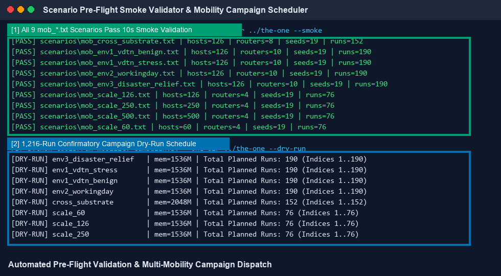

# Chapter 7: Scenario Anatomy & Hands-On Tutorials

> **Estimated Completion Time:** `10–15` minutes across all walkthroughs.  
> **Prerequisites:** Java JDK `17+`, Python `3.10+`, and a sibling copy of **The ONE** (`..\the-one`). On Windows PowerShell, set `$env:PYTHONDONTWRITEBYTECODE = '1'` to prevent `__pycache__` folders inside source trees.

---

## Tutorial 0: Anatomy of an ADTNM Scenario File (`.txt`)

Every experiment in `scenarios/*.txt` configures five declarative blocks read sequentially by The ONE's `Settings` parser:

```ini
# 1. Clock & Simulation Horizon
Scenario.name = Mob_Env1_Stress_%%Group.router%%_%%MovementModel.rngSeed%%
Scenario.updateInterval = 0.5          # Discrete simulator tick (seconds)
Scenario.endTime = 43200               # 12 hours total (prevents Event C right-censoring)

# 2. Coprime Parameter Sweeps (Cartesian Product)
Group.router = [DtnmaM2MobRouter; DtnmaM2SrlRouter; ...; SprayAndWaitRouter]
MovementModel.rngSeed = [8101; 8111; ...; 8269]                                 # 19 primes
Group.bufferSize = 10M                 # Field RAM capacity
Group.msgTtl = 300                     # Bundle expiration (minutes)

# 3. Heterogeneous Radio, Mobility & Battery Energy Budgets
btInterface.transmitSpeed = 250k       # Field Bluetooth-class radio (35 m range)
highspeedInterface.transmitSpeed = 10M # Backbone tram/relay radio (1,000 m range)
Group.initialEnergy = 2650, 3650       # Stress draw [2650, 3650] J; idle scan = 0.05 W, TX = 0.90 W

# 4. ADTNM Management Engine & Coordinator Bindings
DtnmaRouter.configFile = scenarios/dtnma_params_default.txt
DtnmaRouter.rulesFile = scenarios/rules_vdtn.txt   # Local declarative SRL policy
Group.rulesFile = scenarios/rules_vdtn.txt

# 5. Multi-Class Traffic, Disruption Cohorts & Synchronized Reporting
Events1.prefix = BULK_                 # Background bulk transfers (400-700 KB)
Events3.prefix = CRITICAL_FAULT_       # Priority emergency dispatches to Managers (16-32 KB)
Events4.time = 3600, 3900              # Event A acute 5-minute burst
Report.report1 = DtnmaMetricsReport    # Per-class, Event A/B/C cohort, & # WAVE_ADOPTION_CDF metrics
Report.report3 = DtnmaAuditReport      # Per-decision 21-column ARI provenance trace
```

Notice two critical design conventions:
- **Coprime Array Counts:** Router sweep counts (`4, 8, 10`) are coprime to the prime seed count (`19` confirmatory / `11` exploratory) so The ONE sweeps the full Cartesian product without modular-index aliasing (`validate_mobility_scenarios.py` checks this automatically).
- **Zero Right-Censoring:** Setting `Scenario.endTime = 43200` gives `Event C` (`21,600–28,800 s`) a full `3,600 s` evaluation horizon plus `10,800 s` completion margin.

---

## Tutorial 1: Install, Compile & Run `DtnmaUnitTests` (`< 2 min`)

Deploy ADTNM into The ONE using `install.py` and execute the Java unit test suite:

```powershell
$env:PYTHONDONTWRITEBYTECODE = '1'
$THE_ONE = "n:\R&D\cog\the-one"
$ADTNM   = "n:\R&D\cog\ADTNM"

# 1. Deploy sources, scenarios, and tools into ../the-one and compile with javac
python "$ADTNM\install.py" --one-dir "$THE_ONE"

# 2. Check sync status anytime
python "$ADTNM\install.py" --one-dir "$THE_ONE" --status

# 3. Compile & run the Java unit test suite
javac -cp "$THE_ONE\target;$THE_ONE\lib\*" -d "$THE_ONE\target" `
  "$ADTNM\tests\DtnmaUnitTests.java"
java -cp "$THE_ONE\target;$THE_ONE\lib\*" DtnmaUnitTests
```

**Expected Output Tail:** `Results: 21 passed, 0 failed.` (spanning `17` test methods covering Safety Shield invariants, `16 B` beacons, token conservation, zero overshoot, `Managed*` adapters, mobility EDDs, `M2_MOBILITY_AWARE` & ablations, `CongestionAwareSnWRouter`, and `DtnmaMetricsReport`).

---

## Tutorial 2: Run 1-Hour Smoke Scenario & Inspect Reports (`~15 s`)

To keep your workspace clean, redirect `Report.reportDir` to a temporary scratch folder via an overlay config:

```powershell
$SCRATCH = "$env:TEMP\adtnm_smoke"
New-Item -ItemType Directory -Force "$SCRATCH\reports" | Out-Null
((Get-Content "$ADTNM\scenarios\scenario_dtnma.txt") + "`nReport.reportDir = $($SCRATCH.Replace('\','/'))/reports/") | Set-Content "$SCRATCH\smoke.txt"

Push-Location $THE_ONE
java -Xmx512m -cp "$THE_ONE\target;$THE_ONE\lib\*" core.DTNSim -b 1 "$SCRATCH\smoke.txt"
Pop-Location

Get-Content "$SCRATCH\reports\Dtnma_Benchmark_MessageStatsReport.txt" -TotalCount 10
Get-Content "$SCRATCH\reports\Dtnma_Benchmark_DtnmaMetricsReport.txt" | Select-String "shield_decisions_total|unique_critical_lost|control_bytes_total"
Get-Content "$SCRATCH\reports\Dtnma_Benchmark_DtnmaAuditReport.txt" | Select-String "AUDIT_SUMMARY"
```

**Expected Observations:** `DtnmaAuditReport` logs decisions (`FallbackAct` column, `2,400` rows in `1 h`) with **`traceable_ari_ratio: 1.0000`**, and `DtnmaMetricsReport` emits `shield_decisions_total:`, `beacon_overhead_bytes`, `ack_overhead_bytes`, and `unique_critical_lost: 0`. *(Note: `DtnmaDecisionReport` includes harmless `ACK`-pruned duplicate evictions inside its generic drop total; use `unique_critical_lost` in `DtnmaMetricsReport` to confirm zero live critical loss.)*

---

## Tutorial 3: Author Custom `SRL` Rules & Verify `ARI` Provenance (`< 3 min`)

Create `$SCRATCH\my_custom_rules.txt` enforcing battery protection below `SoC < 0.30` and surge throttling above `Q >= 0.80` with an explicit `PRIORITY: 10` catch-all nominal recovery rule:

```text
RULE: ARI://DTNMA/SRL/CUSTOM_BATT_GUARD | PRIORITY: 100 | DESC: Custom battery survival guard
IF: (EDD_ENERGY_SOC < 0.30) || (EDD_CRIT_QUEUE_RATIO >= 0.50)
THEN: CTRL_SET_SPRAY_QUOTA(1); CTRL_SET_INGRESS_MODE(2); CTRL_SET_TELEMETRY_INTERVAL(600); CTRL_SET_BACKPRESSURE(true)

RULE: ARI://DTNMA/SRL/CUSTOM_SURGE | PRIORITY: 80 | DESC: Custom queue surge throttle
IF: (EDD_QUEUE_RATIO >= 0.80) && (EDD_QUEUE_DRIFT >= 0.005)
THEN: CTRL_SET_SPRAY_QUOTA(2); CTRL_SET_INGRESS_MODE(1); CTRL_SET_TELEMETRY_INTERVAL(300); CTRL_SET_BACKPRESSURE(true)

RULE: ARI://DTNMA/SRL/CUSTOM_NOMINAL | PRIORITY: 10 | DESC: Nominal catch-all recovery
IF: (EDD_QUEUE_RATIO >= 0.0)
THEN: CTRL_SET_SPRAY_QUOTA(6); CTRL_SET_INGRESS_MODE(0); CTRL_SET_TELEMETRY_INTERVAL(60); CTRL_SET_BACKPRESSURE(true)
```

Append `DtnmaRouter.managementMode = M2_AUTONOMIC_SRL`, `DtnmaRouter.rulesFile`, and `Group.rulesFile` (using `/`-separated paths) in your scratch overlay scenario and run `core.DTNSim -b 1`. Inspect `DtnmaAuditReport.txt` to observe `ARI://DTNMA/SRL/CUSTOM_*` provenance and confirm **`traceable_ari_ratio: 1.0000`**.

---

## Tutorial 4: Manage Any Stock ONE Router via `DtnmaManagedRouter` (`Adapter Pattern`)

1. Subclass your chosen ONE protocol (e.g., `extends FirstContactRouter implements DtnmaManagedRouter`).
2. Add `private final DtnmaAgent agent;` initialized inside both the primary and copy constructors (`new DtnmaAgent(this, s)` and `new DtnmaAgent(this, r.agent)`).
3. Delegate `update()` (`agent.onBeforeUpdate(SimClock.getTime()); super.update();`), `changedConnection()`, `createNewMessage()`, `checkReceiving()`, and `makeRoomForMessage()`.
4. Keep native forwarding heuristics intact while sorting `CRIT_`/`CTRL_` tuples first and gating non-direct `BULK_` relays via `agent.allowNonDirectBulkForward`.
5. Validate with `DtnmaUnitTests` and compare Tier 1 (`TIER1_PROTECTION_ONLY`) vs Tier 3 (`TIER3_FULL_WITH_REPLICA_CAPS`) against the unmanaged baseline.

---

## Tutorial 5: Smoke Validation, Campaign Execution & Statistical Analysis

Validate all mobility & sensitivity scenarios before dispatching multi-core JVM batches, or run read-only Holm-Bonferroni analysis and publication figure rendering over completed reports:

```powershell
$env:PYTHONDONTWRITEBYTECODE = '1'
# 1. Structural & 10s smoke check on all mob_*.txt scenarios
python "$ADTNM\tools\validate_mobility_scenarios.py" --one-dir "$THE_ONE" --smoke

# 2. Preview batch commands before executing
python "$ADTNM\tools\run_mobility_campaign.py" --one-dir "$THE_ONE" --dry-run

# 3. Aggregate raw reports with Holm-Bonferroni statistics & generate plots
python "$ADTNM\tools\analyze_mobility_campaign.py" --reports-dir "$THE_ONE\reports\mobility_suite" --out-dir "$env:TEMP\mob_analysis"
python "$ADTNM\tools\plot_mobility_figures.py" --summary-json "$env:TEMP\mob_analysis\summary_stats.json" --out-dir "$env:TEMP\mob_figs"
```

## Verified Setup & Validation Screenshots



