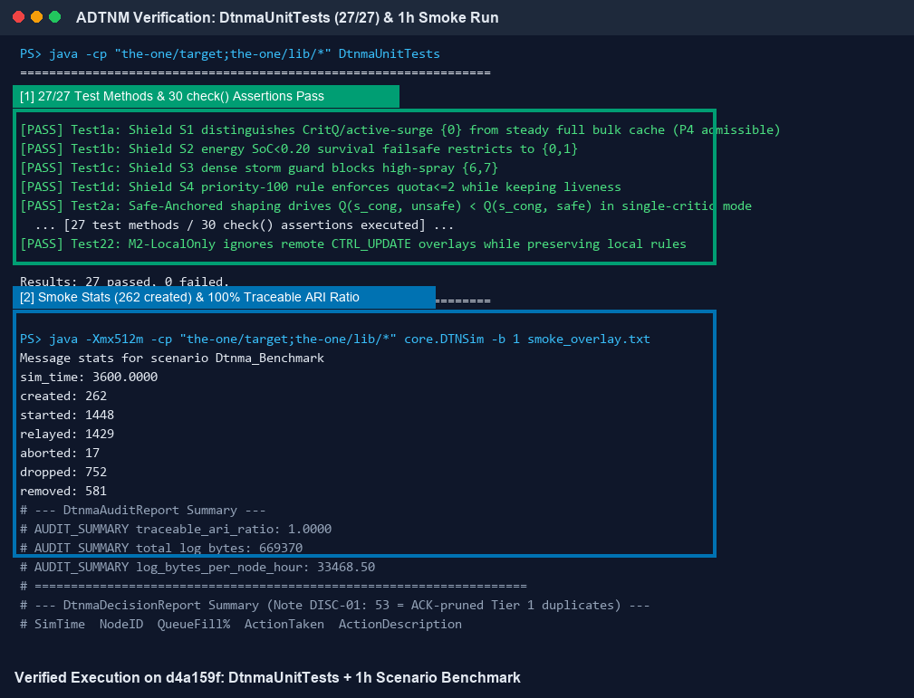
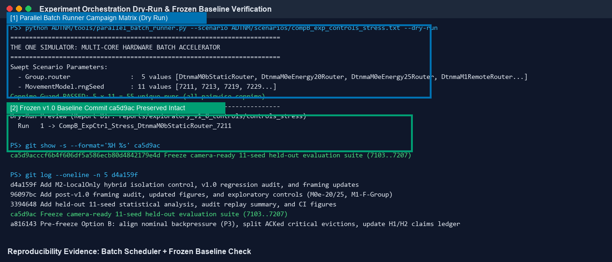

# Chapter 7: Scenario Anatomy & Hands-On Tutorials

> **Estimated Completion Time:** `10–15` minutes across all walkthroughs.  
> **Verified Environment:** Java JDK `17+` (tested on `24`), Python `3.10+`, and **The ONE** (`../the-one`). On Windows PowerShell, set `$env:PYTHONDONTWRITEBYTECODE = '1'` to keep `__pycache__` out of source trees.

---

## Tutorial 0: Anatomy of an ADTNM Scenario File (`.txt`)

Every experiment in `scenarios/*.txt` configures five declarative blocks read sequentially by The ONE's `Settings` parser. Understanding these blocks makes any simulation campaign immediately transparent:

```ini
# 1. Clock & Simulation Horizon
Scenario.name = CompB_MultiScale_%%Group.router%%_%%MovementModel.rngSeed%%
Scenario.updateInterval = 0.5          # Discrete simulator tick (seconds)
Scenario.endTime = 43200               # 12 hours total (prevents event right-censoring)

# 2. Coprime Parameter Sweeps (Cartesian Product)
Group.router = [SprayAndWaitRouter; DtnmaM0bStaticRouter; ...; DtnmaM3RlRouter]  # 8 modes
MovementModel.rngSeed = [7103; 7109; ...; 7207]                                  # 11 primes -> 88 runs
Group.bufferSize = 10M                 # Field RAM capacity (5M Overload, 15M Blackout, 10M CompB)
Group.msgTtl = 300                     # Bundle expiration (minutes)

# 3. Heterogeneous Radio, Mobility & Battery Energy Budgets
btInterface.transmitSpeed = 250k       # Field Bluetooth-class radio (35 m range)
highspeedInterface.transmitSpeed = 10M # Backbone tram/relay radio (1,000 m range)
Group.initialEnergy = 2650, 3650       # Stress random draw [2650, 3650] J; idle scan = 0.05 W, TX = 0.90 W

# 4. ADTNM Management Engine Bindings
DtnmaRouter.configFile = scenarios/dtnma_params_default.txt
DtnmaRouter.rulesFile = scenarios/rules_vdtn.txt   # Local declarative SRL policy
Group.rulesFile = scenarios/rules_vdtn.txt

# 5. Multi-Class Traffic, Disruption Cohorts & Synchronized Reporting
Events1.prefix = BULK_                 # Background bulk transfers (400-700 KB every 14-20 s)
Events3.prefix = CRITICAL_FAULT_       # Priority emergency dispatches to Managers (16-32 KB)
Events4.time = 3600, 3900              # Event A acute 5-minute burst (paired with Manager wave W1)
Report.report1 = DtnmaRlMetricsReport  # Per-class, Event A/B/C cohort, & # WAVE_ADOPTION_CDF metrics
Report.report3 = DtnmaAuditReport      # Per-decision 16-column ARI provenance trace
```

Notice two subtle best practices used across the repository:
- **Coprime Array Counts:** `tools/parallel_batch_runner.py` verifies that swept parameter arrays (e.g., `8` routers × `11` seeds) resolve cleanly without accidental index aliasing (`--dry-run` previews every run name).
- **Zero Right-Censoring:** Setting `Scenario.endTime = 43200` gives `Event C` (`21,600–28,800 s`) a full `3,600 s` evaluation horizon plus `10,800 s` spare margin.

---

## Tutorial 1: Sync, Compile & Run `DtnmaUnitTests` (`< 2 min`)

The recommended one-step installer (`install.py`) links ADTNM sources and scenarios into a sibling `the-one` checkout, or you can compile manually against `the-one/target`:

```powershell
$env:PYTHONDONTWRITEBYTECODE = '1'
$THE_ONE = "n:\R&D\cog\the-one"
$ADTNM   = "n:\R&D\cog\ADTNM"

# Option A: Standard install & compile via installer
# python "$ADTNM\install.py" --one-dir "$THE_ONE"

# Option B: Direct javac compile + run 27 unit tests (30 check() assertions)
javac -cp "$THE_ONE\target;$THE_ONE\lib\*" -d "$THE_ONE\target" `
  "$ADTNM\src\routing\*.java" "$ADTNM\src\report\*.java" "$ADTNM\tests\DtnmaUnitTests.java"
java -cp "$THE_ONE\target;$THE_ONE\lib\*" DtnmaUnitTests
```

**Expected Output Tail:** `Results: 27 passed, 0 failed.` (spanning `Test1a..Test22` across `30` `check()` assertions).

---

## Tutorial 2: Run 1-Hour Smoke Scenario & Inspect All 3 Reports (`~15 s`)

To keep the repository free of stray output files during exploration, redirect `Report.reportDir` to a temporary scratch folder via a lightweight overlay file:

```powershell
$SCRATCH = "$env:TEMP\adtnm_smoke"
New-Item -ItemType Directory -Force "$SCRATCH\reports" | Out-Null
((Get-Content "$ADTNM\scenarios\scenario_dtnma.txt") + "`nReport.reportDir = $($SCRATCH.Replace('\','/'))/reports/") | Set-Content "$SCRATCH\smoke.txt"

Push-Location $THE_ONE
java -Xmx512m -cp "$THE_ONE\target;$THE_ONE\lib\*" core.DTNSim -b 1 "$SCRATCH\smoke.txt"
Pop-Location

Get-Content "$SCRATCH\reports\Dtnma_Benchmark_MessageStatsReport.txt" -TotalCount 10
Get-Content "$SCRATCH\reports\Dtnma_Benchmark_DtnmaAuditReport.txt" | Select-String "AUDIT_SUMMARY"
```

**Expected Observations:** `MessageStatsReport` reports `created: 262`, `delivered: 184` (`delivery_prob: 0.7023`, `overhead_ratio: 6.7663`). `DtnmaAuditReport` logs `2,400` decisions with **`traceable_ari_ratio: 1.0000`** (`33,468.50 B/node-hr`). *(Note: `DtnmaDecisionReport` counts harmless Tier 1 `ACK`-pruned duplicate evictions (`53`) inside its generic drop total; inspect `unique_critical_lost` in `DtnmaRlMetricsReport` to confirm `0` live critical message loss.)*

---

## Tutorial 3: Author Custom `SRL` Rules & Verify `100%` Replay (`< 3 min`)

Create `$SCRATCH\my_custom_rules.txt` enforcing battery protection below `SoC < 0.30` and surge throttling above `Q >= 0.80` with an explicit `PRIORITY: 10` catch-all nominal recovery rule:

```text
RULE: ARI://DTNMA/SRL/CUSTOM_BATT_GUARD | PRIORITY: 100 | DESC: Custom battery survival guard
IF: (EDD_ENERGY_SOC < 0.30) || (EDD_CRIT_QUEUE_RATIO >= 0.50)
THEN: CTRL_SET_SPRAY_QUOTA(1); CTRL_SET_INGRESS_MODE(2); CTRL_SET_TELEMETRY_INTERVAL(600); CTRL_SET_BACKPRESSURE(true)

RULE: ARI://DTNMA/SRL/CUSTOM_SURGE | PRIORITY: 80 | DESC: Custom queue surge throttle
IF: (EDD_QUEUE_RATIO >= 0.80) && (EDD_QUEUE_DRIFT >= 0.005)
THEN: CTRL_SET_SPRAY_QUOTA(2); CTRL_SET_INGRESS_MODE(1); CTRL_SET_TELEMETRY_INTERVAL(300); CTRL_SET_BACKPRESSURE(true)

RULE: ARI://DTNMA/SRL/CUSTOM_NOMINAL | PRIORITY: 10 | DESC: Nominal catch-all recovery
IF: (EDD_QUEUE_RATIO >= 0.0)
THEN: CTRL_SET_SPRAY_QUOTA(6); CTRL_SET_INGRESS_MODE(0); CTRL_SET_TELEMETRY_INTERVAL(60); CTRL_SET_BACKPRESSURE(true)
```

Append `DtnmaRouter.intelligenceMode = STATIC_RULES`, `DtnmaRouter.rulesFile`, and `Group.rulesFile` (using `/`-separated paths) in your scratch overlay scenario and run `core.DTNSim -b 1`. Inspect `DtnmaAuditReport.txt` to observe `ARI://DTNMA/SRL/CUSTOM_*` provenance and run `verify_audit_replay` (`tools/evaluate_autonomic_framework.py`) to confirm **`100.00%`** deterministic replay.

---

## Tutorial 4: Manage Any Stock ONE Router via `DtnmaManagedRouter` (`Adapter Pattern`)

1. Subclass your chosen ONE protocol (e.g., `extends FirstContactRouter implements DtnmaManagedRouter`).
2. Add `private final DtnmaAgent agent;` initialized cleanly inside both constructors (`new DtnmaAgent(this, s)` and copy constructor `new DtnmaAgent(this, r.agent)`).
3. Delegate `update()` (`agent.onBeforeUpdate(SimClock.getTime()); super.update();`), `changedConnection()`, `createNewMessage()`, `checkReceiving()`, and `makeRoomForMessage()`.
4. Keep native forwarding heuristics intact while sorting `CRIT_`/`CTRL_` tuples first and gating non-direct `BULK_` relays via `agent.allowNonDirectBulkForward`.
5. Validate with `DtnmaUnitTests` and test Tier 1 (`TIER1_PROTECTION_ONLY`) against an unmanaged baseline.

---

## Tutorial 5: Batch Dry-Run & Re-Running `v1.0` Statistical Analyzers (`< 1 min`)

Preview sweep expansion safely before dispatching multi-core JVM batches, or recompute held-out statistics in read-only mode over existing report directories:

```powershell
$env:PYTHONDONTWRITEBYTECODE = '1'
python "$ADTNM\tools\parallel_batch_runner.py" --scenario "$ADTNM\scenarios\compB_exp_controls_stress.txt" --dry-run
python "$ADTNM\tools\analyze_final_11seed.py" --skip-replay --out-json "$env:TEMP\check_f11.json" --out-md "$env:TEMP\check_f11.md"
python "$ADTNM\tools\analyze_exploratory_controls.py" --skip-replay --out-dir "$env:TEMP"
```

## Verified Tutorial Execution Screenshots




