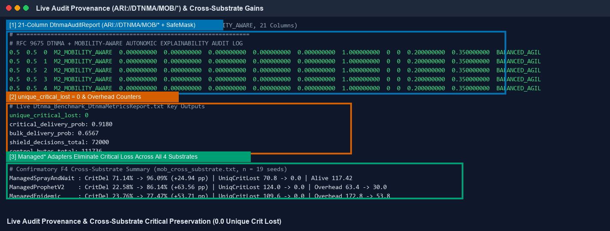

# Worked Examples: Six End-to-End Walkthroughs

> **Purpose:** Concrete numerical traces illustrating `M2_MOBILITY_AWARE`, `SRL` rule firing, `DtnmaSafetyShield` overriding, Tier `1` vs. Tier `2` blackout survival, remote `M1-Remote` lag, and `ACK`-pruned duplicate accounting.

---

## Example 1: `M2_MOBILITY_AWARE` Closed-Form Coordination Step

Suppose node `42` runs `DtnmaM2MobRouter` (`JOINT`, `mobHorizonSec = 600.0`, `mobTtdCritRatio = 0.60`, `mobTtdWarnRatio = 1.10`, `mobShortContactSec = 12.0`, `mobLongIctSec = 180.0`) at evaluation tick `t = 29,500 s`:
- Observed telemetry (`EddTelemetrySampler`): `Q = 0.84`, `CritQ = 0.02`, `dQ = 0.011`, `SoC = 0.52`, `ttdRatio = 0.72` (estimated battery lasts `432 s < 600 s`), `durMean = 14.5 s`, `ictEff = 144.0 s`, `encRate = 0.9 / min`, `Dens = 4.0`.
- **ICT-scaled threshold:** $\text{ictFrac} = \min(1.0, 144.0 / 180.0) = 0.80$, so $\theta_Q = 0.88 - 0.10 \times 0.80 = 0.80$.
- **Priority Cascade (`DtnmaAgent.evaluateMobilityAwareController`):**
  1. `CritQ(0.02) >= 0.50` (`FALSE`), `SoC(0.52) < 0.20` (`FALSE`), `SoC < 0.45 && ttdRatio < 0.60` (`FALSE`).
  2. `useEnergy && SoC(0.52) < 0.55 && ttdRatio(0.72) < ttdThrottle` (`ttdThrottle = 0.5 * (0.60 + 1.10) = 0.85`): **`TRUE`!** -> Proposes **`P1` (`SAFE_THROTTLE_STRICT`: `L=2, ing=1, bp=0.08`)** with `ARI://DTNMA/MOB/ENERGY_HORIZON_THROTTLE`. *(Even if energy weren't low, `Q(0.84) >= theta_Q(0.80) && dQ(0.011) >= 0.008` would also trigger `ICT_SURGE_THROTTLE` -> `P1`.)*
- **Shield Verification:** `mask = 11111111`, `P1` passes (`PASS`), leaving headroom to reach Hours 8–12 without blackout.

---

## Example 2: One Closed-Loop Epoch on `M2-SRL` (`VDTN_SURGE_THROTTLE`)

**Audit Line Schema (`M2SrlRouter_DtnmaAuditReport.txt`):**
```text
3360.5  3360.5  53  M2_AUTONOMIC_SRL  0.919217000  0.005594100  0.008392627  15.000000000  7.178909959  0.922762185  1  0  0.200000000  0.350000000  SAFE_THROTTLE_STRICT  SAFE_THROTTLE_STRICT  SAFE_THROTTLE_STRICT  PASS  11111111  ARI://DTNMA/SRL/VDTN_SURGE_THROTTLE  [EDD_QUEUE_RATIO(0.92) >= 0.88 -> TRUE] AND [EDD_QUEUE_DRIFT(0.01) >= 0.01 -> TRUE]
```

**Step-by-Step Arithmetic:**
1. **Snapshot (`t = 3360.5 s`, node `53`):** `Q = 0.919217`, `CritQ = 0.005594`, `dQ = 0.008393`, `Dens = 15.0`, `Speed = 7.179 m/s`, `SoC = 0.9228`.
2. **Rule Scan (`rules_vdtn.txt`):** `PRIO 100` (`SoC < 0.20 || CritQ >= 0.50`) is `FALSE`; `PRIO 80` (`Q >= 0.88 && dQ >= 0.008`) is **`TRUE`**.
3. **Shield Check:** `CritQ < 0.35` and `SoC > 0.20` -> `mask = 11111111`; `P1` (`L=2, ing=1, bp=0.08`) executes as **`PASS`**.

---

## Example 3: `DtnmaSafetyShield` Dense-Storm Clamping (`S3`)

When a dense vehicle cluster hits `Q >= 0.78` and `Dens >= 5.0` (e.g., `Q = 0.9298`, `Dens = 12.0`), `DtnmaSafetyShield` invariant `S3` (`DENSE_STORM_GUARD`) masks off high-spray profiles `{P6, P7}` (`mask = 11111100`), clamping an aggressive proposal (`P6`, `HIGH_SPRAY_BACKPRESSURE`, `L = 10`) down to safe **`P3` (`BALANCED_AGILE_FOCUS`, `L = 6`)** with status **`OVERRIDE`** and `ARI://DTNMA/SHIELD/DENSE_STORM_GUARD`.

---

## Example 4: Battery Emergency Guard Firing at `SoC = 0.1919` (`Node 94`)

```text
29460.5  29460.5  94  M2_AUTONOMIC_SRL  0.937859000  0.034220600  -0.000000000  6.000000000  8.093327344  0.191856707  1  6  0.200000000  0.350000000  SAFE_EMERGENCY_HOLD  SAFE_EMERGENCY_HOLD  SAFE_EMERGENCY_HOLD  PASS  11111111  ARI://DTNMA/SRL/VDTN_BUFFER_CRITICAL  [EDD_ENERGY_SOC(0.19) < 0.20 -> TRUE] OR [EDD_CRIT_QUEUE_RATIO(0.03) >= 0.50 -> FALSE]
```

Because `VDTN_BUFFER_CRITICAL` uses disjunction (`||`), even modest `CritQ = 0.034` lets `SoC = 0.1919 < 0.20` switch node `94` cleanly into `P0` (`SAFE_EMERGENCY_HOLD`, `ing = 2`, `L = 1`), preserving emergency critical reachability without exhausting remaining battery on transit bulk relays.

---

## Example 5: Cross-Substrate Composability Under `M2-Mob` (`F4`, `n = 19`)

| Substrate | CritDel (`Stock -> Managed`) | BulkDel (`Stock -> Managed`) | Alive (`/126`) | Unique Crit Lost | Overhead |
|---|---:|---:|---:|---:|---:|
| `SprayAndWait` | `71.14% -> 96.09%` (`+24.94 pp`) | `72.82% -> 80.80%` (`+7.98 pp`) | `56.16 -> 117.42` | `70.8 -> 0.0` | `6.4 -> 3.1` |
| `PRoPHETv2` | `22.58% -> 86.14%` (`+63.56 pp`) | `21.40% -> 46.36%` (`+24.97 pp`) | `6.11 -> 30.26` | `124.0 -> 0.0` | `63.4 -> 30.0` |
| `Epidemic` | `23.76% -> 77.47%` (`+53.71 pp`) | `17.10% -> 38.43%` (`+21.33 pp`) | `6.05 -> 10.74` | `109.6 -> 0.0` | `172.8 -> 53.8` |

Wrapping completely distinct routing engines with the shared `DtnmaAgent` eliminates unique critical alert loss (`0.0` across all `19` seeds) while cutting `Epidemic` overhead by `>3x`.

---

## Example 6: Explaining `53` Smoke Critical Drops vs. `0` `unique_critical_lost`

**From 1-Hour Smoke Benchmark (`scenario_dtnma.txt`):**
- `DtnmaDecisionReport`: `Critical Fault Messages Dropped: 53`
- `DtnmaMetricsReport`: `unique_critical_lost: 0`, `critical_buffer_dropped: 0`, `critical_buffer_dropped_acked: 53`

**Reconciliation:** Once `CRIT_` bundles reach their destination, peers exchange `4 B` ACK IDs (`<= 32 / contact`) and mark redundant replicas in `deliveredAckSet`. When RAM fills, `selectNextMessageToRemove()` evicts already-delivered duplicates first (`53` benign prunes) with **`0` live information loss**.

## Captured Trace Excerpts


